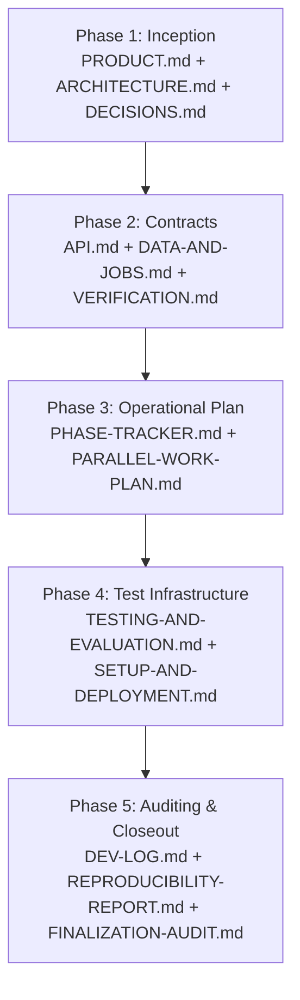

# Universal Development Documentation Playbook

> **Authoritative Specification & Generation Framework for Autonomous Engineering Projects**  
> *Derived from Afterfact's 16-Document Grounded Verification Architecture*

---

## 1. Overview & Philosophy

In modern engineering projects—particularly those developed by collaborative teams, autonomous AI agents, or hybrid human-in-the-loop workflows—documentation often fails in one of two failure modes:
1. **Dead Spec Hallucination:** Outdated, aspirational markdown files that describe an architecture that was never built or has since mutated.
2. **Implicit Tribal Knowledge:** Undocumented assumptions about database clocks, concurrency limits, lease timeouts, error codes, and fallback routing scattered across source files.

The **Afterfact Living Documentation Architecture** eliminates both failure modes by treating documentation as a formal, verifiable contract. Every specification is bound to:
- A specific lane of ownership (**Lane A**, **Lane B**, or **Lane C**).
- A formal **Invariant-to-Proof Chain**.
- A concrete **Evidence Tier (E1–E5)** verified via automated test transcripts and live execution logs.
- A **Phase Tracker Ticket** with zero speculative claims.

This playbook catalogs all 16 core development documents developed for Afterfact and provides an end-to-end framework to generate, bootstrap, and maintain equivalent documentation suites for future software projects.

---

## 2. Inventory of Development Documents

Below is the complete registry of the 16 authoritative engineering specifications utilized during Afterfact's development. In production repositories, these files live in `docs/` and serve as the deterministic ground truth for developers and autonomous agents.

| # | Document | Lane Scope | Primary Purpose & Contents |
| :-: | :--- | :---: | :--- |
| **01** | [`PRODUCT.md`](#01-productmd) | Product / All | Product vision, target persona workflows, claim category taxonomy, input modes (paste, ask, compare), and non-goals. |
| **02** | [`ARCHITECTURE.md`](#02-architecturemd) | Platform / All | 3-Lane partition model, 5-stage DAG lifecycle, runtime boundaries (Next.js serverless, QStash workers, Bifrost gateway), and data flow invariants. |
| **03** | [`API.md`](#03-apimd) | Platform / B | Public REST & streaming endpoints (`/api/v1/verify`, `/api/runs/[id]/stream`), internal worker webhooks, HMAC signature verification, SSE packet schemas, and error taxonomy. |
| **04** | [`DATA-AND-JOBS.md`](#04-data-and-jobsmd) | Platform / B | Prisma relational schema, Neon connection pooling vs direct URLs, 30s lease fencing, QStash worker flow control, idempotent claim locking, and dead-letter queues. |
| **05** | [`VERIFICATION.md`](#05-verificationmd) | Verification / A | Universal Claim Ticket schema, 3-date disentanglement (published, announced, effective), 4-gate sequential decision logic, bounded semantic inference, and surgical diff generation. |
| **06** | [`DECISIONS.md`](#06-decisionsmd) | Governance / All | Architectural Decision Records (ADRs 001–023) documenting context, considered alternatives, rationale, and consequences for irreversible choices. |
| **07** | [`PHASE-TRACKER.md`](#07-phase-trackermd) | Project Lead / All | Master ticket registry (28 tickets across G0–G4 release gates), dependency DAG, lane assignments, pass/fail status, and verifiable CLI evidence transcripts. |
| **08** | [`PARALLEL-WORK-PLAN.md`](#08-parallel-work-planmd) | Project Lead / All | Wave-based execution DAGs for multi-contributor isolation, mock interfaces, cross-lane handoff protocols, and zero-conflict file edit boundaries. |
| **09** | [`TESTING-AND-EVALUATION.md`](#09-testing-and-evaluationmd) | Verification / A | E1–E5 evidence tier hierarchy, Vitest unit/integration suite, Playwright e2e matrix (desktop, tablet, mobile), and 30-case evaluation benchmark with statistical scoring rubric. |
| **10** | [`SETUP-AND-DEPLOYMENT.md`](#10-setup-and-deploymentmd) | Platform / B | Environment variable inventory, zero-secret logging rules, Neon branching runbook, Railway Bifrost deployment, Upstash QStash webhook configuration, and local setup guide. |
| **11** | [`DEMO-AND-SUBMISSION.md`](#11-demo-and-submissionmd) | Product / C | 3-minute hackathon judge demo script, sponsor integration proofs, fallback recorded walkthroughs, and submission checklist. |
| **12** | [`FINALIZATION-AUDIT.md`](#12-finalization-auditmd) | Lead / All | Pre-flight release audit, end-to-end user journey verification matrix, route bundle optimization check, and finding remediation register. |
| **13** | [`EVIDENCE-REASONING-AUDIT.md`](#13-evidence-reasoning-auditmd) | Verification / A | Deep-dive forensic audit of verifier logic against adversarial test cases (compound assertions, historical supersession, missing qualifiers). |
| **14** | [`SEMANTIC-CORRECTNESS-AUDIT.md`](#14-semantic-correctness-auditmd) | Verification / A | Formal evaluation of bounded semantic inference rules, modal qualifiers, universal quantification refutations, and counterexample generation. |
| **15** | [`REPRODUCIBILITY-REPORT.md`](#15-reproducibility-reportmd) | Lead / All | Step-by-step reproduction instructions from a clean git clone, seed dataset instructions, fixture replay commands, and expected test hashes. |
| **16** | [`DEV-LOG.md`](#16-dev-logmd) | All | Append-only chronological developer log tracking engineering sessions, timestamped commits, root-cause analyses, and architectural pivots. |

---

## 3. Structural Breakdown & Template Specifications

When generating these documents for a new project, follow these structural templates:

### 01. `PRODUCT.md`
- **Executive Summary:** Core problem statement, product thesis, and market/technical differentiation.
- **User Personas & Workflows:** Concrete personas (e.g., Enterprise Fact-Checker, Developer, Auditor) with step-by-step before/after workflows.
- **Input Modes & Feature Matrix:** Explicit definitions of each product mode (e.g., Single Assertion, Document Verification, Contrastive Evaluation).
- **Core Product Invariants:** Non-negotiable product invariants (e.g., "The system shall never hallucinate a verified score for citations not found in retrieved text").
- **Out of Scope / Non-Goals:** Explicit boundaries to prevent scope creep during sprints.

### 02. `ARCHITECTURE.md`
- **System Topography:** ASCII/Mermaid component diagram showing client, edge router, background worker queues, persistence, and external gateways.
- **Lane Ownership Partition:**
  - **Lane A (Domain / Verification):** Pure business logic, schemas, prompts, evaluation benchmarks.
  - **Lane B (Platform / Infra):** Queues, database, RPC/REST gateways, security, secret safety.
  - **Lane C (Product / UI):** Client components, state management, design tokens, responsive layouts.
- **Data Lifecycle & DAG Flow:** Step-by-step lifecycle from ingestion, validation, dispatch, DAG node execution, to final aggregation.
- **Fault Tolerance & Isolation:** What fails closed vs. fails open? Timeout budgets, retry cascades, and dead-letter boundaries.

### 03. `API.md`
- **Base Standards:** Content-Type, authentication headers, error envelopes, rate limits, and idempotency key headers.
- **Endpoint Contracts:** For each route:
  - Method & URL
  - Query parameters & request body JSON schema (with Zod/TypeScript definitions)
  - HTTP status codes (200, 202, 400, 404, 409, 422, 500)
  - Full request & response JSON payloads
- **Real-Time Streaming Protocols:** Server-Sent Events (SSE) packet types, event format (`event: claim:updated\ndata: {...}`), reconnect policies, and backoff jitter.
- **Webhook Handlers:** Inbound signatures (HMAC SHA-256), replay attack prevention (timestamp tolerances), and execution duration constraints.

### 04. `DATA-AND-JOBS.md`
- **Relational Data Model:** Entity-Relationship diagram and complete Prisma/SQL schema.
- **Connection Topography:** Pooled connections for serverless request handlers (`DATABASE_URL`) vs direct unpooled connections for migration runners (`DIRECT_URL`).
- **Distributed Concurrency & Heartbeats:** Lease fencing mechanisms (e.g., 30s heartbeat timestamp, worker ID lease, fail-closed `409 Conflict` on lease loss).
- **Queue & Worker Architecture:** Dispatch triggers, queue sizing, payload encryption, deduplication windows, and retry backoff formulas ($T_{\text{wait}} = 2^k \times \text{base}$).

### 05. `VERIFICATION.md`
- **Domain Object Schemas:** Canonical data structures (e.g., `ClaimTicket`, `EvidenceUnit`, `QualifierMap`).
- **Temporal Disentanglement:** Explicit handling of conflicting timestamps:
  - *Publication Date ($T_{\text{pub}}$):* When the article or source was published.
  - *Announcement Date ($T_{\text{ann}}$):* When a policy or event was publicized.
  - *Effective Date ($T_{\text{eff}}$):* When the policy or rule takes legal/operational effect.
- **Sequential Decision Gates:** Deterministic evaluation pipeline (e.g., Gate 1: Citation Grounding $\to$ Gate 2: Temporal Validity $\to$ Gate 3: Qualifier Match $\to$ Gate 4: Semantic Entailment).
- **Mathematical Scoring Formula:** Exact scoring rubric and deterministic reason codes.

### 06. `DECISIONS.md` (Architectural Decision Records)
Each ADR follows the standard format:
- **Number & Title:** `ADR-00X: Short Descriptive Title`
- **Status:** Proposed | Accepted | Deprecated | Superseded
- **Context:** The technical challenge, external constraints, and why a decision was needed.
- **Considered Alternatives:** List of alternatives with pros and cons (e.g., Option 1 vs. Option 2 vs. Option 3).
- **Decision:** The chosen path and the explicit rationale for selection.
- **Consequences:** Positive outcomes, negative trade-offs, and downstream implementation tasks.

### 07. `PHASE-TRACKER.md`
- **Release Milestone Gates:**
  - **Gate G0 (Foundation):** Pinned contracts, type safety, lint zero, clean build.
  - **Gate G1 (Slice):** Single end-to-end slice working with real database and external provider.
  - **Gate G2 (Concurrency & Scale):** Background queues, worker lease fencing, deduplication, retry recovery.
  - **Gate G3 (Product Flows):** Responsive client, all UI modes, error states, and live streaming.
  - **Gate G4 (Release Candidate):** Full test suite passing, evaluation benchmark verified, audit complete.
- **Task Ticket Schema:**
  ```markdown
  ### [LANE-TICKET-ID] Ticket Title
  - **Lane:** Lane A / Lane B / Lane C
  - **Status:** TODO | IN PROGRESS | BLOCKED | DONE
  - **Dependencies:** [TICKET-IDs]
  - **Files:** List of modified/created files
  - **Acceptance Criteria:** Unambiguous bullet points
  - **Evidence Tier:** E1 | E2 | E3 | E4 | E5
  - **Evidence:** Real terminal command output and observed logs
  ```

---

## 4. The 5-Tier Evidence Hierarchy (E1–E5)

Every task claimed as `DONE` must be verified using the formal evidence hierarchy:

| Level | Classification | Scope & Meaning | Required Verification |
| :---: | :--- | :--- | :--- |
| **E1** | Static Analysis | Code compiles, formats, types resolve, schema validates. | `pnpm lint`, `pnpm typecheck`, Zod schema parsing. |
| **E2** | Unit / Logic Test | Pure business logic, isolated deterministic routines. | `pnpm test` (vitest with pure fixtures or mock doubles). |
| **E3** | Disposable Integration | Real relational database, migrations, transactions. | Test execution against live disposable database branch. |
| **E4** | Staging / Sandbox | Real cloud providers, signed webhooks, gateway fallback. | Live runs on staging environment with valid test keys. |
| **E5** | Production Operations | Full end-to-end user workflows on live domains. | Real web retrieval, live judge walkthrough, latency traces. |

> [!CRITICAL]
> A unit test passing with mock data (**E2**) cannot satisfy an integration or database requirement (**E3/E4**). Never transition a ticket to `DONE` without capturing concrete terminal command outputs.

---

## 5. Invariant-to-Proof Verification Chain

Stateful, transactional, or distributed tickets must document the unbroken verification chain:

$$\text{INVARIANT} \longrightarrow \text{ENTRY POINT} \longrightarrow \text{HANDLER} \longrightarrow \text{AUTHORITY} \longrightarrow \text{ENFORCEMENT} \longrightarrow \text{TEST} \longrightarrow \text{EVIDENCE}$$

### Example Verification Chain:
1. **Invariant:** Claims referencing text not found in retrieved excerpts must fail closed.
2. **Production Entry Point:** `src/server/verify/decision-gate.ts`
3. **Handler:** `evaluateCitationGrounding(claim, evidence)`
4. **Authority:** Evidence item passage text returned from provider.
5. **Enforcement:** `evidence.passage.includes(claim.quote)` check failing closed with `UNSUPPORTED_CITATION`.
6. **Test:** `tests/unit/verify/citation-grounding.test.ts`
7. **Evidence:** `511/511 tests passing` (terminal log attached in ticket).

---

## 6. How to Bootstrap Development Docs for a New Project

When starting a new project or migrating an existing repository, execute the following 5-phase onboarding runbook:



### Phase 1: Inception & Architectural Guardrails
1. Run a kickoff session to define `PRODUCT.md` (problem statement, personas, non-goals).
2. Establish the 3-Lane partition and produce `ARCHITECTURE.md`.
3. Capture Day-1 technical decisions in `DECISIONS.md` (framework choice, database engine, queue mechanism).

### Phase 2: Interface Contracts & Pinned Schemas
1. Define database models in `DATA-AND-JOBS.md` before writing migrations.
2. Define API endpoints, query params, and JSON schemas in `API.md` before writing route handlers.
3. Define core domain invariants and business logic in `VERIFICATION.md` (or domain equivalent).

### Phase 3: Operational Decomposition
1. Decompose the project into sequential milestone release gates (**G0** through **G4**).
2. Author all atomic tickets in `PHASE-TRACKER.md`, linking dependencies explicitly.
3. Map out parallel execution tracks in `PARALLEL-WORK-PLAN.md` to ensure zero file-locking between contributors or agents.

### Phase 4: Test Strategy & Infrastructure Setup
1. Define the evidence requirements and benchmark tests in `TESTING-AND-EVALUATION.md`.
2. Document environment variables, cloud deployment, and local setup in `SETUP-AND-DEPLOYMENT.md`.

### Phase 5: Audits, Traceability & Closeout
1. Maintain an append-only `DEV-LOG.md` throughout active development.
2. Conduct formal semantic and security audits (`FINALIZATION-AUDIT.md`).
3. Verify clean clone reproduction in `REPRODUCIBILITY-REPORT.md`.

---

## 7. AI Agent Prompts for Document Generation

To generate these documents automatically using autonomous LLM agents (Claude, Gemini, GPT-4o), utilize the following prompt templates:

### Prompt A: Architecture & Partition Generator
```markdown
You are an expert Principal Systems Architect. Inspect the codebase repository, packages, and frameworks.
Generate an authoritative ARCHITECTURE.md specifying:
1. High-level architectural topography with an ASCII or Mermaid diagram.
2. 3-Lane ownership boundary partitioning Lane A (Domain Logic), Lane B (Platform/Data/Workers), and Lane C (UI/Client).
3. Complete end-to-end request lifecycle and DAG execution flow.
4. Distributed failure isolation policies, timeouts, and fallback routing cascades.
5. Invariant enforcement rules preventing cross-lane mutation.
Format in clean GitHub Flavored Markdown. Do not include speculative or unimplemented abstractions.
```

### Prompt B: Phase Tracker & Ticket Generator
```markdown
You are a Staff Technical Program Manager. Given the ARCHITECTURE.md, API.md, and PRODUCT.md:
Construct a master PHASE-TRACKER.md adhering to the 5-Gate Release Taxonomy:
- Gate G0: Foundation Checkpoint (Contracts, types, lint, static builds)
- Gate G1: Live Slice (First functional end-to-end vertical integration)
- Gate G2: Concurrency & Scale (Queues, worker leases, idempotency, retries)
- Gate G3: Product Flows (Full UI, state persistence, responsive layouts)
- Gate G4: Release Candidate (Full eval benchmark, 100% test pass, final audit)
Partition every ticket across Lanes A, B, and C with explicit dependencies, target files, acceptance criteria, and Evidence Tier (E1–E5).
```

### Prompt C: Invariant-to-Proof Chain Generator
```markdown
You are a Formal Methods & Reliability Engineer. Review the stateful and distributed components in the codebase.
Identify every system invariant (e.g. lease heartbeats, citation fail-closed rules, duplicate webhooks, cross-tenant leaks).
Construct an unbroken Invariant-to-Proof table mapping:
INVARIANT -> PRODUCTION ENTRY POINT -> HANDLER -> AUTHORITY -> ENFORCEMENT -> TEST FILE -> EVIDENCE TIER.
```

---

## 8. Git Hygiene & Document Lifecycles

### Why Gitignore Internal Development Docs?
Once a project stabilizes or enters public release:
- Granular internal sprint trackers (`PHASE-TRACKER.md`), raw development logs (`DEV-LOG.md`), and historical scratch tickets clutter the public repository.
- Detailed internal development documentation should remain accessible locally on disk for core contributors and coding agents, while public repositories expose a polished `README.md` and this meta-specification (`DEV_DOCS.md`).

### Recommended `.gitignore` Configuration:
```gitignore
# Internal development documentation (preserved locally for agents and core contributors)
/docs/*
!/docs/audit-evidence/
```
> [!NOTE]
> The exception rule `!/docs/audit-evidence/` ensures that visual assets, dark-mode screenshots, and UI proof captures remain tracked in git so that `README.md` and public showcases render without broken image links.
