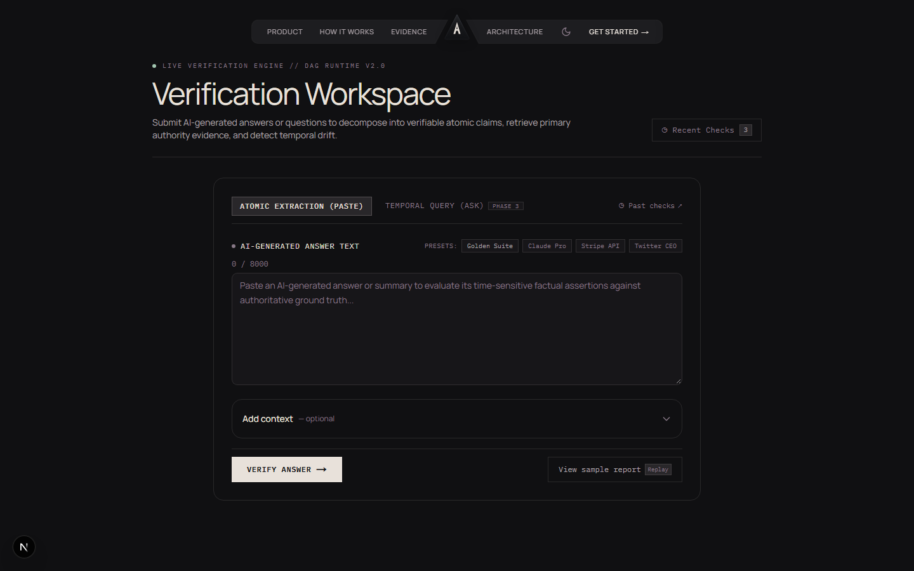
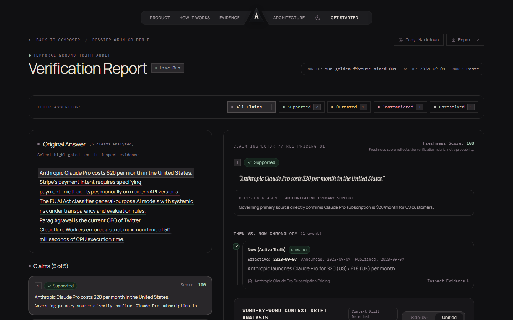
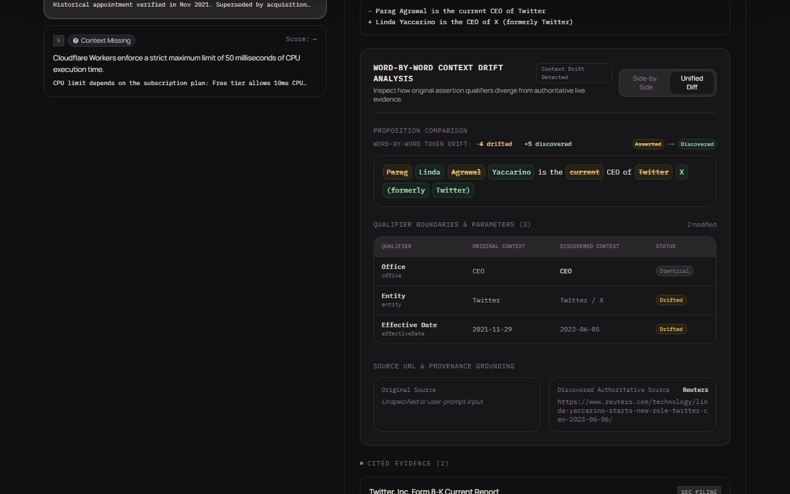
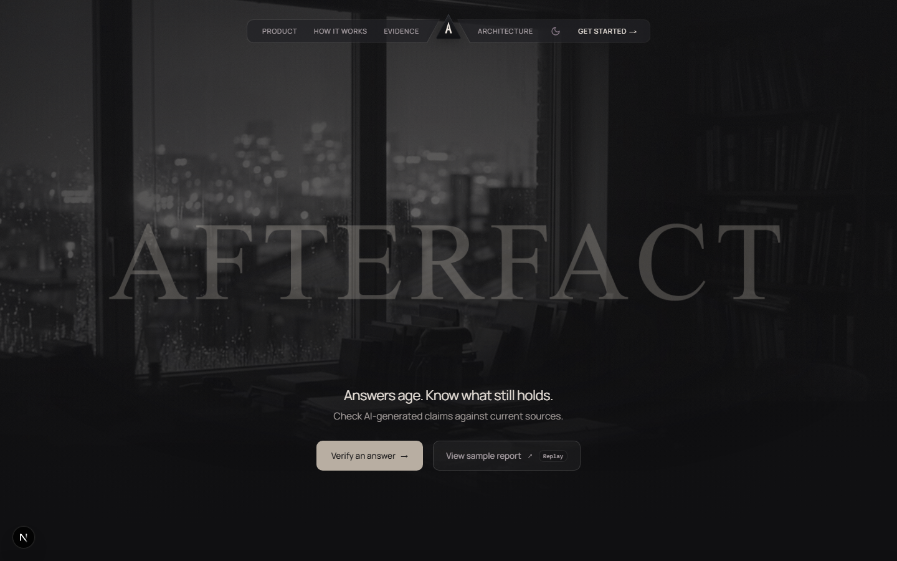
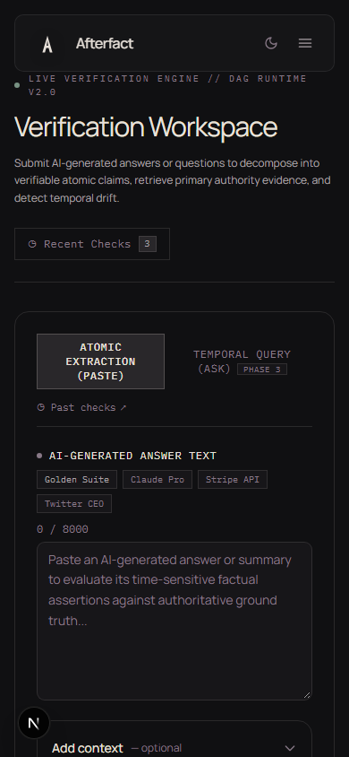
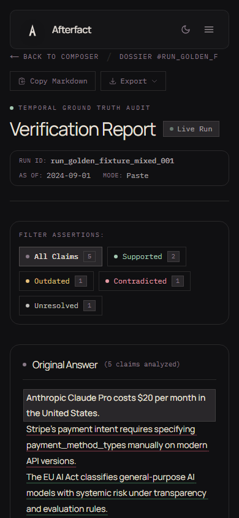
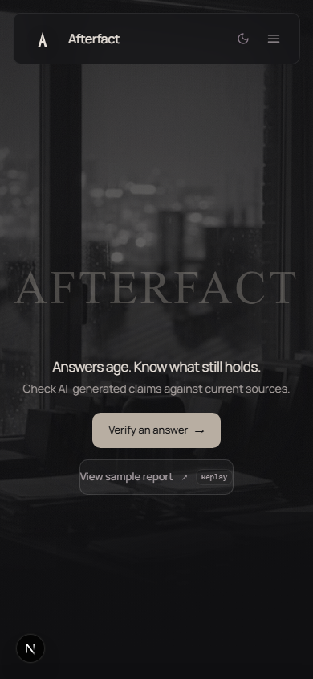
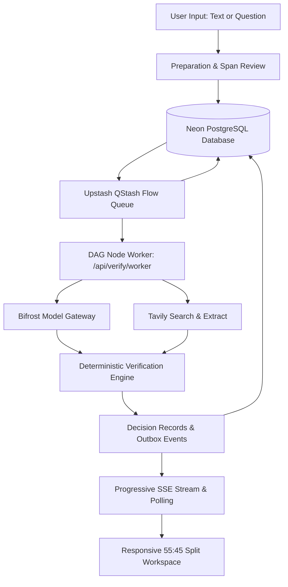
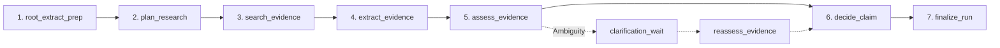

<p align="center">
  <br />
  
  <br />
  <sub><strong>REAL-TIME TEMPORAL FACT VERIFICATION & DRIFT DETECTION ENGINE</strong></sub>
  <br />
</p>

# Afterfact (working name: Stale-Answer Detector)

> **Real-time freshness verification, drift detection, and deterministic temporal grounding for AI-generated answers.**
>
> *Afterfact dissects AI-generated content into atomic verifiable claims, queries authoritative live web evidence via Tavily, assesses candidate passages through the Maxim Bifrost gateway, and applies deterministic TypeScript policies to verify whether each claim is currently supported, outdated, contradicted, or context-dependent — with zero hallucinated citations.*

<p align="center">
  <a href="https://nextjs.org/"></a>
  <a href="https://react.dev/"></a>
  <a href="https://www.typescriptlang.org/"></a>
  <a href="https://tailwindcss.com/"></a>
  <a href="https://neon.tech/"></a>
  <a href="https://github.com/maximhq/bifrost"></a>
  <a href="https://upstash.com/docs/qstash"></a>
  <a href="https://tavily.com/"></a>
  <a href="https://vitest.dev/"></a>
  <a href="https://playwright.dev/"></a>
  
  
</p>

---

## Interactive Quick Links

Explore live interfaces locally or inspect golden audit traces:
- **Interactive Verification Workspace:** [`/app`](http://localhost:3000/app) — Live 55:45 split document inspector, claim chips, and real-time citation cards.
- **Verification Report Showcase:** [`/report/sample-run`](http://localhost:3000/report/sample-run) — Full audit report with "Then vs. Now" supersession timelines and verified surgical diffs.
- **Input Composer & Preparation Review:** [`/`](http://localhost:3000) — Multi-context AI answer ingestion and qualifier disambiguation.
- **Paired Semantic Design Reference:** [`/design`](http://localhost:3000/design) — Paired light/dark design token system with zero CSS color leaking.
- **GitHub Public Repository:** [Driftaxe/Afterfact](https://github.com/Driftaxe/Afterfact) — Complete open-source codebase and engineering history.

---

## Table of Contents

- [Current Status & Milestone Registry](#current-status--milestone-registry)
- [Interface & Verification Showcase](#interface--verification-showcase)
- [Why Afterfact? (The Core Problem)](#why-afterfact-the-core-problem)
- [Core Verification Engine & Invariants](#core-verification-engine--invariants)
  - [1. Universal Claim Ticket & Strongly Typed Qualifiers](#1-universal-claim-ticket--strongly-typed-qualifiers)
  - [2. Three-Date Temporal Disentanglement](#2-three-date-temporal-disentanglement)
  - [3. Bounded Semantic Inference Synthesizer](#3-bounded-semantic-inference-synthesizer)
  - [4. Compound Claim Decomposition & Directional Entailment](#4-compound-claim-decomposition--directional-entailment)
  - [5. Mathematical Scoring Rubric & Reason Codes](#5-mathematical-scoring-rubric--reason-codes)
  - [6. UPPR Invariant-to-Proof Verification Chain](#6-uppr-invariant-to-proof-verification-chain)
- [System Architecture & Dynamic DAG Lifecycle](#system-architecture--dynamic-dag-lifecycle)
- [Tech Stack & Toolchain](#tech-stack--toolchain)
- [Core Repository Contributors & Lane Ownership](#core-repository-contributors--lane-ownership)
- [Authoritative Documentation Index](#authoritative-documentation-index)
- [Developer Quick Start & Diagnostic Runbook](#developer-quick-start--diagnostic-runbook)
- [License & Standards](#license--standards)

---

## Current Status & Milestone Registry

| Release Milestone | Status | Scope & Verifiable Proof |
| :--- | :---: | :--- |
| **Gate G0 (Foundation Checkpoint)** | **PASSED** | Contracts pinned (`ClaimTicket`, `DecideClaimInput`, `DAG`, `Report`), paired semantic dark/light tokens implemented, clean production build. |
| **Gate G1 (Live Slice via Persisted DAG)** | **PASSED** | Neon PostgreSQL persisted DAG execution, Tavily web search capture, fail-closed quotation grounding (`text.includes(quote)`), and sequential decision gates. |
| **Gate G2 (Broad Coverage & Durability)** | **PASSED** | Upstash QStash concurrency control (max 3 claims), dynamic DAG expansion, database clock lease fencing (30s heartbeat), and partial result survival. |
| **Gate G3 (Product Flows & Staging)** | **PASSED** | Ask mode, compare drawer, Then vs. Now timeline, scheduled change badges, recheck freshness, and sanitized SSE streaming over TLS. |
| **Gate G4 (Release Candidate & Grounded Inference)** | **PASSED** | Bounded general inference synthesizer, universal counterexample refutations, single-passage paraphrases, and **535+ automated tests passing** (511 Vitest + 24 Playwright). |

---

## Interface & Verification Showcase

### 1. Interactive Verification Workspace (55:45 Split Inspector)
Real-time claim navigation with verbatim text spans, dynamic claim chips, authority badges, and empirical citation cards.

<p align="center">
  
</p>

### 2. Deep-Dive Verification Report & Transition Timeline
Inspect deterministic verdict reasons, then-vs-now supersession timelines, scheduled change indicators, and surgical text corrections.

<p align="center">
  
</p>

### 3. Word-by-Word Context Drift & Comparative Qualifier Diff
Examine token-level drift between asserted propositions and authoritative empirical evidence, highlighting drifted phrases, discovered replacements, and shifted qualifier boundaries (`entity`, `office`, `effectiveDate`).

<p align="center">
  
</p>

### 4. Multi-Context Input Composer & Preparation Review
Dissect incoming AI answers or questions into atomic propositions with strongly typed property qualifiers before executing web retrieval.

<p align="center">
  
</p>

### 5. Fully Responsive Mobile Experience
Compact 390px mobile viewport rendering with zero horizontal drift, accessible touch targets, and sticky claim context sheets.

<p align="center">
  
  
  
</p>

---

## Why Afterfact? (The Core Problem)

Large Language Models state facts with unwavering confidence — even when those facts were only true at training time, have since been superseded, or depend on omitted regional, tier, or version qualifiers.

Standard LLM-as-a-judge approaches fail in production because they hallucinate URLs, conflate publication dates with event effective dates, and lack deterministic falsification logic:

| Capability | Standard LLM-as-a-Judge | Afterfact Verifier |
| :--- | :--- | :--- |
| **Citation Grounding** | Generates plausible URLs and quotes that may not exist in reality. | **Fail-Closed Grounding:** Quotes must strictly match retrieved source substrings (`SourceDocument.text.includes(quote)`). |
| **Temporal Disentanglement** | Confuses announcement dates with legal effective dates. | **Three-Date Separation:** Distinguishes Publication Date, Announcement Date, and Effective Date; flags future changes with `Scheduled change` without falsely calling current facts stale. |
| **Scope & Context Sensitivity** | Blurs pricing tiers, regional laws, and API versions. | **Explicit Scope Matching:** Differentiates annual vs. monthly billing, EU vs. US GDPR clauses, and SDK versions (e.g. Stripe `2020` vs. `2024`). |
| **Temporal Transitions** | Labels prior facts as flat hallucinations. | **"Then vs. Now" Timelines:** Demonstrates historical validity prior to a documented superseding event or policy change. |
| **Clarification & Ambiguity** | Guesses missing parameters or answers arbitrarily. | **Dynamic Clarification:** Pauses DAG branch to request missing details or falls back cleanly to `depends_on_context`. |
| **Execution Safety** | Vulnerable to serverless timeouts and dropped states. | **Durable DAG & Lease Fencing:** Neon PostgreSQL + Upstash QStash enforces bounded concurrency (max 3 claims) with automatic recovery. |
| **Compound Falsification** | Evaluates compound statements monolithically. | **Directional Entailment & Conjunction:** Refuting a necessary component ($c_1$) decisively refutes the compound parent claim ($c_1 \wedge c_2$). |
| **Visual Architecture** | Generic markdown output. | **Paired Cinematic Workspace:** 55:45 split document viewer, text highlights mapped to claim chips, and live DAG inspector. |

---

## Core Verification Engine & Invariants

### 1. Universal Claim Ticket & Strongly Typed Qualifiers

Claims are represented as strongly typed tickets ([`ClaimTicket`](src/lib/contracts/claim-ticket.ts)) carrying variable typed property qualifiers:

```typescript
export interface ClaimTicket {
  ticketId: string;                 // Stable unique identifier (e.g. "tkt_01j98ab7...")
  claimId: string;                  // Parent claim entity reference
  runId: string;                    // Associated run identifier
  inputHash: string;                // SHA-256 of original source text statement
  revision: number;                 // Monotonically increasing revision counter
  originalStatement: string;        // Verbatim extracted sentence or clause
  normalizedProposition: string;    // Disambiguated proposition for web verification
  targetTime: string;               // ISO 8601 evaluation timestamp or date (YYYY-MM-DD)
  verificationContext: VerificationProperty[]; // Strongly typed context properties
  components?: ClaimComponent[];    // Decomposed atomic sub-assertions
  relationships?: ClaimRelationship[]; // Propositional edges (conjunction, entailment)
}
```

- **Scope Precedence Invariant:**
  $$\text{Explicit Claim Qualifier} \succ \text{User Target Context} \succ \text{Model Suggestion} \succ \text{Default}$$
- **Date Precision Preservation:** Properties support full ISO dates (`YYYY-MM-DD`), year-month partial dates (`YYYY-MM`), or year partial dates (`YYYY`) without artificial midnight padding (`-01-01`).

---

### 2. Three-Date Temporal Disentanglement

Temporal correctness requires separating when an article was written from when an event actually took effect:

```
[ Publication Date ]  ──► When the journalist / publisher posted the URL.
[ Announcement Date ] ──► When an organization declared a planned change.
[ Effective Date ]    ──► When the change legally or operationally took effect.
```

- **Rule 1 (Future Effective Date):** An announcement on Nov 1 declaring a price change effective Dec 1 **must not** mark the current price stale on Nov 15. The system emits `verdict: 'supported'` with a `Scheduled change (Dec 1)` badge.
- **Rule 2 (Preceding Event Date):** An appearance before an alleged event date **cannot refute** a later event. An appearance after the event date refutes it.
- **Rule 3 (Contemporaneous Vitality Window):** For continuous status allegations (e.g., life vs. death) evaluated as of `targetTime`, contemporaneous proof of life within 90 days refutes the allegation; gaps $> 90$ days fail closed to `insufficient_evidence` (`TEMPORAL_GAP_UNRESOLVED`).

---

### 3. Bounded Semantic Inference Synthesizer

Implemented in [`src/server/verify/inference-synthesizer.ts`](src/server/verify/inference-synthesizer.ts), Afterfact interprets indirect evidence beyond literal keyword repetitions via 5 bounded patterns:

1. **Universal Claim Counterexamples:** A grounded exception (e.g., *"Enterprise customers may open requests via dashboard"*) refutes a universal claim (*"Every customer must submit requests by email"*).
2. **Single-Passage Paraphrases:** Context-embedded wording (e.g., *"terminated all remote work options and mandated 5 days in office"*) substantiates indirect phrasing (*"Company XYZ ended telecommuting"*).
3. **Chronological Release Succession:** Pairs independent release dates across distinct documents (Doc A: Model Cedar 2026-09-02; Doc B: Model Willow 2026-11-10) to substantiate recency rankings without demanding synthetic sentences.
4. **Event Attendance & Date Anchors:** Links event attendance proof with an anchored event date to establish contemporaneous life or physical presence.
5. **Complementary Conjunctions:** Combines complementary excerpts establishing joint sub-assertions under matching entity and scope.

**Operational Bounds:** Bounded strictly to $N \in [1, 4]$ units per bundle, maximum 3 bundles per claim, with verified quote grounding and strict actor non-conflation (*"A fact about B establishes a fact about A only when a grounded relationship justifies that inference"*).

---

### 4. Compound Claim Decomposition & Directional Entailment

When evaluating compound assertions ($c_1 \wedge c_2$, e.g., *"Salman Khan was found dead by Puneet Superstar"*):

- **Necessary Component Falsification:** Contradicting a necessary component ($c_1$, where `necessity !== 'incidental'`) refutes the conjunction:
  $$\neg c_1 \implies \neg(c_1 \wedge c_2)$$
  *Result:* `verdict: 'contradicted'`, `score: 0`, `reasonCode: 'DECISIVE_CONTRADICTION'`.
- **Incidental Insulation:** Contradiction of an incidental detail (`necessity === 'incidental'`) does **not** refute the core assertion and fails closed to `insufficient_evidence`.
- **Directional Entailment:** If $c_2 \implies c_1$ (Puneet finding the body entails Salman died), refuting $c_1$ undermines $c_2$. Relationships labeled `attribution` or `temporal_precedence` are strictly excluded from falsifying parent propositions.
- **Conjunction Partial Support Guard:** Supporting $c_1$ while $c_2$ lacks evidence fails closed to `insufficient_evidence` (`score: null`, `INSUFFICIENT_RETRIEVAL_DATA`). Partial support is never promoted to `supported`.

---

### 5. Mathematical Scoring Rubric & Reason Codes

Verdicts are computed sequentially through pure deterministic TypeScript gates in [`decideClaim()`](src/server/verify/decide.ts):

| Verdict | Score | Reason Code | Machine Meaning |
| :--- | :---: | :--- | :--- |
| **`supported`** | `100` | `PRIMARY_AUTHORITY_CONFIRMED` | Grounded primary authority document directly confirms the proposition under matching scope and time. |
| **`supported`** | `75` | `CREDIBLE_SECONDARY_CONFIRMED` | Reputable secondary news/reports confirm the proposition; primary authority unavailable. |
| **`contradicted`** | `0` | `DECISIVE_CONTRADICTION` | Primary or credible secondary evidence directly contradicts the proposition or refutes a necessary sub-component. |
| **`outdated`** | `0` | `PROVEN_OUTDATED_BY_SUPERSEDING` | Claim was historically valid, but a documented effective change superseded it prior to target time. |
| **`conflicting_evidence`** | `null` | `CREDIBLE_SOURCES_DISAGREE` | Grounded assessments of equal authority directly conflict under identical scope and time. |
| **`depends_on_context`** | `null` | `ESSENTIAL_CONTEXT_MISSING` | Proposition depends on unresolved user qualifiers (jurisdiction, subscription tier, SDK version). |
| **`insufficient_evidence`**| `null` | `INSUFFICIENT_RETRIEVAL_DATA` | No authoritative evidence substantiates or refutes the claim; fails closed with zero score. |

---

### 6. UPPR Invariant-to-Proof Verification Chain

All verification follows the Universal Prompt Patterns Registry (UPPR Revision 4) invariant-to-proof chain:

$$\text{INVARIANT} \longrightarrow \text{ENTRY POINT} \longrightarrow \text{HANDLER} \longrightarrow \text{AUTHORITY} \longrightarrow \text{ENFORCEMENT} \longrightarrow \text{TEST} \longrightarrow \text{EVIDENCE}$$

```
[ Invariant #1: Unsupported Citation ]
  ↳ Entry: assessEvidenceAgainstClaim()
  ↳ Enforcement: quoteVerified = source.text.includes(quote)
  ↳ Test: TC-ERA-05
  ↳ Evidence: Unmatched quotes fail closed to 'insufficient_evidence'

[ Invariant #2: Wrong-Scope Evidence ]
  ↳ Entry: evaluateScopeAndProperties()
  ↳ Enforcement: Required claim property mismatches trigger exclusion: 'wrong_scope'
  ↳ Test: TC-ERA-20
  ↳ Evidence: Excluded from primary/counter evidence lists

[ Invariant #3: Future Effective Date ]
  ↳ Entry: evaluateTemporal()
  ↳ Enforcement: effectiveDate > targetTime labeled 'future', excluded from supersession
  ↳ Test: TC-ERA-22
  ↳ Evidence: Emits 'Scheduled change' badge; current facts remain supported

[ Invariant #4: Cross-Owner Access Isolation ]
  ↳ Entry: GET /api/runs/[id]
  ↳ Enforcement: SHA-256 salted IP ownerHash cookie check
  ↳ Test: TC-B06-03
  ↳ Evidence: Cross-owner requests return 404 Not Found

[ Invariant #5: Duplicate Delivery Idempotency ]
  ↳ Entry: POST /api/verify/worker
  ↳ Enforcement: Neon PostgreSQL transaction lease fence on (runId, nodeId)
  ↳ Test: TC-B05-02
  ↳ Evidence: Redundant QStash webhooks return 200 OK without re-executing

[ Invariant #6: Stale Lease Commit Abort ]
  ↳ Entry: completeDagNode()
  ↳ Enforcement: UPDATE ... WHERE leaseToken = :token
  ↳ Test: TC-B05-04
  ↳ Evidence: Expired worker leases fail closed with 409 Conflict
```

---

## System Architecture & Dynamic DAG Lifecycle

Afterfact executes verification as an asynchronous, distributed Directed Acyclic Graph (DAG) persisted in Neon PostgreSQL and driven by Upstash QStash webhook dispatches:





---

## Tech Stack & Toolchain

| Layer | Technology | Version | Purpose |
| :--- | :--- | :--- | :--- |
| **Framework** | Next.js App Router | `15.5.29` | Full-stack serverless application, Server Actions, API route handlers |
| **Core Runtime** | Node.js | `22.x` (`.nvmrc: 22.18.0`) | Modern LTS serverless runtime execution |
| **Package Manager**| pnpm | `11.9.0` | Deterministic dependency resolution with frozen lockfile |
| **Language** | TypeScript | `5.7.3` | Strict type safety with zero-any policy |
| **Styling** | Tailwind CSS | `3.4.17` | Utility-first paired semantic design tokens (dark/light) |
| **Schema Validation**| Zod | `3.24.2` | Runtime validation across contracts, DB mutations, and API fences |
| **Relational DB** | Neon PostgreSQL | Serverless | Storage for runs, Universal Claim Tickets, DAG nodes, and events |
| **ORM** | Prisma ORM | `6.19.3` | Type-safe migrations, query generation, and connection pooling |
| **Model Gateway** | Maxim Bifrost | Latest | Authenticated LLM routing, structured outputs, automated fallback profiles |
| **Web Retrieval** | Tavily API | v1 Search/Extract | Authoritative live web search and raw passage extraction |
| **Job Queue** | Upstash QStash | `^2.12.1` | Durable HTTP job delivery, lease renewal, concurrency limits (max 3 claims) |
| **Testing** | Vitest & Playwright | `3.2.7` / `1.65.0` | E1–E5 verification hierarchy: 511 unit tests, 24 Playwright E2E browser tests |

---

## Core Repository Contributors & Lane Ownership

Afterfact is engineered by the **Driftaxe Engineering Team**, partitioned across three disciplined operating lanes:

| Contributor | Lane Ownership & Role | Primary Architecture Domains | Commits |
| :--- | :--- | :--- | :---: |
| **[Mayur Nanda](https://github.com/Mayur11code)**<br>`@Mayur11code` | **Lane A (Verification Engine)**<br>*Lead Architect & Verification Systems* | Bounded inference synthesizer, sequential decision gates, prompt engineering, UPPR compliance, evaluation benchmark harnesses. | 90+ |
| **[Hardik Akshay](https://github.com/Hardik-codr)**<br>`@Hardik-codr` | **Lane B (Platform & Delivery)**<br>*Infrastructure & Cloud Integration* | Maxim Bifrost model gateway, Neon PostgreSQL data schemas, Upstash QStash worker execution, serverless runtime. | 55+ |
| **[Jivjot Singh Kohli](https://github.com/JivjotSingh559)**<br>`@JivjotSingh559` | **Lane C (Product Experience)**<br>*Product Architecture & Temporal UI* | 55:45 split document inspector, Then vs. Now timeline, paired semantic design tokens, SSE streaming client. | 40+ |

---

## Authoritative Documentation Index

All architectural specifications, protocols, generation procedures, and document blueprints are comprehensively documented in [DEV_DOCS.md](DEV_DOCS.md):

| Category | Document | Description |
| :--- | :--- | :--- |
| **Documentation Playbook** | [DEV_DOCS.md](DEV_DOCS.md) | Full 16-document inventory, generation methodology, prompt templates, and evidence tiers |
| **Operating Standards** | [AGENTS.md](AGENTS.md) | Agent operating rules, evidence hierarchy (E1–E5), secret safety, and invariants |
| **Contribution Guide** | [CONTRIBUTING.md](CONTRIBUTING.md) | Team lane distribution (A/B/C), branch workflow, and pull request checklist |

---

## Developer Quick Start & Diagnostic Runbook

### 1. Prerequisites
- **Node.js:** `^22.0.0` (pinned to `22.18.0` in `.nvmrc`)
- **Package Manager:** `pnpm` (pinned to `11.9.0` in `package.json#packageManager`)

### 2. Installation
```bash
# Clone the repository
git clone https://github.com/Driftaxe/Afterfact.git
cd Afterfact

# Install exact dependencies using the frozen lockfile
pnpm install --frozen-lockfile
```

### 3. Environment Configuration
Copy the sample environment file to create your local `.env`:
```bash
cp .env.example .env
```
Configure your environment variables:
- `DATABASE_URL` / `DIRECT_URL`: Neon PostgreSQL connection strings (`DATABASE_URL` with connection pooling, `DIRECT_URL` for migrations).
- `TAVILY_API_KEY`: API key for live web search and excerpt extraction.
- `BIFROST_BASE_URL`: URL of the Maxim Bifrost gateway (defaults to `http://127.0.0.1:8080`).
- `QSTASH_TOKEN` / `QSTASH_CURRENT_SIGNING_KEY`: Upstash QStash webhook tokens.

*(Note: The core contract suite, design showcase, and sample report fixture run locally without requiring external cloud credentials).*

### 4. Running the Local Bifrost Gateway (Docker-Free)
Run Maxim Bifrost locally without Docker using our preconfigured startup command:
```bash
pnpm bifrost
```

### 5. Automated Verification & Testing
Run the automated verification suite to validate code health:
```bash
# Run TypeScript static typechecker (Strict zero-any policy)
pnpm typecheck

# Run Next.js and ESLint code checks
pnpm lint

# Run all 511 unit, contract, and inference test suites
pnpm test

# Run Playwright E2E browser smoke tests
pnpm exec playwright install chromium
pnpm test:e2e

# Run optimized Next.js production build
pnpm build
```

### 6. Starting Development Server
Launch the Next.js development server:
```bash
pnpm dev
```
Open [http://localhost:3000](http://localhost:3000) in your browser:
- **Interactive Verification Workspace:** [http://localhost:3000/app](http://localhost:3000/app)
- **Input Composer:** [http://localhost:3000](http://localhost:3000)
- **Sample Verification Report:** [http://localhost:3000/report/sample-run](http://localhost:3000/report/sample-run)
- **Design System Showcase:** [http://localhost:3000/design](http://localhost:3000/design)

---

## License & Standards

- **License:** Open source under the [MIT License](LICENSE).
- **Standards:** Strict compliance with **Universal Prompt Patterns Registry (UPPR) Revision 4** engineering, evidence, and secret-safety baselines.
