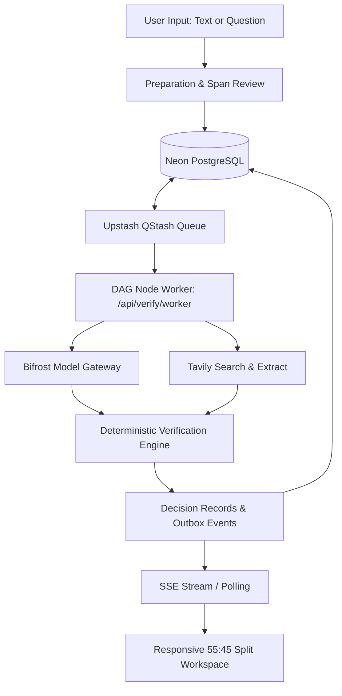

# Afterfact (working name: Stale-Answer Detector)

> **Real-time freshness verification and drift detection for AI-generated answers.**
>
> *Afterfact dissects AI-generated content into atomic verifiable claims, queries authoritative live web evidence via Tavily, assesses candidate passages through Bifrost, and applies deterministic TypeScript policies to verify whether each claim is currently supported, outdated, contradicted, or context-dependent — with zero hallucinated citations.*

[](https://nextjs.org/)
[](https://react.dev/)
[](https://www.typescriptlang.org/)
[](https://tailwindcss.com/)
[](https://www.prisma.io/)
[](https://neon.tech/)
[](https://github.com/maximhq/bifrost)
[](https://upstash.com/docs/qstash)
[](https://tavily.com/)
[](https://vitest.dev/)

---

## Current Status & Roadmap

- **Foundation Checkpoint (Gate G0):** Completed. Scaffolding pinned, contracts established (Universal Claim Tickets, Dynamic DAG, Actions, Reports, Events), paired semantic dark/light tokens implemented, and interactive component gallery live.
- **Current Milestone (Phase 1 / Gate G1):** Persisted DAG execution slice, live Tavily retrieval adapter, and Bifrost model routing underway.
- **147 Automated Unit Tests Passing:** Zero lint or typecheck errors across all schema, UI, and fixture test suites.

Explore live interactive interfaces:
- **Interactive Input Composer:** [`/`](http://localhost:3000)
- **Live Verification Report Showcase:** [`/report/sample-run`](http://localhost:3000/report/sample-run)
- **Paired Semantic Design Reference:** [`/design`](http://localhost:3000/design)

---

## Pitch & Purpose

Large Language Models (LLMs) state facts with unwavering confidence — even when those facts were only true at training time, have since been deprecated, or depend on omitted regional or version context. When users paste an AI response or ask a time-sensitive technical question, **Afterfact**:

1. **Extracts Atomic Claims:** Breaks complex text into isolated, falsifiable claims mapped to character offsets.
2. **Retrieves Authoritative Evidence:** Fetches primary vendor documentation, changelogs, and regulatory registries via **Tavily**.
3. **Assesses Candidate Passages:** Analyzes candidate evidence passages with strict schema validation through the **Maxim Bifrost** model gateway.
4. **Applies Deterministic Verification Policies:** Scores claims with mathematical predictability (100 = direct support, 75 = indirect support, 0 = contradiction, `null` = unresolved) and explicit machine reason codes.
5. **Generates Surgical Diffs:** Pinpoints the exact replacement text required to bring outdated answers up to date.

---

## Core Differentiators

| Capability | Standard LLM-as-a-Judge | Afterfact |
| :--- | :--- | :--- |
| **Citation Grounding** | Generates plausible URLs and quotes that may not exist. | **Fail-Closed Grounding:** Quotes must strictly match retrieved source substrings (`SourceDocument.text.includes(quote)`). |
| **Temporal Disentanglement** | Confuses announcement dates with effective dates. | **Three-Date Separation:** Distinguishes Publication Date, Announcement Date, and Effective Date; flags future changes with `Scheduled change` without falsely calling current facts stale. |
| **Scope & Context Sensitivity** | Blurs pricing tiers, regional laws, and API versions. | **Explicit Scope Matching:** Differentiates annual vs. monthly billing, EU vs. US GDPR/AI Act clauses, and API versions (e.g. Stripe `2020` vs. `2024`). |
| **Temporal Transitions** | Labels prior facts as flat hallucinations. | **"Then vs. Now" Timelines:** Demonstrates historical validity prior to a superseding event or policy change. |
| **Clarification & Ambiguity** | Guesses missing parameters or answers arbitrarily. | **Dynamic Clarification:** Pauses DAG branch to request missing details or falls back cleanly to `depends_on_context`. |
| **Execution Safety** | Vulnerable to serverless timeouts and dropped states. | **Durable DAG & Lease Fencing:** Neon PostgreSQL + Upstash QStash enforces bounded concurrency (max 3 claims) with automatic recovery. |
| **Visual Architecture** | Generic markdown output. | **Paired Cinematic Workspace:** 55:45 split document viewer, text highlights mapped to claim chips, and live DAG inspector. |

---

## System Architecture

```
[ User Input: Paste AI Answer or Ask Mode ]
                     │
                     ▼
[ Interactive Preparation & Context Review (Server Actions) ]
                     │ (Validate Spans & Scopes; Confirm Run)
                     ▼
       [ Neon PostgreSQL Database ] ◄───► [ Upstash QStash ]
       - runs & preparations                 - Flow control: Max 3 claims
       - dag_nodes & dag_edges               - Signed webhook delivery
       - claims, evidence & events           - Dynamic graph expansion
                     │
                     ▼
        [ Next.js DAG Node Worker (/api/verify/worker) ]
                     │
     ┌───────────────┴───────────────┐
     ▼                               ▼
[ Bifrost Model Gateway ]   [ Tavily Search & Extract ]
- Drafting (Ask mode)       - Live authoritative web docs
- Extraction & Preparation  - Query-aware raw passages
- Passage Assessment        - Publisher metadata & dates
- Dynamic Clarification
     │                               │
     └───────────────┬───────────────┘
                     ▼
        [ TypeScript Verification Engine ]
        - Scope isolation (explicit vs target)
        - Three-date separation (pub / announce / effective)
        - Deterministic scoring rubric (100, 75, 0, null)
        - Surgical correction verification
                     ▼
        [ Atomic Database Commit & Event Outbox ]
                     │
                     ▼
       [ Progressive SSE Stream with Replay / Polling ]
                     │
                     ▼
    [ Responsive 55:45 Workspace UI & DAG Inspector ]
     - Highlights, verdict chips & exact quoted citations
     - Accessible dynamic clarification forms
     - Then vs. Now transition timeline & scheduled change badges
     - Context comparison drawer & verified correction diffs
     - Sanitized expandable DAG execution inspector
```



---

## Tech Stack & Toolchain

| Layer | Technology | Version | Purpose |
| :--- | :--- | :--- | :--- |
| **Framework** | Next.js App Router | `15.5.29` | Full-stack application, Server Actions, API route handlers |
| **Core Runtime** | Node.js | `22.x` (`.nvmrc: 22.18.0`) | Modern LTS serverless runtime execution |
| **Package Manager**| pnpm | `11.9.0` | Fast, deterministic dependency resolution with frozen lockfile |
| **Language** | TypeScript | `5.7.3` | Strict type safety with zero-any policy |
| **Styling** | Tailwind CSS | `3.4.17` | Utility-first paired semantic design tokens (dark/light) |
| **Schema Validation**| Zod | `4.0.0` | Runtime validation across contracts, DB mutations, and API fences |
| **Relational DB** | Neon PostgreSQL | Serverless | Storage for runs, Universal Claim Tickets, DAG nodes, and events |
| **ORM** | Prisma ORM | `6.x` | Type-safe migrations, query generation, and connection pooling |
| **Model Gateway** | Maxim Bifrost | Latest | Authenticated LLM routing, structured outputs, fallback profiles |
| **Web Retrieval** | Tavily API | v1 Search/Extract | Authoritative web search and raw passage extraction |
| **Job Queue** | Upstash QStash | `^2.12.1` | Durable HTTP job delivery, lease renewal, concurrency limits |
| **Testing** | Vitest & Playwright | `3.2.0` / `1.51.1` | E1–E5 verification hierarchy, unit tests, and E2E browser smoke |

---

## Repository Structure

```
Afterfact/
├── docs/                             # Authoritative project architecture & specifications
│   ├── lane-b/                       # Lane B (Platform) step-by-step engineering handbook
│   │   ├── 00-system-overview.md     # System architecture & component topology
│   │   ├── 01-workstation-and-accounts.md # Environment & credentials setup
│   │   ├── b01-toolchain-and-dependencies.md
│   │   ├── b02-bifrost-gateway-setup.md
│   │   ├── b03-tavily-search-adapter.md
│   │   ├── b04a-prisma-and-neon-database.md
│   │   ├── b04b-persisted-dag-execution-slice.md
│   │   ├── b05-qstash-delivery-and-recovery.md
│   │   ├── b06-public-endpoints-and-sse.md
│   │   ├── b07-staging-deployment.md
│   │   ├── b08-production-release.md
│   │   └── troubleshooting.md        # Common pitfalls, errors, and resolutions
│   ├── API.md                        # Public and internal API route contracts
│   ├── ARCHITECTURE.md               # Technical architecture, DAG graphs, and failure isolation
│   ├── DATA-AND-JOBS.md              # Prisma schema, lease fencing, and QStash worker lifecycle
│   ├── DECISIONS.md                  # Architectural Decision Records (ADR-001 through ADR-023)
│   ├── DEMO-AND-SUBMISSION.md        # 3-minute presentation script and sponsor evidence
│   ├── PARALLEL-WORK-PLAN.md         # Dynamic DAG execution waves and cross-lane handoffs
│   ├── PHASE-TRACKER.md              # Master registry for 28 task tickets (A01–C09) and gates
│   ├── PRODUCT.md                    # Product requirements, personas, and domain policies
│   ├── SETUP-AND-DEPLOYMENT.md       # Infrastructure provisioning and deployment guide
│   ├── TESTING-AND-EVALUATION.md     # E1–E5 verification protocol and eval benchmark
│   └── VERIFICATION.md               # Claim extraction, passage scoring, and decision gates
├── src/
│   ├── app/                          # Next.js App Router endpoints & pages
│   │   ├── design/                   # Interactive paired-theme design token reference
│   │   ├── report/[id]/              # Verification report view (live runs & sample fixture)
│   │   ├── globals.css               # Semantic CSS color tokens & dark/light definitions
│   │   ├── layout.tsx                # Root layout with ThemeProvider and Header navigation
│   │   └── page.tsx                  # Root page hosting InputComposer
│   ├── components/
│   │   ├── composer/                 # InputComposer & multi-field context controls
│   │   ├── report/                   # ReportView, AnswerDocument, ClaimList, ClaimDetail, EvidenceCard
│   │   ├── theme/                    # ThemeProvider and ThemeToggle (dark/light switch)
│   │   └── ui/                       # Button, Card, StatusBadge, Input, Textarea, Select, Switch
│   └── lib/
│       ├── contracts/                # Canonical Zod contracts (claims, DAG, events, reports, actions)
│       ├── fixtures/                 # Golden sample report fixtures with real-world citations
│       └── report/                   # Highlight span calculators and document render helpers
├── tests/
│   ├── e2e/                          # Playwright browser integration & smoke tests
│   └── unit/                         # Vitest unit test suites (147 passing tests)
│       ├── composer/                 # Input validation and state unit tests
│       ├── contracts/                # Zod contract, DAG schema, and fixture fidelity tests
│       ├── report/                   # Text span mapping and verdict rendering tests
│       └── theme.test.ts             # Theme token resolution unit tests
├── AGENTS.md                         # Autonomous agent rules & evidence standards (UPPR Rev 4)
├── CONTRIBUTING.md                   # Lane-based contribution guidelines (Lanes A, B, C)
└── package.json                      # Project manifest, scripts, and pinned dependencies
```

---

## Quick Start

### 1. Prerequisites
- **Node.js:** `^22.0.0` (pinned to `22.18.0` in `.nvmrc`)
- **Package Manager:** `pnpm` (pinned to `11.9.0` in `package.json#packageManager`)

### 2. Installation
```bash
# Clone the repository
git clone https://github.com/Mayur11code/Afterfact.git
cd Afterfact

# Install exact dependencies using the frozen lockfile
pnpm install --frozen-lockfile
```

### 3. Environment Configuration
Copy the sample environment file to create your local `.env`:
```bash
cp .env.example .env
```
Configure your environment variables as needed:
- `DATABASE_URL` / `DIRECT_URL`: Neon PostgreSQL pooled and direct connection strings.
- `TAVILY_API_KEY`: API key for live authoritative web search and excerpt extraction.
- `BIFROST_BASE_URL`: URL of the Bifrost gateway (defaults to `http://127.0.0.1:8080`).
- `QSTASH_TOKEN` / `QSTASH_CURRENT_SIGNING_KEY`: Upstash QStash webhook tokens.

*(Note: The core contract suite, design showcase, and sample report fixture run locally without requiring external cloud credentials).*

### 4. Verification & Testing
Run the automated verification suite to validate code health:
```bash
# Run TypeScript static typechecker
pnpm typecheck

# Run Next.js and ESLint code checks
pnpm lint

# Run contract, schema, and UI unit tests (147 tests)
pnpm test

# Run Playwright E2E browser smoke tests
pnpm exec playwright install chromium
pnpm test:e2e
```

### 5. Running the Local Bifrost Gateway (Docker-Free)
Run Maxim Bifrost locally without Docker using our preconfigured startup command:
```bash
pnpm bifrost
```

### 6. Starting Development Server
Launch the Next.js development server:
```bash
pnpm dev
```
Open [http://localhost:3000](http://localhost:3000) in your browser:
- **Input Composer:** [http://localhost:3000](http://localhost:3000)
- **Sample Verification Report:** [http://localhost:3000/report/sample-run](http://localhost:3000/report/sample-run)
- **Design System Showcase:** [http://localhost:3000/design](http://localhost:3000/design)

---

## Verification & Evidence Hierarchy (E1–E5)

Following the engineering disciplines defined in [AGENTS.md](AGENTS.md), all implementation tasks and pull requests must satisfy explicit evidence tiers before transitioning:

- **E1 (Static Analysis):** Clean TypeScript typecheck (`pnpm typecheck`), linting (`pnpm lint`), and Zod schema validations.
- **E2 (Unit & Deterministic Logic):** Pure logic and contract tests (`pnpm test` via Vitest).
- **E3 (Disposable DB Integration):** Transactions and migrations against dedicated Neon PostgreSQL test branches (`TEST_DATABASE_URL`).
- **E4 (Staging Integration):** Live runs with signed QStash webhooks, Bifrost fallback routing, and real Tavily extraction.
- **E5 (Production Operations):** End-to-end verification against the frozen benchmark dataset (`eval/cases.jsonl`) with $< 5\%$ false reassurance rate.

---

## Team Lanes & Parallel Execution

Development is organized across three parallel, non-conflicting engineering lanes:

- **Lane A (Verification Engine):** Universal Claim Tickets, research planning, context-preserving extraction, semantic assessment, date logic, domain policies, and evaluation benchmark.
- **Lane B (Platform & Infrastructure):** Toolchain, Neon PostgreSQL, Prisma ORM, Bifrost model gateway, Tavily search adapter, QStash jobs, dynamic DAG runtime, and deployment.
- **Lane C (Product Experience):** Visual design tokens, responsive UI components, split workspace, preparation review, dynamic clarification forms, SSE client, timeline, and compare drawer.

Refer to [docs/PARALLEL-WORK-PLAN.md](docs/PARALLEL-WORK-PLAN.md) and [docs/PHASE-TRACKER.md](docs/PHASE-TRACKER.md) for current task tickets and cross-lane handoff contracts.

---

## Authoritative Documentation

| Category | Document | Description |
| :--- | :--- | :--- |
| **Rules & Standards** | [AGENTS.md](AGENTS.md) | Agent operating rules, evidence standards, secret safety, and invariants |
| **Contribution** | [CONTRIBUTING.md](CONTRIBUTING.md) | Team lane distribution (A/B/C), branch workflow, and PR checklist |
| **Product & Domain** | [docs/PRODUCT.md](docs/PRODUCT.md) | User journeys, claim categories, domain policies, and user experience |
| **System Architecture** | [docs/ARCHITECTURE.md](docs/ARCHITECTURE.md) | Component architecture, DAG execution lifecycle, and fault isolation |
| **Data & Jobs** | [docs/DATA-AND-JOBS.md](docs/DATA-AND-JOBS.md) | Prisma schema, lease fencing, QStash worker lifecycle, and retries |
| **Verification Logic** | [docs/VERIFICATION.md](docs/VERIFICATION.md) | Extraction rules, passage scoring, date resolution, and decision gates |
| **API Specifications** | [docs/API.md](docs/API.md) | Public and internal API route contracts, idempotency, and SSE streaming |
| **Platform Handbook** | [docs/lane-b/README.md](docs/lane-b/README.md) | Step-by-step beginner handbook for all Lane B infrastructure tasks |
| **Setup & Cloud** | [docs/SETUP-AND-DEPLOYMENT.md](docs/SETUP-AND-DEPLOYMENT.md) | Railway Bifrost deployment, Neon branching, and environment inventory |
| **Testing & Evaluation** | [docs/TESTING-AND-EVALUATION.md](docs/TESTING-AND-EVALUATION.md) | E1–E5 evidence levels, benchmark design, and release gates |
| **Decisions (ADRs)** | [docs/DECISIONS.md](docs/DECISIONS.md) | Architectural Decision Records (ADR-001 through ADR-023) |
| **Master Phase Tracker**| [docs/PHASE-TRACKER.md](docs/PHASE-TRACKER.md) | Single source of truth for all 28 task tickets and gates (G0–G4) |
| **Parallel Work Plan** | [docs/PARALLEL-WORK-PLAN.md](docs/PARALLEL-WORK-PLAN.md) | Execution waves, DAG topologies, and cross-lane handoff contracts |
| **Demo & Judging** | [docs/DEMO-AND-SUBMISSION.md](docs/DEMO-AND-SUBMISSION.md) | 3-minute judge script, sponsor proof, and submission checklist |
