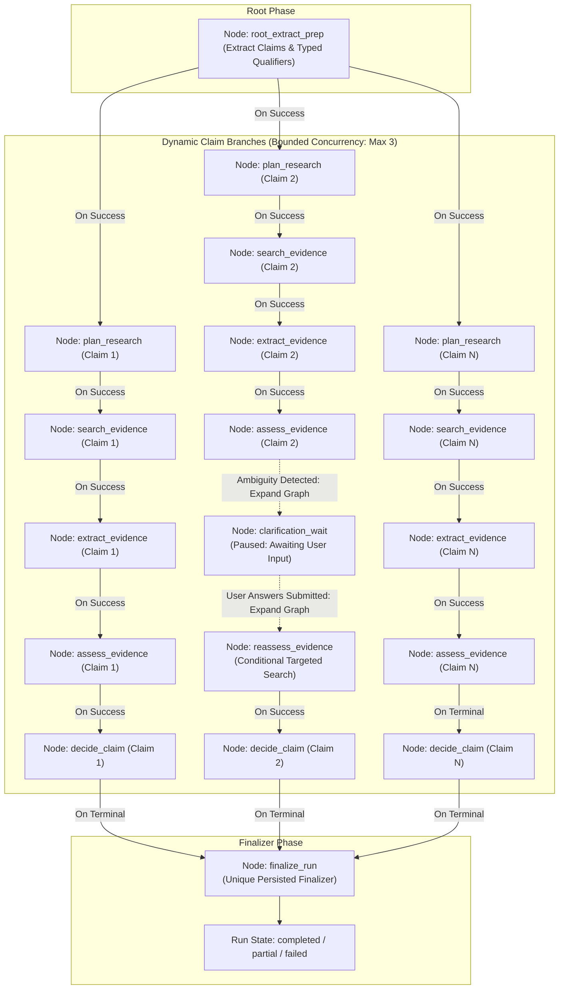

# docs/ARCHITECTURE.md — System Architecture & Topology

This document details the component boundaries, execution flows, persistence contracts, and failure isolation guarantees for **Afterfact** (working name: Stale-Answer Detector).

> [!NOTE]
> All paths, endpoints, and components described below represent planned architectural baselines. Tasks A01, A02, and B01 have completed static and local verification; remaining runtime implementations and external cloud resources are planned under the phased delivery schedule.

---

## 1. Component Architecture Diagram

```mermaid
flowchart TD
    subgraph Client ["Client Tier (Browser)"]
        UI["Workspace UI (Next.js App Router)"]
        PrepUI["Preparation & Context Review Form"]
        ClarifyUI["Dynamic Clarification Form (Accessible)"]
        SSE["SSE Stream / Snapshot Polling Fallback"]
        Comp["Context Compare Drawer & Correction Diff"]
        DAGView["Expandable Run Details & DAG Inspector"]
    end

    subgraph Actions ["Next.js Server Actions (Public Network Entry Points)"]
        ActPrep["startPreparationAction(input)"]
        ActConfirm["confirmPreparationAction(prepId, overrides)"]
        ActClarify["submitClarificationAction(runId, answers)"]
        ActCompare["compareAction(runId, overrides)"]
        ActRecheck["recheckAction(runId)"]
    end

    subgraph HTTPEndpoints ["Explicit HTTP Route Handlers"]
        APIProgrammatic["POST /api/v1/verify (Programmatic REST Adapter)"]
        APISnapshot["GET /api/runs/{id} (Report Snapshot)"]
        APIEvents["GET /api/runs/{id}/events (SSE Replay Stream)"]
        APIWorker["POST /api/verify/worker (Signed QStash Delivery)"]
        APICron["POST /api/internal/reconcile (Signed Recovery Sweeper)"]
    end

    subgraph Services ["Core Server Application Services"]
        PrepService["PreparationService (Extract, Infer, Bind Revision)"]
        DagService["DagExecutionService (Create, Expand, Close, Dispatch)"]
        ClarifyService["ClarificationService (Validate, Store, Unblock)"]
        VerifyService["VerificationService (Programmatic Workflow)"]
        RunQueryService["RunQueryService (Sanitized Snapshot Projection)"]
    end

    subgraph Broker ["Message Broker: Upstash QStash"]
        QStashQueue["QStash Message Queue"]
        FlowControl["Flow Control: Max 3 Concurrent Claim Branches"]
    end

    subgraph Database ["Persistence: Neon PostgreSQL"]
        RunsTable["runs (Lifecycle, InputHash, Limits)"]
        PrepTable["preparations (Extracted Spans, Inferred Scope)"]
        ClaimsTable["claims (ClaimTicket Spec, Result, Chronology)"]
        SourceDocsTable["source_documents (Provenance, URLs, Hashes, Dates)"]
        EvidenceUnitsTable["evidence_units (Verbatim Passages, Locators, Tables)"]
        AssessmentsTable["claim_evidence_assessments (Relational Semantics)"]
        DecisionsTable["decision_records (Auditable Decisions, Scores, Reasons)"]
        EventsTable["events (Monotonic Ordered Sequence)"]
        DagNodesTable["dag_nodes (Jobs, States, Leases, Outputs)"]
        DagEdgesTable["dag_edges (Dependencies, On-Success / On-Terminal)"]
        ClarificationsTable["clarifications (Questions, Answers, Versions)"]
    end

    subgraph Gateway ["Model Gateway: Bifrost Host (Docker over HTTPS)"]
        Bifrost["Bifrost Gateway (Port 8080)"]
        DraftModel["Drafting Profile (Ask mode)"]
        ExtractModel["Claim & Context Extraction Profile"]
        AssessModel["Passage Assessment & Reassessment Profile"]
        FallbackModel["Fallback Model Profile"]
    end

    subgraph Web ["Web Intelligence: Tavily API"]
        TavilySearch["POST /search (Live mode)"]
        TavilyExtract["POST /extract (Query-aware raw passages)"]
    end

    %% Browser Interactions
    UI -->|Paste Text or Ask Question| ActPrep
    PrepUI -->|Review Qualifiers & Confirm| ActConfirm
    ClarifyUI -->|Submit Answers / 'I don't know'| ActClarify
    Comp -->|Submit Alternate Context| ActCompare
    SSE -->|Listen / Reconnect ?afterSeq=N| APIEvents
    DAGView -->|Poll Snapshot / Fallback| APISnapshot

    %% Actions & Routes -> Services
    ActPrep --> PrepService
    ActConfirm --> DagService
    ActClarify --> ClarifyService
    ActCompare --> DagService
    ActRecheck --> DagService
    APIProgrammatic --> VerifyService
    VerifyService --> PrepService
    VerifyService --> DagService
    APIWorker --> DagService
    APICron --> DagService
    APISnapshot --> RunQueryService
    APIEvents --> RunQueryService

    %% Services -> DB, Broker, Gateway, Web
    PrepService --> PrepTable
    PrepService --> Bifrost
    DagService --> RunsTable
    DagService --> DagNodesTable
    DagService --> DagEdgesTable
    DagService --> ClaimsTable
    DagService --> EvidenceTable
    DagService --> EventsTable
    DagService --> QStashQueue
    ClarifyService --> ClarificationsTable
    ClarifyService --> DagNodesTable

    %% Async Worker Execution
    QStashQueue -->|Signed HTTP POST| APIWorker
    APIWorker -->|Acquire Lease & Step Node| DagNodesTable
    APIWorker -->|Extract / Assess / Draft| Bifrost
    APIWorker -->|Search & Extract Excerpts| Web
    Bifrost --> DraftModel
    Bifrost --> ExtractModel
    Bifrost --> AssessModel
    AssessModel -.->|On Error / Timeout Failover| FallbackModel
```



---

## 2. Service Boundaries & Hosting Topology

| Service Boundary | Host / Platform | Protocol / Auth | Security & Network Controls |
| :--- | :--- | :--- | :--- |
| **Browser Mutations (Server Actions)** | Vercel (Next.js Serverless) | Server Action RPC, Anonymous HttpOnly Cookie (`ownerHash`) | Network-accessible entry points; strictly validate Zod schemas, enforce cookie ownership, client idempotency keys, and rate limits. Return minimal payloads. |
| **Public Snapshots & SSE (`/api/runs/*`)** | Vercel (Next.js Serverless) | HTTPS, Anonymous Cookie (`ownerHash`) | Owner-scoped read access (`WHERE id = $id AND ownerHash = $cookieHash`). SSE stream emits ordered persisted events; lifetime decoupled from worker execution. |
| **Programmatic API (`/api/v1/verify`)** | Vercel (Next.js Serverless) | HTTPS, Bearer API Token or Anonymous Session | Thin adapter calling `VerificationService`; executes identical preparation and DAG verification workflow without bypassing validation or safety invariants. |
| **Worker Ingress (`/api/verify/worker`)** | Vercel Serverless | HTTPS + QStash Webhook Signature | Protected by `@upstash/qstash` `verifySignatureAppRouter`. Browser or unauthenticated requests fail with `401 Unauthorized`. |
| **Recovery Sweeper (`/api/internal/reconcile`)** | Vercel Serverless | HTTPS + Signed Cron / Admin Secret | Vercel Cron or admin header authentication; reclaims expired leases and undispatched nodes. |
| **Relational Database** | Neon PostgreSQL | TLS TCP (port 5432) | Split connection model: pooled `DATABASE_URL` (PgBouncer) for application runtime; direct `DATABASE_MIGRATION_URL` for DDL migrations. |
| **Message Broker** | Upstash QStash | HTTPS REST API | Server-side publishing only using `QSTASH_TOKEN`. Concurrency flow control capped at 3 active claim branches per run. |
| **Model Gateway (Bifrost)** | Dedicated Docker Host | HTTPS Reverse Proxy (Caddy/Nginx) | Ingress restricted to authenticated inference route (`BIFROST_GATEWAY_TOKEN`). Admin dashboard bound to `127.0.0.1:8080` (accessible via SSH tunnel only). Content logging disabled. |
| **Web Retrieval (Tavily)** | Tavily Cloud REST API | HTTPS Bearer Auth | Server-side calls only using `TAVILY_API_KEY`. Browser never calls Tavily directly. |

---

## 3. End-to-End Workflow & Persisted Dynamic DAG Protocol

### Step 1: Input Submission & Preparation
1. User submits text via `startPreparationAction` (or question in Ask mode).
2. The server action validates payload shapes (up to 8,000 characters for paste; up to 800 characters for ask).
3. If Ask mode: `PrepService` calls Bifrost drafting profile to generate candidate answer text.
4. `PrepService` computes `inputHash = SHA-256(text + question + baseContext)`.
5. If an identical `inputHash` already has completed preparation for this `ownerHash`, return the cached preparation immediately.
6. Otherwise, `PrepService` calls Bifrost extraction profile in a single unified model pass to:
   - Extract atomic claim statements and exact UTF-16 character spans.
   - Extract explicit qualifiers stated directly in the text (with text span offsets).
   - Propose inferred qualifier suggestions for missing context fields.
7. Persist record into `preparations` table (`status: 'ready'`).
8. Return sanitized preparation view to browser: claims, highlighted spans, explicit scopes, inferred scope suggestions, and editable target context fields.

### Step 2: Context Review, Clarification & Confirmation
1. User inspects extracted claims and qualifiers on the workspace.
2. User may adjust target context fields (e.g. target date, jurisdiction, currency) or provide initial clarification.
   > [!CRITICAL]
   > **Scope Isolation Invariant:** Explicit qualifiers extracted directly from the claim text (e.g. *"In the UK, Stripe charges..."*) are permanently anchored to that claim. User-provided target context applies only to claims with unspecified or open qualifiers; it **never** overwrites explicit claim scope.
3. User clicks **Confirm & Verify**, triggering `confirmPreparationAction(prepId, contextOverrides)`.
4. If the input text was edited since preparation, the server rejects confirmation with `STALE_PREPARATION_REVISION`, requiring re-preparation.
5. In a single database transaction, `DagService`:
   - Inserts row into `runs` table (`state: 'running'`, `inputHash`, `prepId`, `graphVersion: 1`).
   - Materializes root nodes in `dag_nodes` (unified jobs table) and dependencies in `dag_edges`.
   - Appends initial `run_started` and `claims_identified` events to `events` table.
   - Generates initial dispatch records.
6. Upon transaction commit, `DagService` publishes eligible root node IDs to QStash.

---

## 4. Persisted Dynamic DAG Lifecycle & Execution Protocol

The verification engine operates strictly as a **full dynamic Directed Acyclic Graph (DAG)** persisted in PostgreSQL. A static 2-step pipeline or unpersisted state machine is explicitly rejected.



### 1. Concrete Node Types
1. `root_extract_prep`: Validates input, parses UTF-16 spans, seeds `ClaimTicket` records and initial typed context properties.
2. `plan_research`: Formulates an auditable `ResearchPlan` per claim branch specifying targeted search queries, query purposes (`establish_current_state`, `investigate_exceptions_or_scope`, `seek_counterevidence`, `establish_historical_state_or_transition`), target source roles, and stopping conditions.
3. `search_evidence`: Calls Tavily `/search` and `/extract` for target queries, persisting immutable `SourceDocument` records.
4. `extract_evidence`: Performs context-preserving extraction on retrieved documents, retaining negation, header hierarchies, table dimensions, footnotes, and direct properties into discrete `EvidenceUnit` records.
5. `rank_evidence`: Optional vector shortlisting node. Active only when candidate passages $> 4$; computes in-memory cosine similarity against claim proposition for shortlisting. **Strictly excluded from truth scoring.**
6. `assess_evidence`: Calls Bifrost to generate candidate semantic relationships, then executes deterministic TypeScript quotation verification (`SourceDocument.text.includes(quote)`), producing validated `ClaimEvidenceAssessment` records.
7. `clarification_wait`: Represents a pause awaiting human input. **Holds zero worker leases and executes zero background jobs while paused.**
8. `reassess_evidence`: Dynamically spawned node executing targeted secondary search after clarification or ambiguity discovery.
9. `decide_claim`: Deterministic TypeScript synthesis judge executing sequential decision gates, producing an auditable `DecisionRecord`, assigning categorical score (`100`, `75`, `0`, or `null`), and recursively verifying surgical correction diffs.
10. `finalize_run`: Unique terminal aggregator node calculating run-level summaries and closing the run.

### 2. Dependency Conditions
- `on_success`: Successor becomes eligible only if the predecessor completes with `state = 'completed'`.
- `on_terminal`: Successor becomes eligible when predecessor reaches any terminal state (`completed`, `failed`, or `skipped`). (Used by `finalize_run` and fallback handlers).

### 3. Dynamic Graph Expansion Protocol
During execution, a running worker (e.g. `assess_evidence`) may discover that verification requires additional work (such as domain clarification or targeted secondary search). It expands the graph according to these atomic invariants:
1. **Cycle Rejection:** Before persisting new edges, the expansion engine runs cycle detection (DFS topological sort). If a proposed edge creates a cycle, the expansion is rejected, and the node records an error.
2. **Atomic Expansion Commit:** In a single transaction guarded by the node's `leaseToken`:
   ```sql
   BEGIN;
     -- 1. Verify lease is active
     UPDATE dag_nodes SET state = 'completed', leaseToken = NULL WHERE id = $currentNodeId AND leaseToken = $token;
     -- 2. Insert newly expanded nodes
     INSERT INTO dag_nodes (id, runId, nodeType, state, ...) VALUES ($newNodeId, $runId, 'clarification_wait', 'waiting_for_input', ...);
     -- 3. Insert dependency edges
     INSERT INTO dag_edges (runId, predecessorId, successorId, condition) VALUES ($runId, $newNodeId, $downstreamNodeId, 'on_success');
     -- 4. Re-link downstream dependencies to depend on the new branch
     -- 5. Append event to events table
     INSERT INTO events (runId, seq, type, payload) VALUES ($runId, $seq, 'graph_expanded', ...);
   COMMIT;
   ```
3. **No External Calls Inside DB Transactions:** All LLM and Tavily API calls execute *before* opening the commit transaction.

### 4. Strict Graph Closure Protocol
A run must never terminate prematurely or hang indefinitely. Graph closure adheres to the following unambiguous lifecycle rules:
1. **No Worker Assumes "Last Worker":** Workers never check `COUNT(*) WHERE state != 'completed'` and unilaterally set `runs.state = 'completed'`. All aggregation is owned by the unique persisted `finalize_run` node.
2. **Finalizer Eligibility Invariant:** The `finalize_run` node becomes eligible for dispatch **if and only if**:
   - All required upstream claim-evaluation nodes are in a terminal state (`completed`, `failed`, or `skipped`).
   - Zero nodes are in `waiting_for_input` state (no unresolved active clarification questions).
   - Zero nodes are in `running` or `leased` state.
   - The graph is not undergoing active expansion.
3. **Sealed Terminal Run Invariant:** Once `finalize_run` commits `runs.state = 'completed'` (or `'partial'` / `'failed'`), the run is permanently sealed. Any subsequent mutation attempt on `dag_nodes` or `dag_edges` for that `runId` fails closed. Explicit rechecks create new, distinct runs (`parentRunId`).
4. **Finalizer Failure & Bounded Recovery:** If `finalize_run` crashes or times out, the recovery sweeper re-enqueues it (up to 3 attempts). If retries exhaust, the sweeper marks `runs.state = 'failed'` with `reasonCode = 'FINALIZATION_EXHAUSTED'`.

### 5. Zero-Claim, All-Failed, and Partial Success Outcomes
- **Zero-Claim Case:** If extraction yields zero verifiable claims (e.g. pure opinion or greeting), the graph directly routes to `finalize_run`, which commits `runs.state = 'completed'` with `summary.totalClaims = 0` and an informational note.
- **All-Failed Case:** If external providers fail completely on every claim branch after max retries, `finalize_run` transitions `runs.state = 'failed'`, logging `ALL_CLAIMS_FAILED`.
- **Partially Successful Case:** If Claim 1 succeeds (`supported`) and Claim 2 fails (`RETRIEVAL_FAILED`), Claim 1's evidence and verdict remain fully visible, while Claim 2 renders its error code. `finalize_run` transitions `runs.state = 'partial'`.

---

## 5. Failure Isolation & Resiliency Architecture

- **Claim-Level Blast Radius Isolation:** Each claim branch in the DAG executes independently. Provider rate limits or timeouts on one claim never cancel or corrupt sibling branches.
- **Clarification Pauses Without Held Leases:** When a branch enters `waiting_for_input`, its node is persisted in state `'waiting_for_input'` with `leaseToken = NULL` and `leaseUntil = NULL`. No background worker runs, no HTTP timeout ticks, and no database locks are held while awaiting user interaction.
- **Database-Clock Lease Fencing:** Active worker execution is fenced by `leaseUntil = NOW() + INTERVAL '35 seconds'`. Expired workers attempting to commit results fail closed (`409 Conflict`), preventing split-brain corruption.
- **Provider Gateway Fallbacks:** Bifrost intercepts upstream LLM rate limits and failovers to configured fallback profiles without restarting the DAG node or re-fetching raw Tavily passages.
- **Reconnectable SSE with Snapshot Polling Fallback:** The browser listens on `/api/runs/[id]/events`. On disconnect, it reconnects using `?afterSeq=N` to replay missing ordered events. If the SSE connection cannot be re-established, the client drops back to polling `/api/runs/[id]` snapshot every 2 seconds until terminal state.
- **Execution Limits:** To prevent infinite loops or cost overruns, runs enforce hard system bounds: maximum 16 total DAG nodes, maximum depth of 5, maximum 3 retries per logical node, maximum 2 clarification rounds, and an overall execution timeout of 180 seconds.
