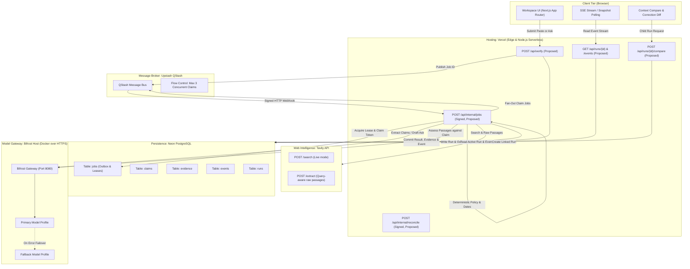

# docs/ARCHITECTURE.md — System Architecture & Topology

This document details the component boundaries, execution flows, persistence contracts, and failure isolation guarantees for **Afterfact** (working name: Stale-Answer Detector).

> [!NOTE]
> All paths, endpoints, and components described below are currently **proposed** architecture baselines. No runtime implementations or external cloud resources are active yet.

---

## 1. Component Architecture Diagram

---

## 2. Service Boundaries & Hosting Topology

| Service | Host / Platform | Protocol / Auth | Network Boundary & Privacy |
| :--- | :--- | :--- | :--- |
| **Frontend & Public API** | Vercel (Node.js Serverless) | HTTPS, Anonymous HttpOnly Cookie | Public Internet facing; strictly rate-limited; CORS restricted to origin. |
| **Internal Job Handlers** | Vercel Serverless (`/api/internal/*`) | HTTPS + QStash Webhook Signature | Protected by `@upstash/qstash` `verifySignatureAppRouter`. Browser requests rejected with 401. |
| **Relational Database** | Neon PostgreSQL | TLS TCP (port 5432) | Access via pooled `DATABASE_URL` (app runtime) and direct `DATABASE_MIGRATION_URL` (migrations). |
| **Background Message Queue**| Upstash QStash | HTTPS REST API | Server-side publishing only using `QSTASH_TOKEN`. |
| **Model Gateway (Bifrost)** | Always-on Docker Host | HTTPS Reverse Proxy (Caddy/Nginx) | Ingress restricted to authenticated inference route (`BIFROST_GATEWAY_TOKEN`). Admin dashboard bound to `localhost:8080` (accessible via SSH tunnel only). Content logging disabled. |
| **Web Retrieval (Tavily)** | Tavily Cloud REST API | HTTPS Bearer Auth | Server-side only with `TAVILY_API_KEY`. Browser never contacts Tavily directly. |

---

## 3. Execution Path: Paste and Ask Workflows

### Phase A: Submission & Job Enqueue
1. User submits text via `POST /api/verify`.
2. The route handler validates the payload against Zod schemas (`request.ts`):
   - Paste: Plain text up to 8,000 characters.
   - Ask: Question up to 800 characters.
3. In a single database transaction, the handler:
   - Computes `ownerHash` from anonymous cookie.
   - Inserts row into `runs` table (state: `queued`).
   - Inserts coordinator job into `jobs` table (status: `pending`).
4. Upon successful transaction commit, the handler triggers QStash to publish the coordinator job ID.
5. Returns `202 Accepted` with `{ runId, state: "queued" }`.

### Phase B: Coordinator Worker Execution
1. QStash delivers signed POST request to `/api/internal/jobs`.
2. Worker verifies QStash signature (`QSTASH_CURRENT_SIGNING_KEY`).
3. Worker atomically acquires lease on the coordinator job in Postgres (`leaseToken`, `leaseUntil = NOW() + 35s`).
4. **If Ask mode:** Calls Bifrost draft profile to generate initial answer text and updates `runs.text`.
5. Calls Bifrost claim extraction profile (`extract-claims.ts`) to extract atomic claims and UTF-16 span offsets.
6. In a single transaction:
   - Inserts up to 8 rows into `claims` table (state: `pending`).
   - Inserts corresponding claim job rows into `jobs` table.
   - Appends `claims_identified` event to `events` table.
7. Worker fans out claim jobs to QStash, applying concurrency flow control (maximum 3 concurrent active claims).
8. Releases coordinator job (`status: "completed"`).

### Phase C: Per-Claim Verification Worker
1. QStash delivers claim job to `/api/internal/jobs`.
2. Worker acquires lease on claim job.
3. **Retrieval (`tavily/client.ts`):**
   - Formulates target query and change query based on domain policy.
   - Calls Tavily `/search` (up to 4 results) and `/extract` on top 3 authoritative URLs.
4. **Assessment (`assess-evidence.ts`):**
   - Feeds numbered excerpts and normalized claim to Bifrost.
   - If primary model times out or errors, Bifrost automatically routes to configured fallback model.
5. **Deterministic Policy & Scoring (`decide.ts`):**
   - Evaluates jurisdiction, version strings, billing terms, and dates.
   - Derives verdict (`supported`, `outdated`, `contradicted`, `depends_on_context`, `conflicting_evidence`, `insufficient_evidence`).
   - Calculates score (100, 75, 0, or `null`).
6. In a single transaction guarded by `leaseToken`:
   - Updates `claims` record with verdict, score, and explanation.
   - Inserts extracted passages into `evidence` table.
   - Inserts `claim_result` event into `events` table.
   - If all claims for this `runId` are now terminal, marks `runs.state` as `completed` (or `partial` if some claims failed) and appends `run_finished` event.
7. Releases claim job.

---

## 4. Failure Isolation & Resiliency Architecture

- **Claim-Level Blast Radius Isolation:** Each claim executes as an independent job. If Tavily retrieval fails or Bifrost errors on Claim #3, Claim #3 transitions to `failed` (`reasonCode: RETRIEVAL_FAILED`), but Claims #1, #2, and #4 proceed uninterrupted. The final run state transitions to `partial`, allowing the user to view all successfully verified claims.
- **Lease Fencing and Stale Commit Rejection:** Workers must provide their active `leaseToken` during status commits. If a worker times out and its lease is stolen by the recovery daemon, late writes from the expired worker are rejected (`409 Conflict`), preventing split-brain corruption.
- **Provider Gateway Fallbacks:** Bifrost manages upstream LLM rate limits and downtime transparently. When the primary model profile fails, Bifrost invokes the fallback profile without re-running Tavily searches or re-fetching raw pages.
- **SSE Stream Interruption Recovery:** The client tracks the highest received sequence number (`nextEventSeq`). If the SSE connection drops, the client automatically requests `GET /api/runs/{id}/events?afterSeq=N` to replay missed events or falls back to polling `GET /api/runs/{id}` every 2 seconds.
