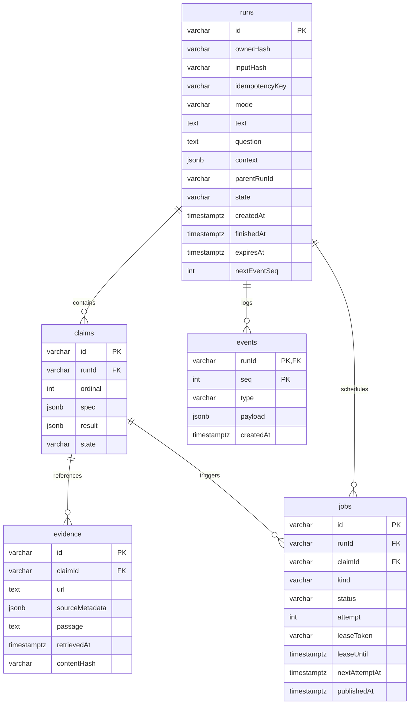

# docs/DATA-AND-JOBS.md — Persistence, Transactions & Background Jobs

This document specifies the database schemas, transaction boundaries, leasing contracts, and background job lifecycle for **Afterfact** (working name: Stale-Answer Detector).

---

## 1. Relational Schema Specification (Neon PostgreSQL + Drizzle ORM)



### Table Definitions & Constraints

#### 1. `runs`
- `id` (VARCHAR(36), PK): Nanoid or UUIDv7.
- `ownerHash` (VARCHAR(64), NOT NULL): SHA-256 of the anonymous browser cookie token.
- `inputHash` (VARCHAR(64), NOT NULL): SHA-256 of normalized input text and context.
- `idempotencyKey` (VARCHAR(64), NULL): Client-supplied idempotency key.
- `mode` (VARCHAR(16), NOT NULL): `'paste'` | `'ask'`.
- `text` (TEXT, NOT NULL): Stored answer text (original paste or drafted answer).
- `question` (TEXT, NULL): Stored user question.
- `context` (JSONB, NOT NULL): Stored target date, jurisdiction, currency, etc.
- `parentRunId` (VARCHAR(36), NULL): References parent run for compare/recheck.
- `state` (VARCHAR(16), NOT NULL): `'queued'` | `'running'` | `'completed'` | `'partial'` | `'failed'`.
- `createdAt` (TIMESTAMPTZ, NOT NULL, DEFAULT NOW()).
- `finishedAt` (TIMESTAMPTZ, NULL).
- `expiresAt` (TIMESTAMPTZ, NOT NULL): Default 24 hours after creation.
- `nextEventSeq` (INT, NOT NULL, DEFAULT 1): Monotonically increasing sequence counter.
- **Constraints & Indexes:**
  - `UNIQUE (ownerHash, idempotencyKey)`: Enforces idempotency per user.
  - `INDEX (ownerHash, createdAt)`: Rapid lookup for user history.
  - `INDEX (expiresAt)`: Efficient batch pruning by cleanup worker.

#### 2. `claims`
- `id` (VARCHAR(36), PK).
- `runId` (VARCHAR(36), NOT NULL, REFERENCES `runs(id)` ON DELETE CASCADE).
- `ordinal` (INT, NOT NULL): Zero-indexed order of appearance.
- `spec` (JSONB, NOT NULL): Normalized entity, attribute, asserted value, UTF-16 span offsets.
- `result` (JSONB, NULL): Verdict, score, scoreReason, reasonCode, transition, correction.
- `state` (VARCHAR(16), NOT NULL): `'pending'` | `'researching'` | `'assessed'` | `'failed'`.
- **Constraints & Indexes:**
  - `UNIQUE (runId, ordinal)`: Guarantees strict ordering.
  - `INDEX (runId, state)`.

#### 3. `evidence`
- `id` (VARCHAR(36), PK).
- `claimId` (VARCHAR(36), NOT NULL, REFERENCES `claims(id)` ON DELETE CASCADE).
- `url` (TEXT, NOT NULL): Primary source URL.
- `sourceMetadata` (JSONB, NOT NULL): Publisher, title, source type, publication date, effective date.
- `passage` (TEXT, NOT NULL): Exact character sequence extracted from page.
- `retrievedAt` (TIMESTAMPTZ, NOT NULL).
- `contentHash` (VARCHAR(64), NOT NULL): Hash of raw passage to deduplicate.
- **Constraints & Indexes:**
  - `INDEX (claimId)`.

#### 4. `events`
- `runId` (VARCHAR(36), NOT NULL, REFERENCES `runs(id)` ON DELETE CASCADE).
- `seq` (INT, NOT NULL): Per-run sequence number.
- `type` (VARCHAR(32), NOT NULL): Event type.
- `payload` (JSONB, NOT NULL): Structured event body.
- `createdAt` (TIMESTAMPTZ, NOT NULL, DEFAULT NOW()).
- **Constraints & Indexes:**
  - `PRIMARY KEY (runId, seq)`: Guarantees strict monotonic sequence uniqueness.

#### 5. `jobs` (Durable Outbox & Leases)
- `id` (VARCHAR(36), PK): Logical job key.
- `runId` (VARCHAR(36), NOT NULL, REFERENCES `runs(id)` ON DELETE CASCADE).
- `claimId` (VARCHAR(36), NULL, REFERENCES `claims(id)` ON DELETE CASCADE).
- `kind` (VARCHAR(16), NOT NULL): `'coordinator'` | `'claim_verifier'`.
- `status` (VARCHAR(16), NOT NULL): `'pending'` | `'leased'` | `'completed'` | `'failed'`.
- `attempt` (INT, NOT NULL, DEFAULT 0): Execution attempt counter (max 3).
- `leaseToken` (VARCHAR(36), NULL): UUIDv4 fencing token.
- `leaseUntil` (TIMESTAMPTZ, NULL): Database clock expiration timestamp.
- `nextAttemptAt` (TIMESTAMPTZ, NOT NULL, DEFAULT NOW()).
- `publishedAt` (TIMESTAMPTZ, NULL): When published to QStash.
- **Constraints & Indexes:**
  - `UNIQUE (runId, claimId, kind)`: Prevents duplicate job creation for the same logical task.
  - `INDEX (status, nextAttemptAt)`: Fast index scan for reconciliation daemon.

---

## 2. Transaction Boundaries & Non-Blocking Rules

> [!CRITICAL]
> **Never hold a relational database lock while invoking external HTTP APIs (Tavily, Bifrost, QStash).**  
> External HTTP latency or network stalls must never hold open PostgreSQL transactions or connection pool slots.

### Permitted Atomic Transaction Boundaries:
1. **Run Initialization:**
   ```sql
   BEGIN;
     INSERT INTO runs (...) VALUES (...);
     INSERT INTO jobs (id, runId, kind, status, ...) VALUES (...); -- Coordinator job
     INSERT INTO events (runId, seq, type, ...) VALUES (..., 1, 'run_started', ...);
   COMMIT;
   -- Network dispatch occurs ONLY AFTER commit:
   -- qstashClient.publishJSON({ url: '/api/internal/jobs', body: { jobId } });
   ```
2. **Coordinator Claim Fan-Out:**
   ```sql
   BEGIN;
     INSERT INTO claims (...) VALUES (...); -- Up to 8 atomic claims
     INSERT INTO jobs (...) VALUES (...);   -- Up to 8 claim_verifier jobs
     UPDATE runs SET nextEventSeq = nextEventSeq + 1 WHERE id = $runId;
     INSERT INTO events (runId, seq, type, ...) VALUES (..., $seq, 'claims_identified', ...);
     UPDATE jobs SET status = 'completed' WHERE id = $coordinatorJobId AND leaseToken = $token;
   COMMIT;
   -- Fan out to QStash AFTER commit
   ```
3. **Claim Result Commit (Lease-Fenced CAS):**
   ```sql
   BEGIN;
     -- Verify lease is still held
     UPDATE jobs 
        SET status = 'completed', leaseToken = NULL 
      WHERE id = $claimJobId AND leaseToken = $token;
     
     -- If row count is 0, abort: lease was stolen!
     
     INSERT INTO evidence (...) VALUES (...);
     UPDATE claims SET result = $result, state = 'assessed' WHERE id = $claimId;
     
     -- Allocate next monotonic event sequence
     UPDATE runs 
        SET nextEventSeq = nextEventSeq + 1 
      WHERE id = $runId 
     RETURNING nextEventSeq;
     
     INSERT INTO events (runId, seq, type, payload) VALUES ($runId, $allocatedSeq, 'claim_result', $payload);
   COMMIT;
   ```

---

## 3. QStash Integration, Leases & Recovery

1. **Signed HTTP Delivery:**  
   Next.js route `/api/internal/jobs` utilizes `@upstash/qstash` `verifySignatureAppRouter`. Incoming requests missing valid signatures are rejected immediately with `401 Unauthorized`.
2. **Database-Clock Lease Fencing:**  
   Worker acquires a lease via atomic conditional update:
   ```sql
   UPDATE jobs 
      SET status = 'leased', 
          leaseToken = $newToken, 
          leaseUntil = NOW() + INTERVAL '35 seconds',
          attempt = attempt + 1
    WHERE id = $jobId 
      AND (status = 'pending' OR (status = 'leased' AND leaseUntil < NOW()))
      AND attempt < 3;
   ```
3. **Competing Worker & Split-Brain Containment:**  
   If Worker A encounters a network pause exceeding 35 seconds, its lease expires. Worker B (or the recovery sweeper) re-acquires the job with a new `leaseToken`. When Worker A attempts to commit its results, the update `WHERE leaseToken = $oldToken` matches 0 rows, forcing Worker A to fail closed and roll back.
4. **Idempotent Reconciliation Sweeper (`/api/internal/reconcile`):**  
   - Runs every 60 seconds.
   - Identifies jobs where `status = 'leased' AND leaseUntil < NOW()`.
   - If `attempt >= 3`, transitions job to `'failed'`, marks associated claim as `'failed'`, and re-evaluates run terminal status.
   - If `attempt < 3`, resets `status = 'pending'` and republishes to QStash.

---

## 4. Retention Policy & Data Pruning

- Verification runs and evidence are ephemeral, retaining data for **24 hours**.
- A bounded daily pruning sweep executes:
  ```sql
  DELETE FROM runs WHERE expiresAt < NOW() LIMIT 500;
  ```
  All associated claims, evidence, events, and jobs cascade automatically via foreign keys (`ON DELETE CASCADE`).
