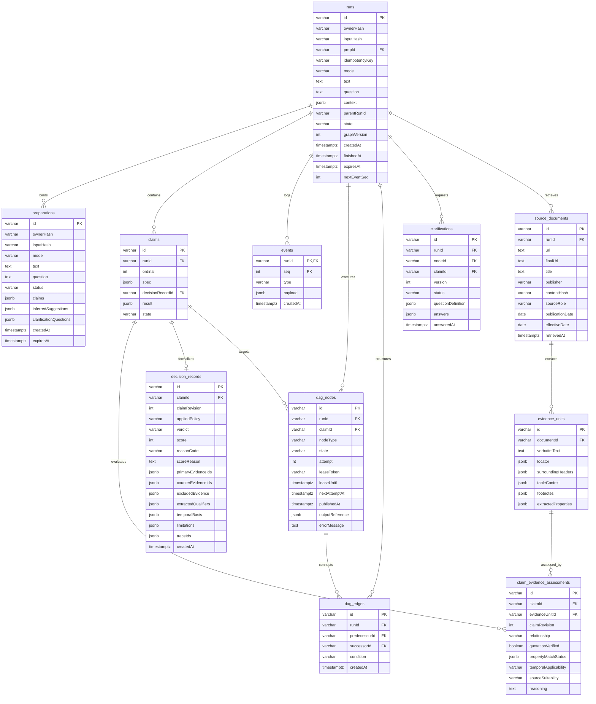

# docs/DATA-AND-JOBS.md — Persistence, Dynamic DAG & Background Execution

This document specifies the database schemas, transaction protocols, lease fencing contracts, and dynamic DAG execution lifecycle for **Afterfact** (working name: Stale-Answer Detector).

---

## 1. Relational Schema Specification (Neon PostgreSQL + Drizzle ORM)



### Table Definitions & Constraints

#### 1. `runs`
- `id` (VARCHAR(36), PK): Nanoid or UUIDv7.
- `ownerHash` (VARCHAR(64), NOT NULL): SHA-256 of the anonymous browser cookie token.
- `inputHash` (VARCHAR(64), NOT NULL): SHA-256 of normalized text, question, and base context.
- `prepId` (VARCHAR(36), NULL, REFERENCES `preparations(id)` ON DELETE SET NULL).
- `idempotencyKey` (VARCHAR(64), NULL): Client-supplied idempotency key.
- `mode` (VARCHAR(16), NOT NULL): `'paste'` | `'ask'`.
- `text` (TEXT, NOT NULL): Stored answer text (original paste or drafted answer).
- `question` (TEXT, NULL): Stored user query (if Ask mode).
- `context` (JSONB, NOT NULL): Target date, jurisdiction, currency, billing commitment.
- `parentRunId` (VARCHAR(36), NULL): Parent run reference for compare and recheck child runs.
- `state` (VARCHAR(16), NOT NULL): `'running'` | `'completed'` | `'partial'` | `'failed'`.
- `graphVersion` (INT, NOT NULL, DEFAULT 1): Incremented on graph topology changes.
- `createdAt` (TIMESTAMPTZ, NOT NULL, DEFAULT NOW()).
- `finishedAt` (TIMESTAMPTZ, NULL).
- `expiresAt` (TIMESTAMPTZ, NOT NULL): Default 24 hours after creation.
- `nextEventSeq` (INT, NOT NULL, DEFAULT 1): Monotonically increasing sequence counter.
- **Constraints & Indexes:**
  - `UNIQUE (ownerHash, idempotencyKey)`: Enforces client idempotency per user.
  - `INDEX (ownerHash, createdAt)`: Rapid lookup for user history.
  - `INDEX (expiresAt)`: Efficient batch pruning by cleanup daemon.

#### 2. `preparations`
- `id` (VARCHAR(36), PK): Preparation session ID (`prep_...`).
- `ownerHash` (VARCHAR(64), NOT NULL): Owner token binding session.
- `inputHash` (VARCHAR(64), NOT NULL): Cryptographic hash of input text.
- `mode` (VARCHAR(16), NOT NULL): `'paste'` | `'ask'`.
- `text` (TEXT, NOT NULL): Input text.
- `question` (TEXT, NULL): Question text.
- `status` (VARCHAR(16), NOT NULL): `'drafting'` | `'ready'` | `'superseded'`.
- `claims` (JSONB, NOT NULL): Extracted claim statements, UTF-16 spans, explicit scopes.
- `inferredSuggestions` (JSONB, NOT NULL): Suggested qualifiers for missing context fields.
- `clarificationQuestions` (JSONB, NULL): Initial questions if input text contains essential ambiguities.
- `createdAt` (TIMESTAMPTZ, NOT NULL, DEFAULT NOW()).
- `expiresAt` (TIMESTAMPTZ, NOT NULL): 24-hour expiration.
- **Constraints & Indexes:**
  - `INDEX (ownerHash, inputHash, status)`: Instant cache hit check for identical text.

#### 3. `claims`
- `id` (VARCHAR(36), PK): Claim ID (`clm_...`).
- `runId` (VARCHAR(36), NOT NULL, REFERENCES `runs(id)` ON DELETE CASCADE).
- `ordinal` (INT, NOT NULL): Zero-indexed order of appearance in source text.
- `spec` (JSONB, NOT NULL): Normalized `ClaimTicket` shape containing `originalStatement`, `normalizedProposition`, `sourceSpan` (UTF-16 start/end), and `verificationContext` (array of `VerificationProperty`).
- `decisionRecordId` (VARCHAR(36), NULL, REFERENCES `decision_records(id)` ON DELETE SET NULL).
- `result` (JSONB, NULL): Verdict, score, scoreReason, reasonCode, timeline chronology, correction diff.
- `state` (VARCHAR(16), NOT NULL): `'pending'` | `'researching'` | `'assessed'` | `'failed'`.
- **Constraints & Indexes:**
  - `UNIQUE (runId, ordinal)`: Enforces ordinal uniqueness.
  - `INDEX (runId, state)`.

#### 4. `source_documents` (Retrieved Document Provenance)
- `id` (VARCHAR(36), PK): Document ID (`doc_...`).
- `runId` (VARCHAR(36), NOT NULL, REFERENCES `runs(id)` ON DELETE CASCADE).
- `url` (TEXT, NOT NULL): Initial target URL.
- `finalUrl` (TEXT, NOT NULL): Final URL after following HTTP redirects.
- `title` (TEXT, NOT NULL): Webpage title.
- `publisher` (VARCHAR(128), NOT NULL): Domain or publisher name.
- `contentHash` (VARCHAR(64), NOT NULL): SHA-256 of raw HTML/text payload.
- `sourceRole` (VARCHAR(32), NOT NULL): `'primary_authority'` | `'regulatory_filing'` | `'official_changelog'` | `'reputable_secondary'` | `'counter_perspective'`.
- `publicationDate` (DATE, NULL): Document publication date ($T_{\text{pub}}$).
- `effectiveDate` (DATE, NULL): Legal/technical effective date ($T_{\text{effective}}$).
- `retrievedAt` (TIMESTAMPTZ, NOT NULL, DEFAULT NOW()).
- **Constraints & Indexes:**
  - `INDEX (runId, contentHash)`: Deduplication across sibling claims.

#### 5. `evidence_units` (Context-Preserving Extracted Passages)
- `id` (VARCHAR(36), PK): Evidence unit ID (`evi_...`).
- `documentId` (VARCHAR(36), NOT NULL, REFERENCES `source_documents(id)` ON DELETE CASCADE).
- `verbatimText` (TEXT, NOT NULL): Verbatim extracted passage.
- `locator` (JSONB, NOT NULL): DOM selector, XPath, or character offsets.
- `surroundingHeaders` (JSONB, NOT NULL): Header hierarchy (`H1`, `H2`, `H3`).
- `tableContext` (JSONB, NULL): Table title, column header, row header.
- `footnotes` (JSONB, NULL): Associated asterisks, footnotes, disclaimers.
- `extractedProperties` (JSONB, NOT NULL): Properties stated directly in this passage.
- **Constraints & Indexes:**
  - `INDEX (documentId)`.

#### 6. `claim_evidence_assessments` (Relational Semantic Assessments)
- `id` (VARCHAR(36), PK): Assessment ID (`asm_...`).
- `claimId` (VARCHAR(36), NOT NULL, REFERENCES `claims(id)` ON DELETE CASCADE).
- `evidenceUnitId` (VARCHAR(36), NOT NULL, REFERENCES `evidence_units(id)` ON DELETE CASCADE).
- `claimRevision` (INT, NOT NULL, DEFAULT 1): Evaluated claim ticket revision.
- `relationship` (VARCHAR(32), NOT NULL): `'supports'` | `'contradicts'` | `'relevant_but_inconclusive'` | `'unrelated'` | `'historical_state'` | `'future_scheduled_change'`.
- `quotationVerified` (BOOLEAN, NOT NULL): Deterministic proof that excerpt exists in source document.
- `propertyMatchStatus` (JSONB, NOT NULL): `{ matching: [], mismatched: [], missingInEvidence: [] }`.
- `temporalApplicability` (VARCHAR(32), NOT NULL): `'active_at_target_time'` | `'historical_prior'` | `'future_pending'` | `'undetermined'`.
- `sourceSuitability` (VARCHAR(32), NOT NULL): `'authoritative_primary'` | `'credible_secondary'` | `'insufficient_authority'`.
- `reasoning` (TEXT, NOT NULL): Epistemic justification for this relationship.
- **Constraints & Indexes:**
  - `UNIQUE (claimId, evidenceUnitId, claimRevision)`: Uniqueness per claim revision and evidence unit.
  - `INDEX (claimId, relationship)`.

#### 7. `decision_records` (Auditable Decision Artifacts)
- `id` (VARCHAR(36), PK): Decision record ID (`dec_...`).
- `claimId` (VARCHAR(36), NOT NULL, REFERENCES `claims(id)` ON DELETE CASCADE).
- `claimRevision` (INT, NOT NULL, DEFAULT 1): Evaluated revision number.
- `appliedPolicy` (VARCHAR(32), NOT NULL): Module name (e.g. `'pricing'`, `'api'`, `'regulation'`, `'leadership'`, `'generic'`).
- `verdict` (VARCHAR(32), NOT NULL): `'supported'` | `'outdated'` | `'contradicted'` | `'depends_on_context'` | `'conflicting_evidence'` | `'insufficient_evidence'`.
- `score` (INT, NULL): Categorical rubric (`100` | `75` | `0` | `NULL`).
- `reasonCode` (VARCHAR(48), NOT NULL): Canonical reason code.
- `scoreReason` (TEXT, NOT NULL): Detailed justification paragraph.
- `primaryEvidenceIds` (JSONB, NOT NULL): IDs of assessments that directly granted verdict.
- `counterEvidenceIds` (JSONB, NOT NULL): IDs of counterevidence assessments evaluated.
- `excludedEvidence` (JSONB, NOT NULL): Array of `{ evidenceId, exclusionReason }`.
- `extractedQualifiers` (JSONB, NOT NULL): Final snapshot of evaluated qualifiers.
- `temporalBasis` (JSONB, NOT NULL): `{ targetTime, effectiveDate, publicationDate, transitionEventDate }`.
- `limitations` (JSONB, NOT NULL): Explicit epistemic boundaries and missing context fields.
- `traceIds` (JSONB, NOT NULL): Model execution trace IDs (strictly no private CoT or secret tokens).
- `createdAt` (TIMESTAMPTZ, NOT NULL, DEFAULT NOW()).
- **Constraints & Indexes:**
  - `INDEX (claimId, claimRevision)`.

#### 8. `events`
- `runId` (VARCHAR(36), NOT NULL, REFERENCES `runs(id)` ON DELETE CASCADE).
- `seq` (INT, NOT NULL): Per-run monotonic sequence number.
- `type` (VARCHAR(32), NOT NULL): Event name (`run_started`, `claims_identified`, `dag_progress`, `clarification_requested`, `claim_result`, `run_finished`).
- `payload` (JSONB, NOT NULL): Event data.
- `createdAt` (TIMESTAMPTZ, NOT NULL, DEFAULT NOW()).
- **Constraints & Indexes:**
  - `PRIMARY KEY (runId, seq)`: Guarantees strict monotonic sequence uniqueness.

#### 9. `dag_nodes` (Execution Authority & Leases)
*Serves as the unified job and execution node authority. Avoids dual job-state systems.*
- `id` (VARCHAR(48), PK): Unique node key, e.g. `node_extract_01`, `node_search_clm01`.
- `runId` (VARCHAR(36), NOT NULL, REFERENCES `runs(id)` ON DELETE CASCADE).
- `claimId` (VARCHAR(36), NULL, REFERENCES `claims(id)` ON DELETE CASCADE).
- `nodeType` (VARCHAR(32), NOT NULL): `'root_extract_prep'` | `'plan_research'` | `'search_evidence'` | `'extract_evidence'` | `'rank_evidence'` | `'assess_evidence'` | `'clarification_wait'` | `'reassess_evidence'` | `'decide_claim'` | `'finalize_run'`.
- `state` (VARCHAR(20), NOT NULL): `'pending'` | `'leased'` | `'waiting_for_input'` | `'completed'` | `'failed'` | `'skipped'`.
- `attempt` (INT, NOT NULL, DEFAULT 0): Execution attempt counter (max 3).
- `leaseToken` (VARCHAR(36), NULL): UUIDv4 fencing token.
- `leaseUntil` (TIMESTAMPTZ, NULL): Database clock expiration timestamp (`NOW() + 35s`).
- `nextAttemptAt` (TIMESTAMPTZ, NOT NULL, DEFAULT NOW()).
- `publishedAt` (TIMESTAMPTZ, NULL): When dispatched to QStash.
- `outputReference` (JSONB, NULL): Persisted output references (e.g. extracted claims or evidence IDs).
- `errorMessage` (TEXT, NULL): Sanitized error explanation on failure.
- **Constraints & Indexes:**
  - `UNIQUE (runId, id)`: Uniqueness per run.
  - `INDEX (runId, state)`: Fast lookup of eligible or active nodes.
  - `INDEX (state, nextAttemptAt)`: Index scan for reconciliation sweeper.

#### 10. `dag_edges` (Dynamic Dependency Structure)
- `id` (VARCHAR(48), PK): Unique edge identifier.
- `runId` (VARCHAR(36), NOT NULL, REFERENCES `runs(id)` ON DELETE CASCADE).
- `predecessorId` (VARCHAR(48), NOT NULL, REFERENCES `dag_nodes(id)` ON DELETE CASCADE).
- `successorId` (VARCHAR(48), NOT NULL, REFERENCES `dag_nodes(id)` ON DELETE CASCADE).
- `condition` (VARCHAR(16), NOT NULL): `'on_success'` | `'on_terminal'`.
- `createdAt` (TIMESTAMPTZ, NOT NULL, DEFAULT NOW()).
- **Constraints & Indexes:**
  - `UNIQUE (runId, predecessorId, successorId)`: Prevents duplicate edges.
  - `INDEX (runId, predecessorId)`: Fast successor discovery upon predecessor completion.

#### 11. `clarifications`
- `id` (VARCHAR(36), PK): Clarification session ID (`clar_...`).
- `runId` (VARCHAR(36), NOT NULL, REFERENCES `runs(id)` ON DELETE CASCADE).
- `nodeId` (VARCHAR(48), NOT NULL, REFERENCES `dag_nodes(id)` ON DELETE CASCADE).
- `claimId` (VARCHAR(36), NULL, REFERENCES `claims(id)` ON DELETE CASCADE).
- `version` (INT, NOT NULL, DEFAULT 1): Incremented on question regeneration.
- `status` (VARCHAR(16), NOT NULL): `'pending'` | `'answered'` | `'exhausted'`.
- `questionDefinition` (JSONB, NOT NULL): Stable field IDs, labels, approved field types (`select`, `short text`, `date`, `number`, `boolean`), options, explanations, and `allowUnknown: true`.
- `answers` (JSONB, NULL): Submitted answer values or `'unknown'`.
- `answeredAt` (TIMESTAMPTZ, NULL).
- **Constraints & Indexes:**
  - `INDEX (runId, nodeId, status)`.

---

## 2. Transaction Boundaries & Non-Blocking Rules

> [!CRITICAL]
> **Never hold a relational database lock while invoking external HTTP APIs (Tavily, Bifrost, QStash).**
> External HTTP latency, timeouts, or network pauses must never hold open PostgreSQL transactions or connection pool slots.

### Permitted Atomic Transaction Protocols

#### Protocol A: Run Materialization & Initial Graph Creation
```sql
BEGIN;
  INSERT INTO runs (id, ownerHash, inputHash, prepId, state, ...)
  VALUES ($runId, $ownerHash, $inputHash, $prepId, 'running', ...);

  -- Insert initial DAG nodes
  INSERT INTO dag_nodes (id, runId, nodeType, state, ...) VALUES
    ('node_root', $runId, 'root_extract_prep', 'pending', ...),
    ('node_finalize', $runId, 'finalize_run', 'pending', ...);

  -- Insert initial dependency edges
  INSERT INTO dag_edges (runId, predecessorId, successorId, condition) VALUES
    ($runId, 'node_root', 'node_finalize', 'on_terminal');

  -- Record initial event
  INSERT INTO events (runId, seq, type, payload) VALUES
    ($runId, 1, 'run_started', $payload);
COMMIT;
-- Publish eligible node ('node_root') to QStash strictly AFTER commit
```

#### Protocol B: Node Completion & Atomic Runtime Expansion
Executed when a node completes and optionally spawns dynamic child nodes (e.g. secondary search or clarification wait):
```sql
BEGIN;
  -- 1. CAS lease verification
  UPDATE dag_nodes
     SET state = 'completed',
         leaseToken = NULL,
         outputReference = $outputRef
   WHERE id = $currentNodeId
     AND leaseToken = $token;

  -- If 0 rows updated, ROLLBACK: lease was stolen or expired!

  -- 2. Insert dynamically expanded nodes (if any)
  INSERT INTO dag_nodes (id, runId, claimId, nodeType, state, ...) VALUES
    ($newChildId, $runId, $claimId, 'clarification_wait', 'waiting_for_input', ...);

  -- 3. Insert new dependency edges (cycle check pre-validated in memory)
  INSERT INTO dag_edges (runId, predecessorId, successorId, condition) VALUES
    ($runId, $currentNodeId, $newChildId, 'on_success'),
    ($runId, $newChildId, 'node_finalize', 'on_terminal');

  -- 4. Increment graph version
  UPDATE runs SET graphVersion = graphVersion + 1, nextEventSeq = nextEventSeq + 1 WHERE id = $runId;

  -- 5. Append progress event
  INSERT INTO events (runId, seq, type, payload) VALUES ($runId, $allocatedSeq, 'dag_progress', $progressPayload);
COMMIT;
-- Dispatch newly eligible nodes to QStash strictly AFTER commit
```

#### Protocol C: Clarification Answer Submission & Unpause
Executed when a user submits clarification answers through `submitClarificationAction`:
```sql
BEGIN;
  -- 1. Validate and update clarification record
  UPDATE clarifications
     SET status = 'answered', answers = $answers, answeredAt = NOW()
   WHERE id = $clarificationId AND version = $expectedVersion;

  -- 2. Transition waiting node to completed
  UPDATE dag_nodes
     SET state = 'completed'
   WHERE id = $waitingNodeId AND state = 'waiting_for_input';

  -- 3. Spawn or unblock downstream assessment node
  INSERT INTO dag_nodes (id, runId, claimId, nodeType, state, ...) VALUES
    ($reassessNodeId, $runId, $claimId, 'reassess_evidence', 'pending', ...);
  INSERT INTO dag_edges (runId, predecessorId, successorId, condition) VALUES
    ($runId, $waitingNodeId, $reassessNodeId, 'on_success');

  -- 4. Append event
  UPDATE runs SET nextEventSeq = nextEventSeq + 1 WHERE id = $runId;
  INSERT INTO events (runId, seq, type, payload) VALUES ($runId, $allocatedSeq, 'dag_progress', $progressPayload);
COMMIT;
-- Enqueue reassessNode to QStash strictly AFTER commit
```

#### Protocol D: Strict Run Finalization (Owned Exclusively by `finalize_run`)
```sql
BEGIN;
  -- 1. Verify lease on finalize_run node
  UPDATE dag_nodes
     SET state = 'completed', leaseToken = NULL
   WHERE id = 'node_finalize' AND leaseToken = $token;

  -- 2. Verify all other nodes are in terminal states ('completed', 'failed', 'skipped')
  -- If any node is 'pending', 'leased', or 'waiting_for_input', ABORT!

  -- 3. Calculate summary metrics from claims table
  -- totalClaims, supported, outdated, contradicted, unresolved, failed

  -- 4. Seal run state permanently
  UPDATE runs
     SET state = $terminalState, -- 'completed', 'partial', or 'failed'
         finishedAt = NOW(),
         nextEventSeq = nextEventSeq + 1
   WHERE id = $runId AND state = 'running';

  -- 5. Record terminal event
  INSERT INTO events (runId, seq, type, payload) VALUES ($runId, $allocatedSeq, 'run_finished', $summaryPayload);
COMMIT;
```

---

## 3. Dynamic DAG Execution, Leases & Recovery

1. **Database-Clock Lease Fencing:**
   Workers acquire an execution lease on a node via atomic conditional update:
   ```sql
   UPDATE dag_nodes
      SET state = 'leased',
          leaseToken = $newToken,
          leaseUntil = NOW() + INTERVAL '35 seconds',
          attempt = attempt + 1
    WHERE id = $nodeId
      AND (state = 'pending' OR (state = 'leased' AND leaseUntil < NOW()))
      AND attempt < 3;
   ```
2. **Competing Worker & Split-Brain Containment:**
   If Worker A takes longer than 35 seconds to assess evidence, its lease expires. Worker B (or the sweeper) steals the lease with a fresh `leaseToken`. When Worker A attempts to commit, its update `WHERE leaseToken = $oldToken` matches 0 rows, forcing Worker A to fail closed and roll back immediately.
3. **Clarification Wait States:**
   When a node enters `waiting_for_input`, it explicitly clears `leaseToken = NULL` and `leaseUntil = NULL`. The node is **not** considered stuck or expired; the sweeper leaves it intact until the 24-hour run expiration or until the user submits answers.
4. **Idempotent Reconciliation Sweeper (`/api/internal/reconcile`):**
   Runs every 60 seconds to perform four maintenance functions:
   - **Expired Leases:** If `state = 'leased' AND leaseUntil < NOW()`, re-enqueues if `attempt < 3`; otherwise transitions to `'failed'`, marks dependent claim as failed, and evaluates finalizer eligibility.
   - **Undispatched Eligible Nodes:** Identifies nodes in `state = 'pending'` whose predecessor dependencies are satisfied but have no `publishedAt` timestamp, dispatching them to QStash.
   - **Clarification Expiration:** If a clarification has remained unanswered for 30 minutes, marks it `'exhausted'`, unblocks the waiting node with default unresolved status (`reasonCode: CLARIFICATION_TIMED_OUT`), and schedules finalization.
   - **Stranded Finalization:** If all upstream nodes are terminal but `finalize_run` was never dispatched, enqueues `finalize_run`.
5. **Execution Guardrails & Resource Limits:**
   To prevent runaway DAG recursion or excessive API spend:
   - Maximum Nodes per Run: 16.
   - Maximum Graph Depth: 5.
   - Maximum Retries per Logical Node: 3.
   - Maximum Clarification Rounds: 2.
   - Maximum Total Run Duration: 180 seconds.

---

## 4. Retention Policy & Ephemeral Data Pruning

- All runs, preparations, claims, evidence, events, DAG nodes, and clarifications are ephemeral with a **24-hour retention window**.
- An automated daily cleanup sweep executes:
  ```sql
  DELETE FROM runs WHERE expiresAt < NOW() LIMIT 500;
  DELETE FROM preparations WHERE expiresAt < NOW() LIMIT 500;
  ```
  All associated claims, evidence, events, DAG nodes, edges, and clarifications cascade automatically via foreign keys (`ON DELETE CASCADE`).
