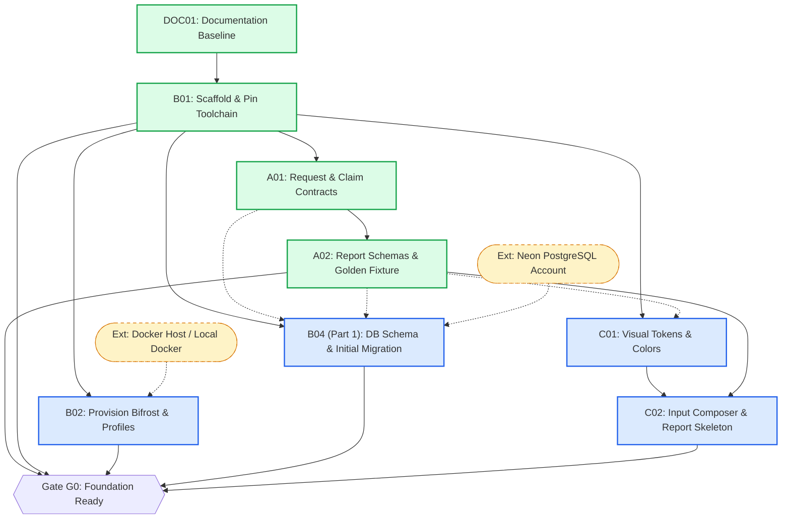
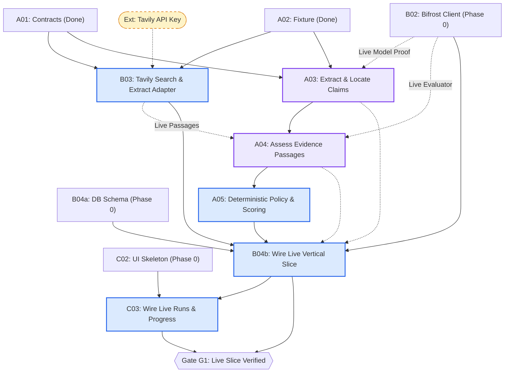
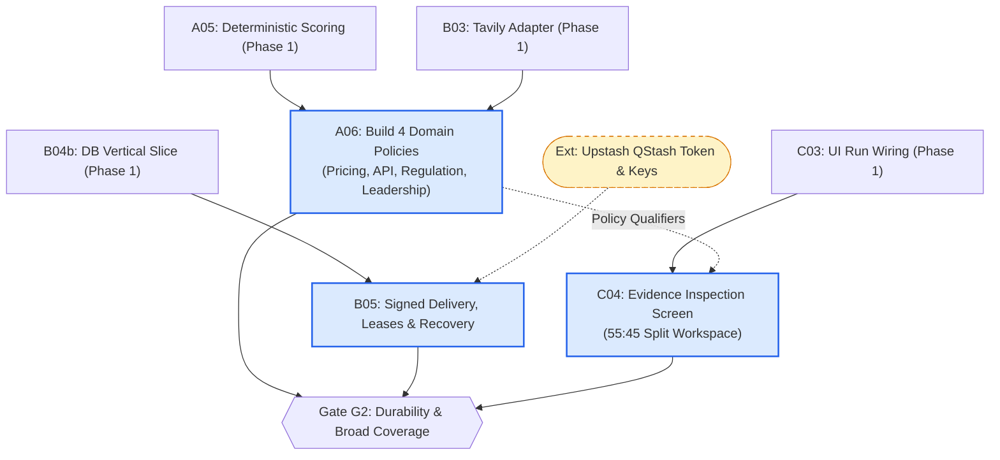
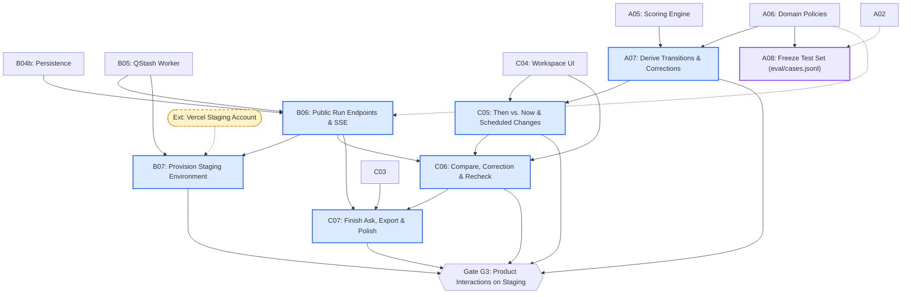
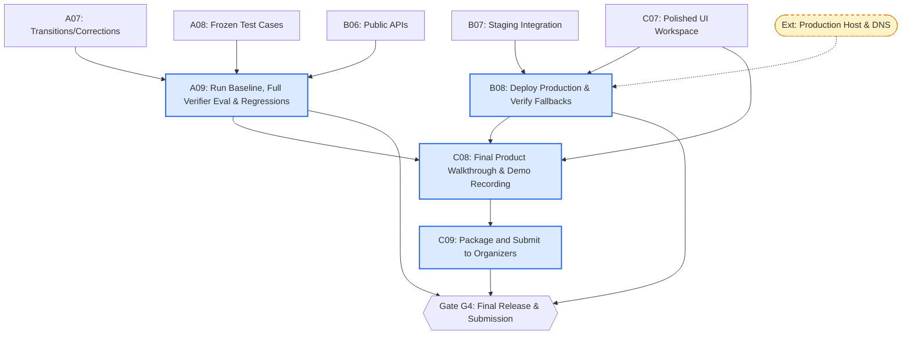

# docs/PARALLEL-WORK-PLAN.md — Parallel Execution & Dependency Map

This document establishes the **authoritative dependency architecture, parallel execution waves, cross-lane handoffs, and phase gate criteria** for **Afterfact** (working name: Stale-Answer Detector).

> [!IMPORTANT]
> **Canonical Status Rule:**  
> [docs/PHASE-TRACKER.md](PHASE-TRACKER.md) remains the **canonical source of truth** for task execution statuses (`TODO`, `IN PROGRESS`, `REVIEW`, `DONE`), assignees, and calibrated evidence logs.  
> This document is the **canonical source of truth** for dependency definitions, parallel work waves, graph topologies, and cross-lane handoff contracts.

---

## 1. Quick Orientation

Work in Afterfact is strictly partitioned into three specialized engineering lanes adapted from the **Universal Prompt Patterns Registry (UPPR) Revision 4.2**:

```
 ┌─────────────────────────────────────────────────────────────────────────────┐
 │                           THREE ACCOUNTABLE LANES                           │
 ├─────────────────────────┬─────────────────────────┬─────────────────────────┤
 │  Lane A: Verification   │    Lane B: Platform     │     Lane C: Product     │
 │  ---------------------  │    ----------------     │     ---------------     │
 │  • Public & DB Schemas  │  • Toolchain & Config   │  • Design Tokens & CSS  │
 │  • Claim Extraction     │  • Docker & Bifrost GW  │  • Split Workspace UI   │
 │  • Passage Assessment   │  • Tavily Web Adapter   │  • SSE Progress Hook    │
 │  • Date & Policy Logic  │  • Neon DB & Migrations │  • Then vs. Now Drawer  │
 │  • Benchmark Evaluation │  • QStash Job Queue     │  • Compare & Correction │
 │  • Golden Fixtures      │  • API Route Handlers   │  • Walkthrough & Demo   │
 └─────────────────────────┴─────────────────────────┴─────────────────────────┘
```

### Dependency Classification Taxonomy
Dependencies between tickets are not simple blockers; they fall into four distinct categories:

1. **Start Prerequisite ($A \longrightarrow B$):**  
   Artifact $A$ must exist in the repository before builder $B$ can perform meaningful work. (e.g., A01 request contracts must exist before A02 report contracts can import them).
2. **Integration / Completion Prerequisite ($A \dashrightarrow B$):**  
   Builder $B$ can implement core logic early using mock doubles, unit fixtures, or draft schemas, but ticket $B$ cannot be closed until $A$ is delivered. Final verification is governed strictly by the specific evidence level (E1 static, E2 unit/contract, E3 database integration, E4 staging, or E5 production) and concrete acceptance criteria declared on that ticket in [docs/PHASE-TRACKER.md](PHASE-TRACKER.md). (e.g., A03 extraction logic can be developed with unit fixtures, but requires B02 Bifrost gateway for live model integration proof).
3. **External Prerequisite ($\Diamond$):**  
   Non-ticket dependencies such as third-party provider credentials, hosting accounts, or cloud projects.
4. **Shared-File Coordination ($\asymp$):**  
   Tasks execute in parallel but edit common files (e.g., `package.json`, `src/app/globals.css`, `docs/PHASE-TRACKER.md`). This represents a coordination requirement, not a serial blocker.

### Graph Notation
In all diagrams below:
- **Solid arrows ($A \longrightarrow B$):** Start Prerequisite.
- **Dashed arrows ($A \dashrightarrow B$):** Integration / Completion Prerequisite.
- **Node text:** `[Ticket ID]: [Plain-language action]`.

---

## 2. Phase-Level & Release Gates Architecture

Project execution progresses across five phases governed by five empirical exit gates (**G0–G4**). Phases are not rigid sequential walls; tasks in Phase $N+1$ can begin in parallel as soon as their specific artifact prerequisites exist.

```mermaid
flowchart TD
    subgraph Phase0 ["Phase 0: Foundation (Target: Nov 7–8)"]
        direction TB
        P0_A["Lane A: A01 (Request/Claim) + A02 (Report/Events/Fixture)"]
        P0_B["Lane B: B01 (Scaffold/Toolchain) + B02 (Bifrost Gateway) + B04a (DB Migration Baseline)"]
        P0_C["Lane C: C01 (Design Tokens) + C02 (Workspace Skeleton)"]
    end

    subgraph Gate0 ["Gate G0: Foundation Checkpoint"]
        G0_Crit["• Shared fixture validates (ReportSchema)<br/>• App builds cleanly (next build)<br/>• Bifrost gateway smoke test succeeds<br/>• Database migration executes against Neon<br/>• Lane C renders fixture mode"]
    end

    subgraph Phase1 ["Phase 1: Live Slice (Target: Nov 8–9)"]
        direction TB
        P1_A["Lane A: A03 (Extract Claims) + A04 (Assess Passages) + A05 (Deterministic Scoring)"]
        P1_B["Lane B: B03 (Tavily Adapter) + B04b (Live Slice Vertical Wire-up)"]
        P1_C["Lane C: C03 (Wire Live Runs & Progress)"]
    end

    subgraph Gate1 ["Gate G1: Live Slice Checkpoint"]
        G1_Crit["• Normal Paste screen verifies 1 real claim<br/>• Full round-trip via Bifrost & Tavily<br/>• Claim links to exact quoted evidence excerpt<br/>• Verifier assigns deterministic score & reason"]
    end

    subgraph Phase2 ["Phase 2: Broad Coverage & Durability (Target: Nov 9–11)"]
        direction TB
        P2_A["Lane A: A06 (Pricing, API, Regulation & Leadership Policies)"]
        P2_B["Lane B: B05 (Signed QStash Jobs, Leases & Recovery)"]
        P2_C["Lane C: C04 (Split Workspace Evidence Inspection Screen)"]
    end

    subgraph Gate2 ["Gate G2: Broad Coverage & Durability Checkpoint"]
        G2_Crit["• 1 mixed answer verifies across all 4 domains<br/>• Partial results survive single claim failure<br/>• Background worker leases prevent double-commit<br/>• Page refresh restores durable run state"]
    end

    subgraph Phase3 ["Phase 3: Product Interactions & Staging (Target: Nov 11–12)"]
        direction TB
        P3_A["Lane A: A07 (Transitions & Corrections) + A08 (Freeze Test Set)"]
        P3_B["Lane B: B06 (Public API & SSE) + B07 (Staging Deployment)"]
        P3_C["Lane C: C05 (Then vs. Now) + C06 (Compare & Recheck) + C07 (Ask & Export)"]
    end

    subgraph Gate3 ["Gate G3: Product Interactions Checkpoint"]
        G3_Crit["• Ask, Compare, Then vs. Now, and Recheck functional<br/>• Scheduled change badges render on future dates<br/>• Full pipeline runs on Vercel/Neon staging<br/>• Signed webhook delivery verified over TLS"]
    end

    subgraph Phase4 ["Phase 4: Evaluation, Hardening & Submission (Target: Nov 13–15)"]
        direction TB
        P4_A["Lane A: A09 (Benchmark Evaluation & Regressions)"]
        P4_B["Lane B: B08 (Production Deployment & Fallback Verification)"]
        P4_C["Lane C: C08 (Walkthrough Recording) + C09 (Packaging & Submission)"]
    end

    subgraph Gate4 ["Gate G4: Release Candidate & Submission Checkpoint"]
        G4_Crit["• Benchmark yields false reassurance < 5%<br/>• Production candidate passes security runbook<br/>• Live judge link opens without credentials<br/>• Demo recording and documentation submitted"]
    end

    Phase0 --> Gate0
    Gate0 --> Phase1
    Phase1 --> Gate1
    Gate1 --> Phase2
    Phase2 --> Gate2
    Gate2 --> Phase3
    Phase3 --> Gate3
    Gate3 --> Phase4
    Phase4 --> Gate4
```



---

## 3. Milestone Task Dependency Graphs

### Wave 0: Foundation Graph (Phase 0)



> [!NOTE]
> **Resolution of the B04 / Gate G0 Ambiguity:**  
> In early drafts, Gate G0 listed "database migration executes" while all database work was cataloged under B04 (Phase 1). This created an apparent phase cycle.  
> As shown above, **B04a and B04b are internal planning milestones of canonical ticket B04 in [docs/PHASE-TRACKER.md](PHASE-TRACKER.md#b04-migrate-the-data-model-and-wire-the-vertical-slice), not separate or newly invented tracker tickets**:
> - **B04a (Database Baseline & DDL Migrations):** Creating Drizzle tables and executing initial migrations against Neon satisfies Gate G0.
> - **B04b (Live Vertical Slice Integration):** Wiring live search, extraction, and synchronous verification into the database satisfies Gate G1.

---

### Wave 1: First Live Claim Graph (Phase 1)



---

### Wave 2: Broad Coverage & Durability Graph (Phase 2)



---

### Wave 3: Product Interactions & Staging Graph (Phase 3)



---

### Wave 4: Evaluation, Hardening & Submission Graph (Phase 4)



---

## 4. Complete Dependency & Execution Matrix

Every implementation ticket is accounted for with strict prerequisite categorization and handoff definitions:

| ID | Title & Tracker Link | Lane | Phase | Start Prerequisites | Integration / Completion Prerequisites | External Prerequisites | What Can Start Early | Deliverable Handed to Next Consumer |
| :---: | :--- | :---: | :---: | :--- | :--- | :--- | :--- | :--- |
| **A01** | [Request & Claim Schemas](PHASE-TRACKER.md#a01-request-and-claim-schemas) | A | 0 | B01 (toolchain) | None | None | Completed | `request.ts`, `claim.ts`, `dates.ts` |
| **A02** | [Report/Event Schemas & Fixture](PHASE-TRACKER.md#a02-report-and-event-schemas) | A | 0 | A01 | None | None | Completed | `evidence.ts`, `report.ts`, `events.ts`, `golden-mixed-report.json` |
| **B01** | [Scaffold & Pin Toolchain](PHASE-TRACKER.md#b01-scaffold-and-pin-the-toolchain) | B | 0 | None | None | None | Completed | Next.js 15, pnpm 11, Node 22, ESLint, Tailwind, Vitest, Playwright, CI |
| **B02** | [Configure Bifrost & Model Profiles](PHASE-TRACKER.md#b02-provision-bifrost-and-model-profiles) | B | 0 | B01 | None | Docker host / Local Docker, Model provider keys | Client fetch wrapper & profile types | `docker-compose.yml`, `src/server/bifrost/client.ts`, `profiles.ts` |
| **C01** | [Set Visual Tokens & States](PHASE-TRACKER.md#c01-visual-tokens-and-component-states) | C | 0 | B01, A02 | None | None | Entire task | Design tokens in `globals.css`, button/card states, reduced motion |
| **C02** | [Input & Report Skeleton](PHASE-TRACKER.md#c02-input-and-report-skeleton) | C | 0 | C01, A02 | None | None | Entire task (renders golden fixture) | `InputComposer.tsx`, `ContextFields.tsx`, `ReportSkeleton.tsx` |
| **B04a**| [DB Baseline & Migrations](PHASE-TRACKER.md#b04-migrate-the-data-model-and-wire-the-vertical-slice) | B | 0 | B01, A01, A02 | None | Neon PostgreSQL account (`DATABASE_URL`, `DATABASE_MIGRATION_URL`) | Drizzle schema files | Drizzle tables (`runs`, `claims`, `evidence`, `events`, `jobs`), executed initial migration |
| **A03** | [Extract & Locate Atomic Claims](PHASE-TRACKER.md#a03-extract-and-locate-atomic-claims) | A | 1 | A01, A02 | B02 (Bifrost model profiles) | Model provider credentials | Sentence splitting, span math, extraction prompt, unit fixture tests | `extract-claims.ts`, extraction prompt, span resolver |
| **A04** | [Assess Passages Against a Claim](PHASE-TRACKER.md#a04-assess-passages-against-a-claim) | A | 1 | A01, A02 | A03, B02, B03 (Tavily passages) | Model provider credentials | Evaluator prompt, quote verification logic, unit tests with mocked passages | `assess-evidence.ts`, evaluator prompt |
| **A05** | [Apply Deterministic Policy & Score](PHASE-TRACKER.md#a05-apply-deterministic-policy-and-score) | A | 1 | A04 | None (pure deterministic TypeScript) | None | Precedence decision tree, date comparator, reason code registry | `decide.ts`, scoring heuristic rules |
| **B03** | [Tavily Search & Extract Adapter](PHASE-TRACKER.md#b03-search-extract-and-evidence-capture) | B | 1 | A01, A02 | None | Tavily API Key (`TAVILY_API_KEY`) | REST client implementation, query generation templates | `tavily/client.ts`, `tavily/queries.ts` |
| **B04b**| [Wire Live Vertical Slice](PHASE-TRACKER.md#b04-migrate-the-data-model-and-wire-the-vertical-slice) | B | 1 | B04a, B02, B03, A05 | None | None | Wire synchronous run pipeline with mock verifier | Synchronous verification entry point, end-to-end run persistence |
| **C03** | [Wire Real Runs & Progress](PHASE-TRACKER.md#c03-wire-real-runs-and-progress) | C | 1 | C02, B04b | B06 (for final SSE streaming) | None | Client state hook (`useRun.ts`), submission flow, polling fallback | `useRun.ts`, progress indicator components |
| **A06** | [Build 4 Domain Policies](PHASE-TRACKER.md#a06-build-pricing-api-regulation-and-leadership-policies) | A | 2 | A05, B03 | None | None | Policy interface, qualifier schemas, query templates | `pricing.ts`, `api.ts`, `regulation.ts`, `leadership.ts` |
| **B05** | [Signed Delivery, Leases & Recovery](PHASE-TRACKER.md#b05-implement-signed-delivery-leases-and-recovery) | B | 2 | B04b | None | Upstash QStash token & signing keys | Job enqueue helper, lease-locking SQL queries | `src/server/jobs/worker.ts`, `/api/internal/jobs`, sweeper |
| **C04** | [Evidence Inspection Screen](PHASE-TRACKER.md#c04-implement-evidence-inspection-screen) | C | 2 | C03, A02 | None | None | 55:45 split layout, claim markers, evidence cards using golden fixture | `ClaimMarker.tsx`, `VerdictChip.tsx`, `EvidenceCard.tsx` |
| **A07** | [Derive Transitions & Corrections](PHASE-TRACKER.md#a07-derive-transitions-and-validate-corrections) | A | 3 | A05, A06 | None | None | Timeline data structures, surgical diff evaluation logic | `transition.ts`, `correction.ts` |
| **A08** | [Freeze Test Set Before Tuning](PHASE-TRACKER.md#a08-freeze-the-test-set-before-tuning) | A | 3 | A02 | A06 (domain policies finalize gold labels) | None | Curating raw candidate claims, context pairs, source URLs | `eval/cases.jsonl` (30 ground-truth claims) |
| **B06** | [Public Run Endpoints & SSE](PHASE-TRACKER.md#b06-implement-the-public-run-endpoints) | B | 3 | B04b, B05, A06 | None | None | Route handler skeletons, anonymous cookie hashing | `/api/verify`, `/runs/[id]`, `/events`, `/compare`, `/recheck` |
| **B07** | [Provision Staging Integrations](PHASE-TRACKER.md#b07-provision-staging-with-real-integrations) | B | 3 | B05, B06 | None | Vercel staging project, Neon branch, QStash webhook endpoint | Create cloud projects, configure environment variables | Staging deployment URL, TLS webhook verification |
| **C05** | [Then vs. Now & Scheduled Changes](PHASE-TRACKER.md#c05-implement-then-vs-now-and-scheduled-changes) | C | 3 | C04, A07 | None | None | Timeline UI cards, scheduled change badge rendering | `ChangeTimeline.tsx`, `ScheduledChangeBadge.tsx` |
| **C06** | [Compare, Correction & Recheck](PHASE-TRACKER.md#c06-implement-compare-correction-and-recheck) | C | 3 | C04, C05, B06 | None | None | Side-by-side drawer UI, inline word-level diff component | `CompareDrawer.tsx`, `CorrectionDiff.tsx` |
| **C07** | [Finish Ask, Export & Polish](PHASE-TRACKER.md#c07-finish-ask-export-and-polish) | C | 3 | B06, C03–C06 | None | None | Export Markdown/JSON formatters, token trace drawer | `AskFlow.tsx`, `ExportReport.tsx`, `TraceViewer.tsx` |
| **A09** | [Run Benchmark & Regressions](PHASE-TRACKER.md#a09-run-baseline-full-pipeline-and-regressions) | A | 4 | A07, A08, B06 | None | Live model & search credits | Eval runner script, metric calculations | Benchmark report, latency traces, accuracy metrics |
| **B08** | [Deploy Production & Fallbacks](PHASE-TRACKER.md#b08-deploy-production-and-verify-fallbacks) | B | 4 | B07, C07 | None | Production Vercel domain, HTTPS proxy for Bifrost | Production environment audit, SSH tunnel setup | Live production URL, provider fallback verification |
| **C08** | [Final Walkthrough & Recording](PHASE-TRACKER.md#c08-run-the-final-product-walkthrough) | C | 4 | C07, B08, A09 | None | Screen recording software | Script authoring, slide deck, demo outline | `public/demo.mp4`, walkthrough runbook |
| **C09** | [Package and Submit](PHASE-TRACKER.md#c09-package-and-submit) | C | 4 | C08 | None | Organizer submission portal access | Final README review, license verification | Submission receipt, final release commit tag |

---

## 5. Parallel Work Waves

### Wave 0: Foundation (Day 1 · Gate G0)
- **Lane A Work:** Deliver A01 (request/claim schemas) and A02 (report/event schemas, golden fixture). *(Complete in branch review)*.
- **Lane B Work:** Deliver B01 (toolchain scaffold, test runners, CI). *(Complete in branch review)*. B02 (Bifrost gateway), B03 (Tavily adapter), and B04a (Neon database baseline) become available workstreams.
- **Lane C Work:** Start C01 (visual design tokens) and C02 (workspace UI skeleton rendering golden fixture in `[REPLAY MODE]`).
- **Shared Inputs:** [fixtures/golden-mixed-report.json](file:///C:/Users/Mayur/Desktop/Afterfact/fixtures/golden-mixed-report.json).
- **Exit Evidence:** Gate G0 passed: App builds, fixture validates, Bifrost container responds, database migration executes, C renders fixture mode.

> [!IMPORTANT]
> **Lane B Available Workstreams vs. Developer Allocation:**
>
> B02 (Bifrost Gateway), B03 (Tavily Adapter), and B04a (Database Baseline & Migrations) represent **three concurrently available workstreams**, not an expectation that a single developer must execute all three simultaneously.
> - **If multiple builders or agents work on Lane B:** Assign one accountable owner per concurrent workstream and isolate their checkouts using separate working directories (e.g., via `git worktree`).
> - **If a single builder executes Lane B:** Sequence them logically: B02 (Model Gateway) $\longrightarrow$ B03 (Tavily Client) $\longrightarrow$ B04a (Database Baseline).

### Wave 1: First Live Claim / Live Slice (Day 2 · Gate G1)
- **Lane A Work:** Implement A03 (claim extraction prompt & spans), A04 (passage relevance assessment), and A05 (deterministic scoring & decision tree).
- **Lane B Work:** Implement B03 (Tavily search & extract adapter) and B04b (wire synchronous live verification slice into Neon DB).
- **Lane C Work:** Implement C03 (submit button, run state management, polling live runs).
- **Shared Inputs:** `AtomicClaimSpecSchema`, `EvidenceItemSchema`, `decide.ts`.
- **Exit Evidence:** Gate G1 passed: Pasting an answer verifies one real claim end-to-end through Tavily and Bifrost, displaying an exact clickable excerpt on the screen.

### Wave 2: Multi-Claim Durability & Broad Coverage (Days 3–4 · Gate G2)
- **Lane A Work:** Implement A06 (Pricing, API, Regulation, and Leadership domain policies with qualifier rules).
- **Lane B Work:** Implement B05 (QStash signed webhook delivery, lease-locking, outbox worker, and recovery sweeper).
- **Lane C Work:** Implement C04 (55:45 split desktop workspace, responsive mobile sheet, interactive claim cards).
- **Shared Inputs:** `PolicyModule` interface, QStash webhook payload schemas.
- **Exit Evidence:** Gate G2 passed: One mixed paragraph verifying all 4 domains completes via background QStash workers; partial results survive worker failure and page refresh.

### Wave 3: Differentiating Interactions & Staging (Days 4–5 · Gate G3)
- **Lane A Work:** Implement A07 (chronological timeline derivation and surgical correction diffs) and A08 (freeze `eval/cases.jsonl` benchmark suite).
- **Lane B Work:** Implement B06 (public API endpoints for compare/recheck and SSE stream) and B07 (provision Vercel/Neon staging).
- **Lane C Work:** Implement C05 (Then vs. Now timeline & scheduled change badges), C06 (context comparison drawer & correction diff), and C07 (Ask tab & JSON/Markdown report export).
- **Shared Inputs:** `TimelineEntrySchema`, `CorrectionSchema`, `/api/runs/[id]/compare`.
- **Exit Evidence:** Gate G3 passed: Staging deployment successfully executes Ask flows, Then vs. Now transitions, side-by-side context comparisons, and live rechecks.

### Wave 4: Evaluation, Hardening & Submission (Days 6–7 · Gate G4)
- **Lane A Work:** Execute A09 (run baseline and full pipeline evaluation, report accuracy and false reassurance metrics).
- **Lane B Work:** Execute B08 (deploy production Vercel app, secure Bifrost behind HTTPS, test provider fallback failover).
- **Lane C Work:** Execute C08 (record 3-minute video walkthrough) and C09 (package submission assets, test judge links, submit).
- **Shared Inputs:** Benchmark dataset, staging URL, production deployment URL.
- **Exit Evidence:** Gate G4 passed: Production link accessible without login, false reassurance < 5%, video uploaded, submission confirmation recorded.

---

## 6. Current Ready-to-Start Snapshot

**Snapshot Date:** November 8, 2026 IST  
**Reference Commit:** [`07c0252`](https://github.com/Driftaxe/Afterfact/commit/07c0252) on `feat/b01-scaffold`

*(Note: Lane B unblocked items B02, B03, and B04a represent available workstreams, not a requirement for one engineer to execute all three at once. Separate checkouts/worktrees are required for concurrent execution).*

```
 ┌─────────────────────────────────────────────────────────────────────────────┐
 │                         IMMEDIATE READINESS STATUS                          │
 ├──────────────────────────────────────────┬──────────────────────────────────┤
 │ Ready to Start Immediately (Unblocked):  │ Awaiting Prerequisites:          │
 │ • Lane B: B02 (Bifrost Gateway & Client) │ • A06, A07, A09 (Lane A)         │
 │ • Lane B: B03 (Tavily Search Adapter)    │ • B05, B06, B07, B08 (Lane B)    │
 │ • Lane B: B04a (DB Schema & Migration)   │ • C04, C05, C06, C07, C08, C09   │
 │ • Lane C: C01 (Visual Design Tokens)     │   (Lane C)                       │
 │ • Lane C: C02 (Input & Report Skeleton)  │                                  │
 ├──────────────────────────────────────────┼──────────────────────────────────┤
 │ Ready to Start Partially (Mock-Enabled): │ Existing Work Awaiting PR Merge: │
 │ • Lane A: A03 (Extraction Logic)         │ • Lane A: A01 (Request & Claim)  │
 │ • Lane A: A04 (Passage Scoring Prompts)  │ • Lane A: A02 (Report & Events)  │
 │ • Lane A: A05 (Deterministic Scoring)    │ • Lane B: B01 (Scaffold & CI)    │
 │ • Lane A: A08 (Curating Benchmark Cases) │                                  │
 └──────────────────────────────────────────┴──────────────────────────────────┘
```

---

## 7. Interface & Ownership Handoffs

To prevent integration bugs, boundaries between lanes are mediated by strict contracts:

| Producer | Consumer | Interface Artifact | Contract Authority | Availability Point | Verification Requirement |
| :--- | :--- | :--- | :--- | :---: | :--- |
| **B (B02)** | **A (A03, A04)** | `src/server/bifrost/client.ts` | [docs/ARCHITECTURE.md](ARCHITECTURE.md#2-service-boundaries--hosting-topology) | End of Phase 0 | Mock model profile returns typed JSON; error maps to typed failure. |
| **B (B03)** | **A (A04)** | `src/server/tavily/client.ts` | [src/lib/contracts/evidence.ts](file:///C:/Users/Mayur/Desktop/Afterfact/src/lib/contracts/evidence.ts) | Wave 1 | Returns `EvidenceItem[]` with valid HTTP URLs, passages, and UTC dates. |
| **A (A05)** | **B (B04b, B05)**| `src/server/verify/decide.ts` | [src/lib/contracts/report.ts](file:///C:/Users/Mayur/Desktop/Afterfact/src/lib/contracts/report.ts) | Wave 1 | Returns `AssessedClaimResult` obeying verdict score rubric (100, 75, 0, null). |
| **A (A02)** | **C (C01–C04)** | `fixtures/golden-mixed-report.json`| [src/lib/contracts/report.ts](file:///C:/Users/Mayur/Desktop/Afterfact/src/lib/contracts/report.ts) | **Available Now** | `ReportSchema.parse(fixture)` succeeds without Zod errors. |
| **B (B06)** | **C (C03)** | `GET /api/runs/[id]/events` | [src/lib/contracts/events.ts](file:///C:/Users/Mayur/Desktop/Afterfact/src/lib/contracts/events.ts) | Wave 3 | Emits sequenced SSE stream replayable via `Last-Event-ID` or `afterSeq`. |
| **A (A09)** | **All (C09)** | `docs/BENCHMARK-RESULTS.md` | [docs/TESTING-AND-EVALUATION.md](TESTING-AND-EVALUATION.md#2-benchmark-design--paired-evaluation) | Wave 4 | Paired accuracy, false reassurance < 5%, decisive coverage > 80%. |

---

## 8. Shared-File Coordination & Multi-Agent Safety Rules

When multiple builders or autonomous coding agents work simultaneously, file overlaps create conflict hazards:

### Critical Shared Files

1. **`package.json` & `pnpm-lock.yaml`:**
   - *Risk:* Concurrent package additions cause lockfile merge conflicts.
   - *Protocol:* Only **Lane B (Platform)** is authorized to add dependencies or run `pnpm add`. If Lane A or C requires a dependency, request it via ticket issue before touching the manifest.
2. **`src/lib/contracts/*`:**
   - *Risk:* Breaking schema changes invalidate in-flight database rows and frontend components.
   - *Protocol:* Owned by **Lane A (Verification)**. Any change to exported schemas requires a deprecation warning and approval from Lanes B and C.
3. **`src/app/globals.css` & `tailwind.config.ts`:**
   - *Risk:* Conflicting CSS rules break layout across views.
   - *Protocol:* Owned by **Lane C (Product)** after B01 scaffolding. Lane A and B must not alter styling tokens.
4. **`docs/PHASE-TRACKER.md`:**
   - *Risk:* Concurrent status updates cause git push rejections.
   - *Protocol:* Edit only your assigned ticket section. Never alter another builder's ticket status or evidence logs.

> [!CAUTION]
> **Working Directory Isolation for Autonomous Agents:**  
> Git branches alone **do not** isolate file systems on a local machine. Multiple autonomous agents must **never** edit the same physical repository checkout concurrently. Parallel agents must operate in dedicated `git worktree` directories or work sequentially through agreed pull requests.

---

## 9. Milestone Dependency Chains

### Dependency Chain to Gate G1 (First Real Claim Verified)
The shortest path to the first live claim requires unblocking the live slice:

$$\text{B01 (Done)} \longrightarrow \begin{cases} \text{B02 (Bifrost Gateway)} \\ \text{B03 (Tavily Adapter)} \\ \text{B04a (DB Baseline)} \end{cases} \longrightarrow \text{A03} \longrightarrow \text{A04} \longrightarrow \text{A05} \longrightarrow \text{B04b} \longrightarrow \text{C03} \longrightarrow \mathbf{Gate\ G1}$$

### Dependency Chain to Gate G4 (Final Release & Submission)
Following Gate G1, the dependency chain to release proceeds through broad policies and staging:

$$\mathbf{G1} \longrightarrow \begin{cases} \text{A06 (4 Policies)} \\ \text{B05 (QStash Leases)} \\ \text{C04 (Split Workspace)} \end{cases} \longrightarrow \mathbf{G2} \longrightarrow \begin{cases} \text{A07 + A08} \\ \text{B06 + B07 (Staging)} \\ \text{C05 + C06 + C07} \end{cases} \longrightarrow \mathbf{G3} \longrightarrow \begin{cases} \text{A09 (Benchmark)} \\ \text{B08 (Production)} \\ \text{C08 (Recording)} \end{cases} \longrightarrow \text{C09} \longrightarrow \mathbf{Gate\ G4}$$

---

## 10. Document Maintenance Protocol

To ensure documentation integrity over the lifecycle of the project:
1. **Coupled Tracker Updates:** Whenever a ticket's prerequisites or interfaces change, update both [docs/PHASE-TRACKER.md](PHASE-TRACKER.md) and this document in the same pull request.
2. **No Invented IDs:** Never create intermediate sub-ticket IDs (e.g., "A03.5"). B04a and B04b are internal planning milestones of canonical ticket B04 in [docs/PHASE-TRACKER.md](PHASE-TRACKER.md#b04-migrate-the-data-model-and-wire-the-vertical-slice), not separate tracker tickets.
3. **Evidence Precedence:** Theoretical readiness never overrides observed evidence. Ticket closure requires the specific evidence tier (E1 static, E2 unit/contract, E3 integration, E4 staging, or E5 production) and concrete acceptance criteria specified in each ticket's tracker entry, rather than an arbitrary blanket gate.
