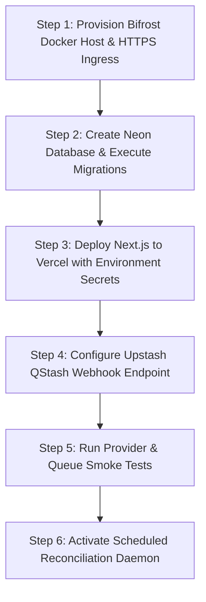

# docs/SETUP-AND-DEPLOYMENT.md — Environment, Provisioning & Deployment

This document describes the environment topology, configuration settings, migration order, and operational runbooks for **Afterfact** (working name: Stale-Answer Detector).

> [!WARNING]
> **Secret Safety (P28):** Never commit actual secret keys or credentials to version control. This document lists environment variable keys and topologies only.

---

## 1. Environment Topology & Infrastructure Matrix

| Environment | Next.js Hosting | Database (Postgres) | Model Gateway | Queue Broker | Web Retrieval |
| :--- | :--- | :--- | :--- | :--- | :--- |
| **Local Dev** | `localhost:3000` (Node 22) | Neon Local Branch / Docker PG | Docker (`127.0.0.1:8080`) | QStash via Local Tunnel / Synchronous G1 dev fallback | Tavily API |
| **Staging** | Vercel Staging Alias | Neon Staging Branch | Dedicated Docker Host (HTTPS) | Upstash QStash (Staging topic) | Tavily API |
| **Production** | Vercel Production | Neon Production Database | Dedicated Docker Host (HTTPS) | Upstash QStash (Production topic) | Tavily API |

---

## 2. Environment Variables Inventory

### Next.js Application Server
```bash
# Public Base URL
APP_BASE_URL=https://afterfact.dev

# Neon Database Connections
DATABASE_URL=postgres://...           # Pooled connection string (PgBouncer) for serverless app
DATABASE_MIGRATION_URL=postgres://... # Direct connection string for Drizzle DDL migrations

# Web Intelligence
TAVILY_API_KEY=tvly-...               # Tavily search and raw passage extraction key

# Model Gateway (Bifrost)
BIFROST_BASE_URL=https://gateway.internal.afterfact.dev
BIFROST_GATEWAY_TOKEN=bf_gw_...       # Bearer token for inference route authentication
BIFROST_EXTRACT_MODEL=...             # Profile name for claim extraction
BIFROST_ASSESS_MODEL=...              # Profile name for passage assessment
BIFROST_DRAFT_MODEL=...               # Profile name for Ask drafting
BIFROST_ASSESS_FALLBACK=...           # Secondary fallback model profile

# Queue & Webhook Verification
QSTASH_TOKEN=qstash_...               # Token for server-side job publishing
QSTASH_CURRENT_SIGNING_KEY=sig_...    # Primary key to verify incoming webhook signatures
QSTASH_NEXT_SIGNING_KEY=sig_...       # Secondary key for seamless key rotation
```

### Bifrost Docker Host Configuration
```bash
# Model Provider Secrets (Stored only on Docker Host)
OPENAI_API_KEY=...
ANTHROPIC_API_KEY=...
GROQ_API_KEY=...

# Host Ingress & Security
PORT=8080
BIND_ADDRESS=127.0.0.1                # Bound to localhost; exposed via Caddy/Nginx reverse proxy
BIFROST_API_KEY=bf_gw_...             # Required Bearer token on /v1/*
DISABLE_CONTENT_LOGGING=true          # Content logging disabled in production for user privacy
```

---

## 3. Provisioning & Deployment Sequence

Execute all infrastructure rollouts in this strict chronological order:



### Step 1: Provision and Secure Bifrost Gateway
1. Launch an Ubuntu 24.04 Docker host.
2. Configure Docker Compose to run the official Bifrost container bound to `127.0.0.1:8080`.
3. Configure Caddy or Nginx with Let's Encrypt SSL, proxying `https://gateway.internal.afterfact.dev/v1/*` to `127.0.0.1:8080`.
4. Ensure the Bifrost admin UI and dashboard remain bound to `127.0.0.1` and are accessible **only via SSH port-forwarding**.
5. Configure primary model profiles and a verified fallback model provider.

### Step 2: Database Provisioning & Migration
1. Provision a Neon PostgreSQL project.
2. Obtain both the connection-pooled URL (`DATABASE_URL`) and the direct URL (`DATABASE_MIGRATION_URL`).
3. Run Drizzle migration command:
   ```bash
   pnpm db:migrate
   ```

### Step 3: Deploy Next.js to Vercel
1. Link GitHub repository to Vercel.
2. Populate environment variables in Vercel project settings.
3. If Vercel Deployment Protection is active, configure a bypass token for QStash webhook ingress.

### Step 4: Configure Upstash QStash
1. In the Upstash console, set up the QStash project.
2. Note `QSTASH_CURRENT_SIGNING_KEY` and set webhook target to `${APP_BASE_URL}/api/internal/jobs`.
3. Set default retry policy to 3 attempts with exponential backoff.

### Step 5: Smoke Testing Entry Points
Before routing user traffic, run end-to-end smoke verification:
```bash
# Check Bifrost gateway health and model availability
curl -H "Authorization: Bearer ${BIFROST_GATEWAY_TOKEN}" ${BIFROST_BASE_URL}/v1/models

# Check Tavily search API
curl -X POST https://api.tavily.com/search -H "Authorization: Bearer ${TAVILY_API_KEY}" -d '{"query":"test"}'
```

---

## 4. Rollback and Disaster Recovery

1. **Vercel Rollback:**  
   Vercel allows instant 1-click redeployment of previous immutable deployment artifacts. All database migrations must maintain backwards compatibility (P16: additive columns only) so earlier application builds can query the current database schema without crashing.
2. **Database Point-in-Time Recovery:**  
   Neon supports instant branching and point-in-time recovery. In the event of catastrophic data corruption, restore from a point-in-time branch within the 24-hour retention window.
3. **Queue Drain:**  
   If an unhandled bug causes poison-pill jobs in QStash, purge the pending queue topic via the Upstash CLI/dashboard and trigger `/api/internal/reconcile` to mark pending jobs as failed.
