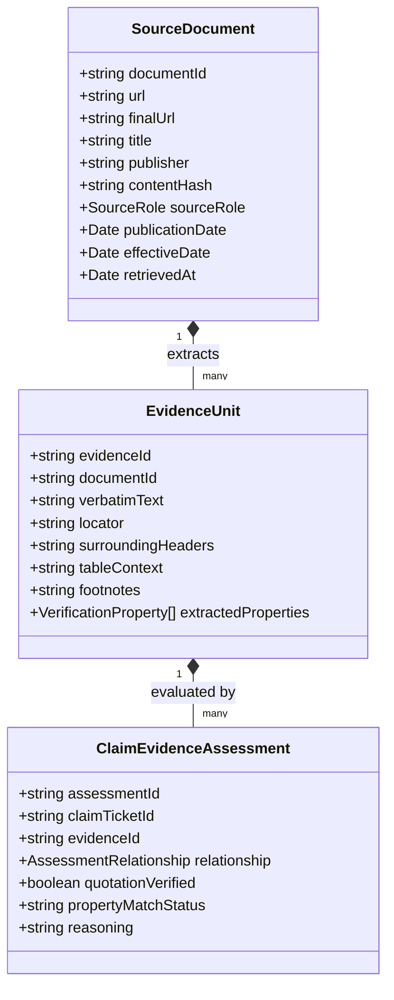
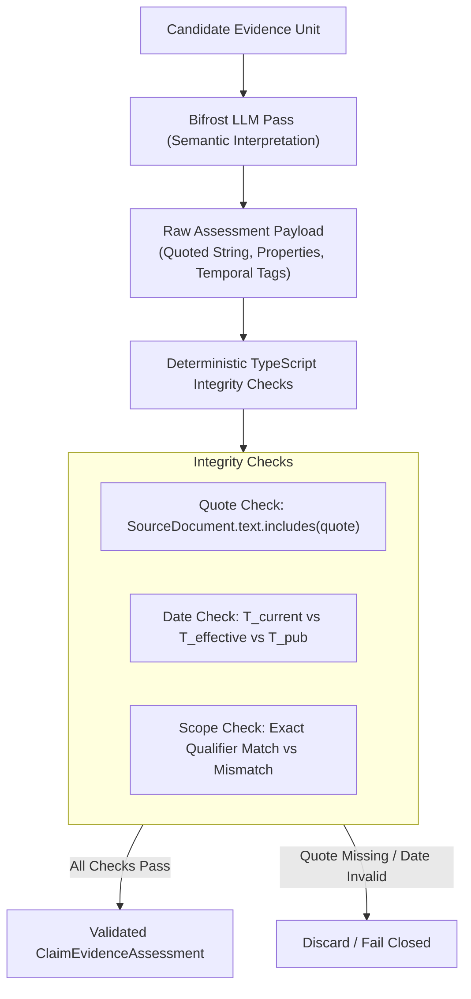
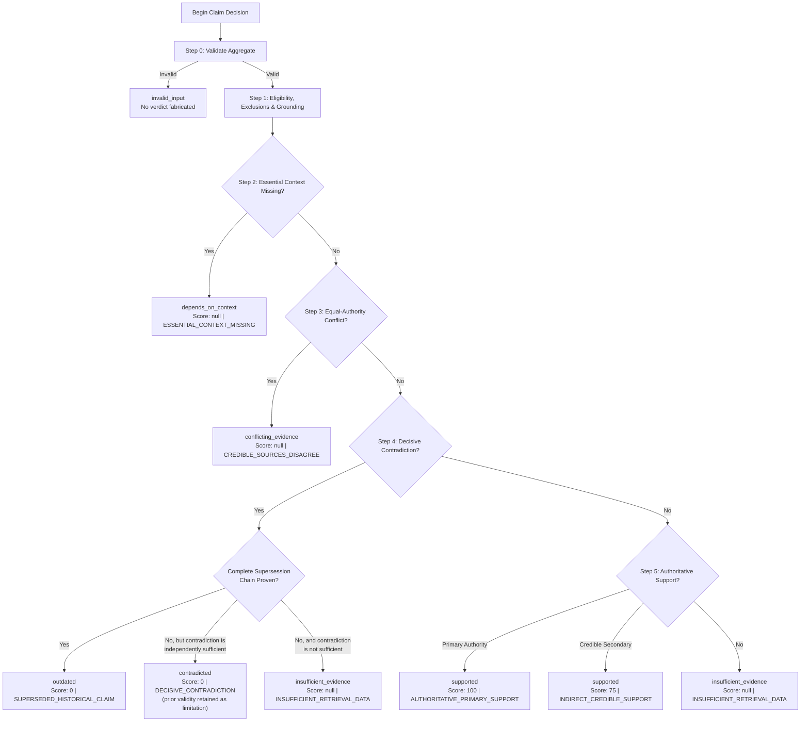

# docs/VERIFICATION.md — Verification Engine, Evidence Architecture & Decision Gates

This document specifies the algorithmic, date resolution, preparation, research planning, evidence extraction, dynamic clarification, and scoring rules for the **Afterfact** (working name: Stale-Answer Detector) verification engine. All claim analysis is strictly grounded in empirical web evidence and deterministic TypeScript logic rather than probabilistic LLM guesswork.

> [!NOTE]
> All schemas, interfaces, and algorithms defined below represent planned architectural specifications. Shared contracts in `src/lib/contracts/` govern implementation across server services, workers, and UI components.

---

## 1. Universal Claim Ticket & Variable Typed Property Context

Verification evaluates discrete, atomic factual statements. Rather than using an unstructured text string or a rigid, domain-specific database column schema, the engine represents claims via a **Universal Claim Ticket** carrying a collection of variable, strongly typed context properties.

### A. Conceptual Model: `ClaimTicket`
The `ClaimTicket` extends the foundational `ClaimSpec` contract to support iterative revision, context evolution, and multi-round verification:

```typescript
export interface ClaimTicket {
  ticketId: string;                 // Stable unique identifier (e.g. "tkt_01j98ab7...")
  claimId: string;                  // Parent claim entity reference (e.g. "clm_01j98...")
  runId: string;                    // Associated run identifier
  inputHash: string;                // SHA-256 of original source text statement
  revision: number;                 // Monotonically increasing revision counter (starts at 1)
  originalStatement: string;        // Verbatim extracted sentence or clause
  sourceSpan: {                     // Exact UTF-16 character offsets in the input text
    start: number;
    end: number;
  };
  normalizedProposition: string;    // Disambiguated proposition for web verification
  targetTime: string;               // ISO 8601 evaluation timestamp or date (YYYY-MM-DD)
  verificationContext: VerificationProperty[]; // Strongly typed context properties
}
```

### B. Strongly Typed `VerificationProperty`
Context properties represent the factual qualifiers governing when, where, and under what conditions a claim is asserted to be true (e.g., jurisdiction, subscription tier, billing cycle, SDK version, effective date).

```typescript
export type PropertyType = 'string' | 'number' | 'boolean' | 'date' | 'selection' | 'string_list';

export interface VerificationProperty {
  key: string;                      // Stable qualifier identifier (e.g. "jurisdiction", "subscriptionTier")
  label: string;                    // Human-readable label for UI rendering (e.g. "Geographic Jurisdiction")
  propertyType: PropertyType;       // Discriminated primitive type
  value: string | number | boolean | string[] | null; // Typed value matching propertyType
  units?: string;                   // Optional unit (e.g. "USD", "seats", "requests/min")
  origin:                           // Mutually exclusive provenance category
    | 'explicit_claim_text'         // Extracted directly from input text (has sourceSpan)
    | 'user_target_context'         // Supplied or overridden by user during input/review
    | 'model_inferred'              // Suggested by model during preparation, pending confirmation
    | 'unknown';                    // Material qualifier currently undetermined
  sourceSpan?: {                    // UTF-16 character offsets if origin is 'explicit_claim_text'
    start: number;
    end: number;
  };
  status:                           // Operational lifecycle state
    | 'confirmed'                   // Verified by user or locked by explicit claim text
    | 'pending_review'              // Suggested by extraction pass, awaits user confirmation
    | 'clarification_needed'        // Ambiguity discovered that materially impacts verdict
    | 'system_default';             // Inferred from global run configuration
  applicability:                    // Scope boundary
    | 'claim_level'                 // Governs this specific claim ticket only
    | 'run_level';                  // Inherited across all claims in the parent run
}
```

> [!NOTE]
> **Date Precision Preservation:** Properties with `propertyType: 'date'` support complete ISO calendar dates (`YYYY-MM-DD`), year-month partial dates (`YYYY-MM`), or year partial dates (`YYYY`) validated via `isValidCalendarDateOrPartial()`. Precision is preserved verbatim without artificial midnight or day padding (`-01-01`).

### C. Domain Extensibility & Novel Domain Invariants
- **Pre-Known Domains:** Specialized domain modules (Pricing, APIs, Regulations, Leadership) define property catalogs (e.g., `billingCommitment`, `sdkLanguage`, `regulatoryBody`).
- **Novel Domains:** When claims fall outside pre-known domains, the extraction pass proposes novel properties conforming to the identical `VerificationProperty` meta-schema. Novel domains **never** require database DDL schema migrations, hardcoded TypeScript classes, or dynamic client-side JSX execution.
- **Scope Precedence Invariant:**
  $$\text{Explicit Claim Qualifier} \succ \text{User Target Context} \succ \text{Model Suggestion} \succ \text{Default}$$
  An explicit qualifier extracted directly from the claim text (e.g., *"In the UK, Stripe charges 1.4%..."* $\implies$ `jurisdiction: 'UK'`) is permanently anchored to that claim. It is **never** overwritten or overridden by user-supplied target context. User-provided target context applies strictly to fill in open or unspecified qualifiers.
- **Inference Invariant:** A `model_inferred` property is **never** silently promoted to established fact without user confirmation or empirical evidence corroboration.

---

## 2. Verification Context vs. Search Context

The verification engine maintains a strict separation between what is being verified and how information is retrieved:

```mermaid
flowchart LR
    subgraph ClaimScope ["Verification Context (Truth Boundary)"]
        VC1["Explicit Qualifiers (jurisdiction=UK)"]
        VC2["Target Time (2026-11-08)"]
        VC3["Required Property Matches"]
    end

    subgraph SearchScope ["Search Context (Retrieval Boundary)"]
        SC1["Keyword Queries & Entity Aliases"]
        SC2["Target Domain Whitelists (gov.uk, stripe.com)"]
        SC3["Counterevidence Search Terms"]
    end

    ClaimScope -->|Deterministic Projection| SearchScope
    SearchScope -->|Web Intelligence| RawDocs["Source Documents"]
    RawDocs -->|Context-Preserving Extraction| Evidence["Evidence Units"]
    Evidence -->|Assess against Verification Context| Verdict["Verified Verdict"]
```



### A. Projection Rules
- **Verification Context:** Defines the exact logical conditions under which the claim must be judged true or false. It enforces constraints that retrieved passages *must satisfy* to grant direct support.
- **Search Context:** A derived projection of the verification context into search queries, expanding synonyms, entity aliases, vendor naming shifts (e.g., "Twitter" $\to$ "X (formerly Twitter)"), and trusted domain filters.
- Run-level context properties (e.g. `targetDate`) propagate to search queries across all claims, while claim-level properties (e.g. `currency: 'GBP'`) restrict search terms and filtering for that specific claim only.

### B. Invalidation & Revision Rules
- If a user modifies a verification context property or answers a clarification prompt, a new `ClaimTicket` revision ($R_{n+1}$) is generated.
- Downstream artifacts for that specific claim branch—including the active `ResearchPlan`, retrieved `SourceDocument` references, extracted `EvidenceUnit` items, semantic assessments, and `DecisionRecord`—are immediately marked **invalidated**.
- Sibling claim branches remain completely untouched and continue executing without interruption.

### C. Dynamic Clarification Forms & Bounded Protocol
When claim ambiguity materially threatens verification accuracy, the system engages the dynamic clarification protocol.
- **Approved primitive field types:**
  - `select` (single-select from bounded string options)
  - `short text` (single-line string, max 60 characters)
  - `date` (ISO 8601 calendar date `YYYY-MM-DD`)
  - `number` (bounded numeric value with optional units)
  - `boolean` (true / false toggle)
- Clarifications provide pure structured data to a generic, accessible form renderer. The model is strictly prohibited from returning executable JSX, client scripts, or arbitrary validation code.
- Clarification questions always include `allowUnknown: true` and are bounded to at most **2 rounds** before proceeding with `depends_on_context` (`score: null`, `reasonCode: ESSENTIAL_CONTEXT_MISSING`).

---

## 3. Structured Research Planning

Verification does not perform ad-hoc keyword searches. Every research phase begins with an explicit, auditable **`ResearchPlan`**.

### A. `ResearchPlan` Interface
```typescript
export interface ResearchPlan {
  planId: string;                   // Plan identifier (e.g. "plan_01j98ab7...")
  claimTicketId: string;            // Bound claim ticket ID and revision
  round: number;                    // Research round (1 or 2)
  queries: PlannedQuery[];          // Ordered collection of planned search operations
  materialUnknownQualifiers: string[]; // Properties targeted for discovery (e.g. ["effectiveDate"])
  stoppingConditions: string[];     // Explicit termination rules (e.g. "Conclusive primary vendor docs found")
}

export interface PlannedQuery {
  query: string;                    // Exact query string sent to search provider
  purpose:                          // Explicit epistemic role
    | 'establish_current_state'     // Discover currently active value, version, or policy
    | 'investigate_exceptions_or_scope' // Discover regional, tier, or edge-case variations
    | 'seek_counterevidence'        // Explicitly search for deprecation, disputes, or contradiction
    | 'establish_historical_state_or_transition'; // Locate past validity dates or transition events
  targetSourceRoles: SourceRole[];  // Desired authority tiers
}

export type SourceRole =
  | 'primary_authority'             // Official vendor docs, pricing catalogs, statutory registers
  | 'regulatory_filing'             // SEC 8-K/10-K, EUR-Lex gazette, court opinions
  | 'official_changelog'            // Release notes, GitHub releases, API deprecation logs
  | 'reputable_secondary'           // Major news outlets (Reuters, Bloomberg), recognized industry analysis
  | 'counter_perspective';          // Investigative reports, consumer complaints, policy audits
```

### B. Counterevidence & Invalidation Search
The research planner is strictly required to generate at least one query with `purpose: 'seek_counterevidence'` for claims asserting exclusivity, superlative performance, or active validity (e.g., appending terms such as *"deprecated"*, *"removed"*, *"price increase"*, *"resigned"*, or *"superseded"*).

### C. Budget, Deduplication & Stopping Bounds
- **Query Budget:** Maximum **6 queries** per claim across all research rounds.
- **Round Limit:** Maximum **2 research rounds** per claim branch.
- **Deduplication:** When multiple sibling claims target the same entity or URL domain, the execution planner deduplicates identical queries to conserve search quota.
- **Early Stopping:** If Round 1 returns an authoritative primary source with conclusive support or contradiction, the planner terminates further research rounds immediately.

---

## 4. Three Distinct Evidence Objects

The architecture strictly decouples document provenance, passage extraction, and relationship semantics into three separate, persisted abstractions:



### A. `SourceDocument` (Document Provenance)
Represents a retrieved web page or external publication.
```typescript
export interface SourceDocument {
  documentId: string;               // Unique document hash/ID (e.g. "doc_01j98ab7...")
  url: string;                      // Initial target URL
  finalUrl: string;                 // Final URL after following HTTP redirects
  title: string;                    // Document page title
  publisher: string;                // Organization or domain authority (e.g. "Stripe", "SEC")
  retrievedContentHash: string;     // SHA-256 of raw HTML/text retrieved from provider
  retrievedAt: string;              // ISO 8601 UTC timestamp of retrieval
  publicationDate: string | null;   // Extracted publication date (T_pub)
  effectiveDate: string | null;     // Extracted legal/technical effective date (T_effective)
  sourceRole: SourceRole;           // Assigned authority tier
}
```

### B. `EvidenceUnit` (Context-Preserving Extracted Passage)
Represents a discrete, localized passage extracted verbatim from a `SourceDocument`.
```typescript
export interface EvidenceUnit {
  evidenceId: string;               // Unique evidence unit ID (e.g. "evi_01j98ab8...")
  documentId: string;               // Reference to parent SourceDocument
  verbatimText: string;             // Exact character sequence extracted from source
  locator: {                        // Exact document location
    xpath?: string;
    cssSelector?: string;
    charOffsetStart?: number;
    charOffsetEnd?: number;
  };
  surroundingHeaders: string[];     // Hierarchy of H1, H2, H3 headers framing the passage
  tableContext?: {                  // Column headers, row headers, and unit labels if from a table
    tableTitle?: string;
    columnHeader?: string;
    rowHeader?: string;
  };
  footnotes?: string[];             // Associated asterisks, small-print notes, or caveats
  extractedProperties: VerificationProperty[]; // Properties stated directly in this passage
  extractionLimitations?: string[]; // Truncation or parsing caveats
}
```

### C. `ClaimEvidenceAssessment` (Semantic & Logical Relationship)
Represents the evaluated relationship between **one specific ClaimTicket revision** and an `EvidenceUnit`.
```typescript
export type AssessmentRelationship =
  | 'supports'                      // Directly confirms the asserted proposition and qualifiers
  | 'contradicts'                   // Directly refutes the asserted proposition under matching scope
  | 'relevant_but_inconclusive'     // Mentions entity/attribute but lacks decisive qualifiers
  | 'unrelated'                     // Retrieved excerpt lacks semantic relevance
  | 'historical_state'              // Confirms claim was valid in past, but since superseded
  | 'future_scheduled_change';      // Confirms change announced but effective date is in the future

export interface ClaimEvidenceAssessment {
  assessmentId: string;             // Assessment identifier (e.g. "asm_01j98ab9...")
  claimTicketId: string;            // Bound ClaimTicket ID and revision
  evidenceId: string;               // Bound EvidenceUnit ID
  relationship: AssessmentRelationship; // Evaluated semantic relationship
  quotationVerified: boolean;       // Deterministic proof that excerpt exists in SourceDocument
  propertyMatchStatus: {            // Comparison of claim properties vs evidence properties
    matching: string[];             // Keys with identical values
    mismatched: string[];           // Keys with conflicting values (scope mismatch)
    missingInEvidence: string[];    // Keys not mentioned in evidence
  };
  temporalApplicability:            // Temporal classification
    | 'active_at_target_time'
    | 'historical_prior'
    | 'future_pending'
    | 'undetermined';
  sourceSuitability: 'authoritative_primary' | 'credible_secondary' | 'insufficient_authority';
  reasoning: string;                // Epistemic justification for this relationship
}
```

### D. Architectural Invariants for Evidence Objects
1. **Relationship Independence:** Support or contradiction is **not** a property of a web document; it belongs strictly to the relational `ClaimEvidenceAssessment` between a specific claim revision and a specific evidence passage.
2. **Grounding vs. Truth:** A verbatim quote inside an `EvidenceUnit` proves empirical grounding in the source document; it does **not** prove that the assertion is universally true. Truth requires synthesis against scope and authority.
3. **Untrusted Data Boundary:** Source document content is untrusted data. Verifier prompts strictly treat retrieved passages as passive strings, never executing embedded markup, scripts, or prompt injections.

---

## 5. Context-Preserving Extraction

Naive text splitting strips surrounding context, leading to catastrophic misinterpretation (e.g., missing a section header titled *"Deprecated Features"* or a table footnote stating *"Rates apply to UK cards only"*).

The extraction pipeline adheres to context-preserving rules:
1. **Negation & Scope Boundary Preservation:** Negative qualifiers (*"not"*, *"never"*, *"excluding"*, *"except for"*) must never be detached from the predicate clause.
2. **Header Hierarchy Retention:** Every extracted passage preserves its enclosing header trail (e.g. `["Developers", "Payments API", "v1.2", "Deprecated Parameters"]`).
3. **Table Structural Integrity:** Passages extracted from HTML/Markdown tables retain table titles, associated column headers, row labels, and unit cells.
4. **Footnotes & Disclaimers:** Asterisks, numerical footnote references, and trailing disclaimers on pricing or regulatory pages are parsed and explicitly bound to the `EvidenceUnit.footnotes` collection.
5. **Version & Region Anchors:** If a document contains explicit version banners (e.g. *"Viewing documentation for SDK v2 (Legacy)"*), the banner is extracted as a governing property.

---

## 6. Vector Similarity Boundary: Candidate Shortlisting Only

Vector embeddings provide high-recall discovery over unstructured passages, but vector similarity **cannot judge factual truth**. High semantic similarity regularly occurs between contradictory claims (e.g., *"Stripe charges 2.9%"* vs *"Stripe charges 1.4%"* have $>90\%$ cosine similarity).

```
   ┌────────────────────────────────────────────────────────┐
   │         VECTOR SIMILARITY SCOPE & BOUNDARY             │
   ├───────────────────────────┬────────────────────────────┤
   │  PERMITTED USAGE          │  STRICTLY PROHIBITED       │
   ├───────────────────────────┼────────────────────────────┤
   │  • Candidate shortlisting │  • Public truth scoring    │
   │  • Relevance pre-ranking  │  • Verdict calculation     │
   │  • Redundancy clustering  │  • Weighted score averages │
   └───────────────────────────┴────────────────────────────┘
```

### Rules & Guardrails
1. **Exclusion from Scoring:** Vector similarity scores are **strictly prohibited** from contributing to or being averaged into the public truth score.
2. **Shortlisting Only:** When a search returns dozens of candidate passages from extracted pages, vector similarity against the claim proposition is used solely to shortlist the top candidates for model assessment.
3. **Small Candidate Sets Bypassed:** If the total candidate passage count is $\le 4$, vector similarity ranking is bypassed entirely; all candidates are submitted directly to the structured semantic assessment pass.
4. **Simple In-Memory Cosine Ranking:** Embedding storage is kept lean. Candidate embeddings are computed on-the-fly or cached in PostgreSQL vector columns; ranking uses in-memory cosine similarity without requiring an external hosted vector database.
5. **Counter-Hypothesis Comparison:** Comparing passages against an inverted counter-hypothesis (e.g. *"Stripe does not charge 2.9%"*) is classified as **experimental** and non-blocking. It is never used as an authoritative decision gate.

---

## 7. Structured Semantic Assessment & Deterministic Integrity Checks

To prevent hallucinated verdicts, assessment splits cleanly between model-driven semantic interpretation and deterministic TypeScript verification.



### A. Model-Driven Semantic Assessment (Pass P4)
The model receives the normalized `ClaimTicket` and candidate `EvidenceUnit` items. It outputs:
- The exact substring from the passage that justifies the relationship.
- Extracted property values observed in the passage.
- Temporal indicators ($T_{\text{pub}}, T_{\text{announce}}, T_{\text{effective}}$).
- Proposed relationship (`supports`, `contradicts`, `relevant_but_inconclusive`, `historical_state`, `future_scheduled_change`).

### B. Deterministic TypeScript Integrity Checks
Deterministic code immediately verifies the model output before accepting it:
1. **Verbatim Quotation Integrity:**
   $$\texttt{sourceDocument.text.includes(assessment.quotedText)} === \mathbf{true}$$
   If the quoted text does not exist verbatim in the raw source document, the assessment is **rejected** as an ungrounded hallucination.
2. **Scope Compatibility Check:**
   If a passage exhibits conflicting values for an explicit claim qualifier (e.g., passage is for UK pricing while claim asserts US pricing), it is automatically classified as `wrong_scope` and cannot grant support.
3. **Temporal Invariant Check:**
   Evaluates temporal relationships using exact calendar date arithmetic ($T_{\text{target}} \text{ vs } T_{\text{effective}}$).

---

## 8. Synthesis Judge & Deterministic Decision Gates

The final verdict is derived not by asking an LLM *"What is the overall score?"*, but by executing a deterministic decision gate across all validated `ClaimEvidenceAssessment` records.



### Deterministic Gate Precedence Order
0. **Step 0 (Aggregate Validation):** Validate the complete aggregate and its cross-references before deciding. Wrong claim binding, stale/mixed revisions, dangling references, duplicate IDs with conflicting objects, multiple assessments for one evidence unit where 1:1 is required, inconsistent source grounding, and invalid policy/timestamps return `invalid_input` rather than a partial verdict.
1. **Step 1 (Eligibility, Exclusions & Grounding):** Exclude unverifiable quotations, wrong-scope evidence, incomplete property matches, and assessments whose decisive meaning depends on unverified structural context. Unknown authority, temporal, scope, or grounding facts are never treated as established.
2. **Step 2 (Essential Ambiguity Check):** If an essential qualifier is unknown and different valid options yield conflicting outcomes, return `depends_on_context` (`score: null`, `ESSENTIAL_CONTEXT_MISSING`).
3. **Step 3 (Conflict Check):** If grounded, claim-applicable assessments of equal authority both support and contradict the proposition under the same scope and applicable time, return `conflicting_evidence` (`score: null`, `CREDIBLE_SOURCES_DISAGREE`). This gate intentionally precedes the contradiction gate so an unresolved conflict cannot be won by gate order.
4. **Step 4 (Contradiction & Outdated Check):**
   - If a claim-applicable primary assessment contradicts the asserted fact for the target time:
     - If evidence proves the claim was historically valid, a documented matching-scope change superseded it, and the change was effective by the target time, return `outdated` (`score: 0`, `SUPERSEDED_HISTORICAL_CLAIM`).
     - If the supersession chain is incomplete, the claim remains `contradicted` (`score: 0`, `DECISIVE_CONTRADICTION`) whenever the current contradiction is independently sufficient. The earlier validity is retained in `limitations` with a `PRIOR_VALIDITY_TRANSITION_UNESTABLISHED` entry; a missing transition proof does not invalidate a sufficient contradiction.
     - If neither a sufficient current contradiction nor a complete transition proof exists, preserve uncertainty rather than converting incomplete proof into a verdict.
     - Historical evidence alone never establishes current falsity, and a later state does not contradict an explicit historical claim.
5. **Step 5 (Support Check):**
   - If a claim-applicable primary authority directly confirms the proposition under matching scope, applicable time, and no unresolved material conflict, return `supported` (`score: 100`, `AUTHORITATIVE_PRIMARY_SUPPORT`).
   - If only reputable secondary sources confirm the proposition without unresolved authority conflict, return `supported` (`score: 75`, `INDIRECT_CREDIBLE_SUPPORT`). A 75 is qualifying credible-secondary support, not a penalty for incomplete research.
   - A material unresolved coverage obligation that affects every available supporting assessment prevents a supported verdict. An evidence-scoped obligation blocks only its declared affected assessments, so independent unaffected evidence may still decide. Adding another source does not itself resolve an unresolved requirement. Non-material exclusions, `unrelated` rejected candidates, and free-text limitations do not mechanically block independently sufficient evidence. Budget exhaustion is retained as a limitation; it is not treated as a material factual gap by itself. Unknown material coverage is treated as claim-wide, never as silently complete.
6. **Step 6 (Fallback):** If no decisive evidence exists, return `insufficient_evidence` (`score: null`, `INSUFFICIENT_RETRIEVAL_DATA`).

---

## 9. Categorical Score Semantics

Scores in Afterfact represent **epistemic certainty heuristics**, not continuous statistical probabilities or machine learning confidence ratings:

| Score | Epistemic Meaning | Applicable Verdicts | Reason Code Example |
| :---: | :--- | :--- | :--- |
| **`100`** | Direct primary authoritative support under matching scope and valid target timeframe. | `supported` | `AUTHORITATIVE_PRIMARY_SUPPORT` |
| **`75`** | Indirect credible support from reputable secondary sources; no conflicting evidence found. | `supported` | `INDIRECT_CREDIBLE_SUPPORT` |
| **`0`** | Decisive contradiction by governing authority, or claim is verified to be outdated. | `contradicted`<br>`outdated` | `DECISIVE_CONTRADICTION`<br>`SUPERSEDED_HISTORICAL_CLAIM` |
| **`null`** | Epistemically unresolved; requires user clarification, exhibits source conflict, or lacks data. | `depends_on_context`<br>`conflicting_evidence`<br>`insufficient_evidence` | `ESSENTIAL_CONTEXT_MISSING`<br>`CREDIBLE_SOURCES_DISAGREE`<br>`INSUFFICIENT_RETRIEVAL_DATA` |

> [!CRITICAL]
> **No Continuous Averaging:** Under no circumstances are scores averaged into continuous floats like `84.2%`. Every `null` score is strictly accompanied by a user-facing `scoreReason` and a canonical `reasonCode`.

---

## 10. Auditable Decision Record (`DecisionRecord`)

Every claim evaluation culminates in a fully auditable, immutable **`DecisionRecord`** persisted in PostgreSQL:

```typescript
export interface DecisionRecord {
  recordId: string;                 // Stable unique record ID (e.g. "dec_01j98ab...")
  claimTicketId: string;            // Bound ClaimTicket ID
  claimRevision: number;            // Evaluated revision number
  appliedPolicy: string;            // Versioned policy identifier (e.g. "pricing@1.0.0", "generic@1.0.0")
  verdict:                          // Final verdict
    | 'supported'
    | 'outdated'
    | 'contradicted'
    | 'depends_on_context'
    | 'conflicting_evidence'
    | 'insufficient_evidence';
  score: 100 | 75 | 0 | null;       // Categorical score rubric
  reasonCode: string;               // Canonical machine reason code
  scoreReason: string;              // Human-readable justification paragraph
  primaryEvidenceIds: string[];     // IDs of assessments that directly granted verdict
  counterEvidenceIds: string[];     // IDs of counterevidence assessments evaluated
  excludedEvidence: Array<{         // Evidence discarded or limited during synthesis
    evidenceId: string;
    exclusionReason:
      | 'wrong_scope'
      | 'unverifiable_quote'
      | 'superseded_date'
      | 'untrusted_source'
      | 'insufficient_authority'
      | 'unverified_context'
      | 'incomplete_property_match';
  }>;
  extractedQualifiers: VerificationProperty[]; // Final qualifier snapshot used for decision
  temporalBasis: {                  // Evaluated temporal markers
    targetTime: string;
    effectiveDate: string | null;
    publicationDate: string | null;
    transitionEventDate: string | null;
  };
  limitations: string[];            // Explicit epistemic boundaries (e.g. "Excludes enterprise custom contracts")
  traceIds: {                       // Model execution trace references (no private CoT or secret keys)
    runId?: string;
    nodeId?: string;
    researchPlanTraceId?: string;
    assessmentTraceId?: string;
    proposalId?: string;
  };
  verifiedAt?: string;              // Caller-injected decision timestamp
}
```

### 10.1 A05 Decision-Boundary Implementation Contract

A05 is implemented as the pure function `decideClaim(input: unknown): DecideClaimOutcome` in `src/server/verify/decide.ts` and exported from `src/server/verify/index.ts`.

**Outcomes.** The small discriminated union separates factual uncertainty from software faults:

- `{ status: 'decided', decision: DecisionRecord }` — a valid factual result, including `insufficient_evidence`.
- `{ status: 'invalid_input', reasonCode: 'INVALID_AGGREGATE_INPUT', issues }` — the aggregate is malformed; no verdict is fabricated from the remaining fields.
- `{ status: 'internal_error', reasonCode: 'INTERNAL_INVARIANT_FAILURE', message }` — a post-construction schema or reference invariant failed. This is a bug signal, not `insufficient_evidence`.

**Minimal complete input.** `DecideClaimInput` carries the claim ticket, assessments, evidence units, source provenance, claim temporal scope, per-assessment grounding facts (`quotation_only`, `verified_context`, `unverified_context`, or `unknown`), per-evidence temporal proofs, claim-specific source-authority facts, documented transition proofs, explicit coverage obligations/limitations, a small policy object, and an injected `decidedAt` timestamp. Missing or `unknown` facts remain unresolved; they never default to grounded, complete, authoritative, matching, or current.

**Scope versus value.** Claim-property roles are supplied by policy and are claim-dependent (`scope_qualifier` or `asserted_value`). A mismatch on a scope qualifier excludes the assessment as `wrong_scope`; a mismatch on the asserted value is a same-scope value disagreement and can support a contradiction. A04's `scopeMatching` label is cross-checked against property-level facts, but a coarse `mismatch` label does not by itself exclude a value disagreement.

**Authority qualification.** `sourceRole` and model-declared `sourceSuitability` are necessary but not sufficient. Score 100 additionally requires a provenance-grounded `SourceAuthorityFact` whose basis matches the source document and whose `claimApplicability` is `applicable`.

**Temporal policy.** Publication time, event time, effective time, announcement time, user target time, and historical assertion time stay distinct. An old effective start alone, a publication date alone, or a model temporal label alone does not prove current validity. A future effective change is recorded as a limitation and cannot retroactively contradict current state. Historical claims are tested against their asserted interval and do not require present-day applicability.

**Historical and coverage limits.** `outdated` requires the full chain: grounded earlier validity, a documented superseding change, matching entity/scope, effectiveness by the target time, and resolvable references. An incomplete chain does not invalidate an independently sufficient current contradiction: the result remains `contradicted` and the earlier validity is retained as a `PRIOR_VALIDITY_TRANSITION_UNESTABLISHED` limitation. Historical evidence alone yields no current contradiction or `outdated` verdict.

`CoverageObligation` is typed by `scope` (`claim` or `evidence`), `affectedAssessmentIds`, `resolvedByAssessmentIds`, and `resolutionBasis`. A material unresolved obligation blocks only the support it affects; an evidence-scope obligation without affected IDs is treated as claim-wide because the affected set is unknown. A material unresolved obligation affecting every support prevents a supported verdict, and adding another source does not itself resolve it. Independent unaffected evidence may still decide, including reaching 75 on credible-secondary support. Non-material exclusions, `unrelated` rejected candidates, and free-text `coverage.limitations` do not mechanically block sufficient evidence. `researchComplete: false` without budget exhaustion is an unresolved claim-wide gap; `budgetExhausted: true` is retained as a limitation but is not by itself a material factual gap.

**Determinism and immutability.** The function performs no network, database, queue, model, clock, or environment access. Ordering is canonicalized and the record ID is a stable hash of the decision inputs excluding audit metadata. Reordering equivalent evidence does not change the verdict, and the input object is never mutated.

**A07 handoff.** A05 does not generate corrections. A07 exclusively owns correction text generation, replacement formatting, bounded re-verification scheduling, and withholding unverified corrections. A07 calls `decideClaim` re-entrantly for each candidate correction and may emit a diff only when the new decision is `supported` with score 100.

**B04b loading/persistence requirements.** Lane B must load the complete aggregate (not only `claimTicketId` + `assessmentIds`), including claim temporal scope, per-assessment grounding, per-evidence temporal proofs, source-authority facts, transition proofs, and typed coverage facts. It must persist the returned categorical score, reason code, score reason, primary/counter/excluded evidence IDs, temporal basis, limitations, and trace IDs, and must not persist a `DecisionRecord` when the outcome is `invalid_input`. Message payloads may carry IDs, but the worker must assemble and validate the full typed aggregate before invoking A05. Lane B loads, validates, and passes facts; it does not manufacture authority, temporal applicability, supersession, or coverage semantics.

### 10.2 Decision-Fact Producer Handoff

A05 is deterministic and never invents missing semantic facts. The following table records who must produce each input class, what exists today, and where the live pipeline remains integration-blocked. "Exists today" describes the repository as of this acceptance; it does not claim a working live producer.

| Input class / field | Semantic producer | Exists today? | Transport / persistence | Missing behavior | Remaining owner |
| :--- | :--- | :--- | :--- | :--- | :--- |
| `SourceAuthorityFact` (`basis`, `claimApplicability`) | A06 domain policy, using B03 `SourceDocument.sourceRole` and A04 assessment | No | In-memory `DecideClaimInput.sourceAuthority`; no Prisma field | Derive provenance basis and claim-specific applicability per document | A06 (inputs from B03/A04) |
| `AssessmentGrounding` (`contextBasis`, `limitations`) | A04 semantic assessment / context verification | Partial: A04 emits `quotationVerified` and retains structural context, but no grounding fact | In-memory `DecideClaimInput.assessmentGrounding`; no Prisma field | Emit explicit `quotation_only` / `verified_context` / `unverified_context` / `unknown` basis and limitations per assessment | A04 bounded follow-up |
| `EvidenceTemporalProof` (`basis`, `applicableInterval`) | A04 temporal evaluation (`temporal.ts` + `assess-evidence.ts`) | Partial: A04 emits a `temporalApplicability` label, not a proof object | In-memory `DecideClaimInput.evidenceTemporalProofs`; no Prisma field | Emit basis and the actually supported interval; distinguish effective-start-only and publication-only | A04 bounded follow-up |
| `TransitionProof` (`priorAssessmentId`, `supersedingAssessmentId`, `effectiveDate`, `entityAndScopeMatch`, `basis`) | A04 cross-assessment derivation from historical/current evidence and effective dates, with A06 policy for scope/entity applicability | No | In-memory `DecideClaimInput.transitions`; no Prisma field | Produce the initial documented transition before the first `decide_claim`; A07 may consume/present it but must not be its sole producer | A04 bounded follow-up with A06; A07 consumer |
| `ClaimTemporalScope` (`quantifier`, `assertedTime`, `intervalSemantics`) and property roles | A03 for claim temporal meaning; A06 for `DecisionPropertyRole[]` | Partial: A03 emits `VerificationProperty[]` but not `ClaimTemporalScope`; A06 is TODO | In-memory `DecideClaimInput.claimTemporalScope` / `policy.propertyRoles`; no Prisma field | Derive explicit historical/current scope and declare scope-qualifier versus asserted-value roles | A03 bounded follow-up + A06 |
| `DecisionCoverage` (`researchComplete`, `obligations`, `rejectedCandidates`, `budgetExhausted`) | A04 research/assessment loop for rejected candidates and additional-research signals; B05 dynamic expansion for budget/research completion | Partial: A04 emits `discardedAssessments` / `requiresAdditionalResearch`; no typed coverage object | In-memory `DecideClaimInput.coverage`; `DecideClaimPayloadSchema` carries only IDs; Prisma lacks coverage fields | Assemble typed obligations with scope/affected evidence, distinguish budget exhaustion from unknown incompleteness, and transport to `decide_claim` | A04 bounded follow-up + B05 (with B04b transport) |

A05 currently supports every input class above **through validated supplied facts**, proven at E1/E2. Live pipeline paths remain integration-blocked until these producers and B04b loading/persistence exist. A07 owns timeline presentation and correction generation; it does not own the initial verification proof.

---

## 11. Surgical Correction Verification

Correction generation is owned exclusively by **A07**. A05 validates the aggregate and returns a `DecisionRecord`; it does not generate replacement text, schedule re-verification, or emit diffs. When a claim is determined to be **`outdated`** or **`contradicted`**, A07 generates a minimal, surgical replacement proposition and re-enters `decideClaim` against the identical target context. A07 may own timeline presentation and correction generation, but it does not own the initial transition proof: `TransitionProof` facts must already exist in the aggregate before the first `decide_claim` (produced upstream by A04/A06 and loaded by B04b).

### Verification Lifecycle for Corrections
1. **Targeted Proposition Replacement:** The model generates a replacement phrase targeting *only* the superseded attribute value, preserving the subject and background context.
2. **Recursive Verification Loop:** The candidate replacement is packaged into a new candidate `ClaimTicket` and verified against the identical target context.
3. **Mandatory 100-Score Gate:**
   - A correction diff is emitted **if and only if** the candidate replacement achieves a score of **`100`** (`supported` by primary authority).
   - If the replacement receives score `75`, `0`, or `null`, the correction is suppressed and flagged as `correction_unverified`.
4. **Diff Formatting:** Emits standard unified diff syntax (`- originalText\n+ replacementText`).

---

## 12. Dynamic DAG Mapping & Multi-Pass Model Boundaries

Verification stages map directly to concrete nodes within the persisted Directed Acyclic Graph (DAG) in PostgreSQL:

```
[root_extract_prep] ──► [plan_research] ──► [search_evidence] ──► [extract_evidence]
                                                                          │
  ┌───────────────────────────────────────────────────────────────────────┘
  ▼
[rank_evidence] (optional vector shortlisting if candidates > 4)
  │
  ▼
[assess_evidence] ──► (Ambiguity?) ──► [clarification_wait] ──► [reassess_evidence]
  │                                                                     │
  └───────────────────────────────┬─────────────────────────────────────┘
                                  ▼
                            [decide_claim] ──► [finalize_run]
```

### Multiple Model Passes & Budget Boundaries

| Pass # | Functional Pass | Input Data | Output Contract | DAG Node Binding | Timeout / Budget | Bifrost Fallback |
| :---: | :--- | :--- | :--- | :--- | :---: | :---: |
| **P1** | **Ask Drafting** | User question (max 800 chars) | Candidate factual text | Preparation Phase | 15s / 1 retry | Yes |
| **P2** | **Claim & Property Extraction** | Stored answer text | Atomic claims, UTF-16 spans, `VerificationProperty[]` | `root_extract_prep` / Prep | 12s / 1 retry | Yes |
| **P3** | **Research Planning** | ClaimTicket + properties + target date | `ResearchPlan` (queries, roles, counterevidence) | `plan_research` | 8s / 1 retry | Yes |
| **P4** | **Semantic Assessment** | ClaimTicket + top candidate `EvidenceUnit[]` | `ClaimEvidenceAssessment[]` with quotes & temporal tags | `assess_evidence` | 15s / 1 retry | Yes |
| **P5** | **Targeted Reassessment** | Clarified property + secondary excerpts | Refined `ClaimEvidenceAssessment[]` | `reassess_evidence` | 12s / 1 retry | Yes |
| **P6** | **Correction & Verification** | Contradicted claim + authoritative excerpts | Replacement phrase + validated verification pass | `decide_claim` | 10s / 1 retry | Yes |
