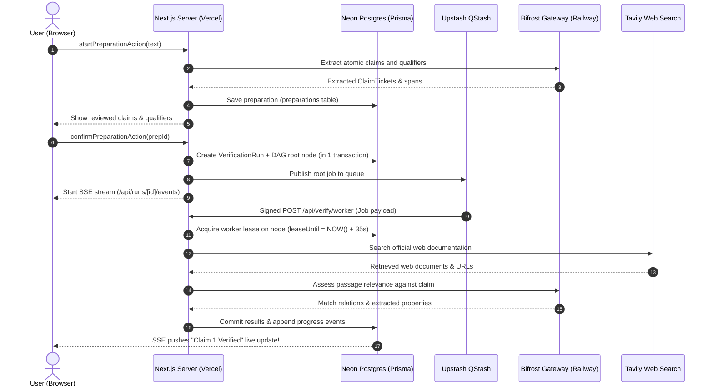

# docs/lane-b/00-system-overview.md — The Platform Big Picture

This guide explains how all the pieces of Afterfact fit together in plain language, before diving into individual code and configuration files.

---

## 1. What Afterfact Actually Does

When a user pastes an AI-generated answer into Afterfact (e.g., *"Stripe charges 2.9% + 30¢ and Parag Agrawal is the CEO of Twitter"*), our system doesn't just ask another AI "is this true?".

Instead, Afterfact:
1. **Breaks the answer into atomic factual claims** (e.g. Claim 1: Stripe US fees, Claim 2: Twitter CEO).
2. **Searches the live web** using Tavily to find official documentation, press releases, and filings.
3. **Pulls exact passages** from those web pages and verifies whether they support or contradict each claim.
4. **Applies deterministic calendar and domain policies** (written in pure TypeScript, not LLM guesswork) to render a verdict (e.g. Parag Agrawal is **Outdated**; current CEO is Linda Yaccarino).
5. **Streams the live progress to the user's screen** and lets them inspect exact quotes and Then vs. Now transition timelines.

---

## 2. The Four Distinct Infrastructure Roles

Beginners often get confused about which tool does what. Here is the strict separation of responsibilities:

```
┌─────────────────────────────────────────────────────────────────────────────┐
│                       AFTERFACT CLOUD ARCHITECTURE                          │
├───────────────────────┬─────────────────────────────────────────────────────┤
│ 1. Application Layer  │ • Next.js 15 App Router deployed on VERCEL          │
│                       │ • Runs Server Actions (RPC for browser)             │
│                       │ • Runs worker endpoints (/api/verify/worker)        │
│                       │ • Accesses PostgreSQL database via PRISMA ORM       │
├───────────────────────┼─────────────────────────────────────────────────────┤
│ 2. Data Persistence   │ • Managed cloud PostgreSQL hosted on NEON           │
│                       │ • Stores runs, claims, evidence, events, DAG nodes  │
│                       │ • PgBouncer connection pooler for serverless apps   │
│                       │ • Distinct branches for dev, test, and production   │
├───────────────────────┼─────────────────────────────────────────────────────┤
│ 3. Model Routing      │ • BIFROST Gateway (Maxim AI) hosted on RAILWAY      │
│                       │ • Official prebuilt container with /app/data volume │
│                       │ • Stores routing configs in internal SQLite db      │
│                       │ • Docker-free local run via: pnpm bifrost           │
├───────────────────────┼─────────────────────────────────────────────────────┤
│ 4. Background Delivery│ • UPSTASH QSTASH cloud message broker               │
│                       │ • Dispatches signed HTTP POST requests to worker    │
│                       │ • Enforces bounded concurrency (max 3 claims at once│
└───────────────────────┴─────────────────────────────────────────────────────┘
```

> [!CAUTION]
> **Key Distinctions to Remember:**
> - **Prisma** is **not** a database. Prisma is the TypeScript library inside our code that communicates with our database.
> - **Neon** is our database host in the cloud running PostgreSQL.
> - **Bifrost** is **not** an LLM. Bifrost is a model gateway that securely holds API keys and routes calls to OpenAI, Anthropic, or Groq.
> - **Railway** is a cloud platform running the Bifrost container with a persistent disk.
> - **Application Database vs. Bifrost Database:** Afterfact's application data lives in **Neon PostgreSQL**. Bifrost's internal configuration (virtual keys, profiles) lives in its own **SQLite database** on Railway. They are completely separate!

---

## 3. The Lifecycle of a Verification Run

Here is what happens behind the scenes from the moment a user clicks "Verify":



---

## 4. Local Development vs. Hosted Production

### Local Development (Your Laptop)
- You run Next.js locally on your machine (`http://localhost:3000`).
- You run Bifrost locally without Docker (`pnpm bifrost` on `http://127.0.0.1:8080`).
- You connect to your cloud Neon dev database branch (`afterfact-dev`).
- You can test claims directly without needing a public domain.

### Hosted Environments (Staging & Production)
- Next.js runs on **Vercel** serverless functions.
- Bifrost runs as a container on **Railway** with an HTTPS address (`https://bifrost.up.railway.app`).
- The database runs on **Neon** (`afterfact-staging` or `main`).
- Background jobs are delivered over the public internet by **Upstash QStash** to Vercel's webhook URL.

> [!WARNING]
> **The Localhost Trap:**
> Your laptop's `localhost` or `127.0.0.1` is **not reachable from the internet**.
> Upstash QStash in the cloud cannot send webhooks to `http://localhost:3000/api/verify/worker` unless you use a secure tunnel (like ngrok or localtunnel). For local testing without a tunnel, our codebase provides an in-process execution fallback.
