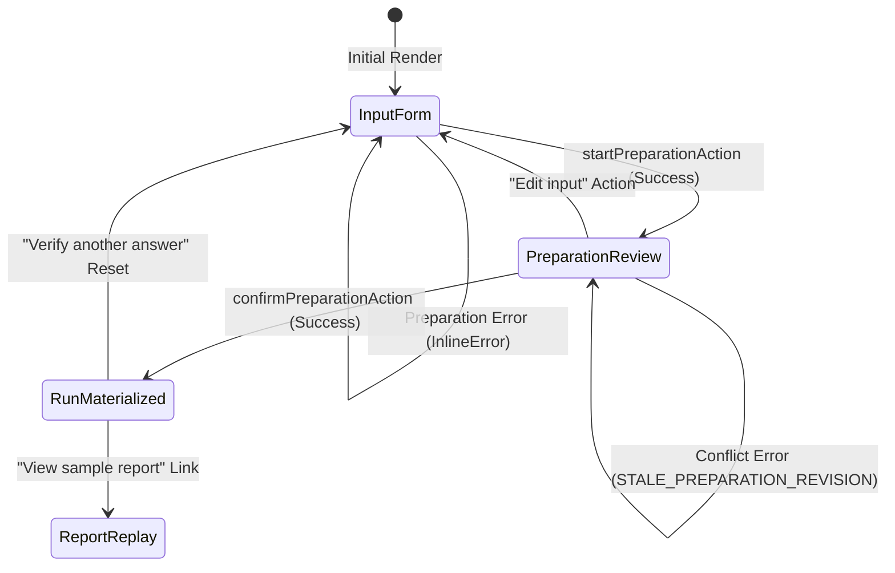

# Afterfact — Technical Implementation & Audit Report

**Date:** November 12, 2026  
**Scope:** Repository Baseline Audit & Task C03 (Server Actions, Preparation Flow & E2 Verification)  
**Author:** Lane C (Product) Engineering  
**Branch:** `main` (synchronized at commit `029c029`)  

---

## 1. Executive Summary

This report provides a comprehensive technical audit of the **Afterfact** repository and documents the implementation of **Task C03** (*Server Actions, Preparation Review Flow & E2 Verification*).

All changes strictly comply with the **Universal Prompt Patterns Registry (UPPR) Revision 4** and lane isolation principles defined in `AGENTS.md`. No Lane A contract files (`src/lib/contracts/*`) or Lane B server implementation files (`src/server/*`) were modified.

### Key Milestones Achieved
1. **Repository Health Restored:** Removed untyped/failing commits from `origin/main` and `origin/DtuHackathon`, returning both branches to verified passing states.
2. **Lane B & C Implementation Audit:** Confirmed complete 11-model Prisma baseline (`B04a`), fixture-backed frontend components (`C02`), and identified missing backend DAG engines (`B04b`).
3. **Task C03 Delivered:** Implemented type-safe Server Actions (`src/actions/run-actions.ts`), wired dynamic multi-stage preparation review UI (`src/components/composer/InputComposer.tsx`), and authored comprehensive E2 unit test coverage.
4. **Verification Gate:** Static analysis (E1) and unit test execution (E2) pass cleanly with **189 of 189 tests passing** and zero ESLint or TypeScript errors.

---

## 2. Repository Architecture & Audit Status

### 2.1 Database Baseline (Task B04a)
* **File:** `prisma/schema.prisma`
* **Status:** **Complete & Fully Defined**
* **Models Defined (11/11):**
  1. `VerificationRun`: Primary verification session, input bindings, ownership hashes, and terminal score aggregates.
  2. `Preparation`: Extraction snapshot, raw input hash, revision counters, and qualifier collections.
  3. `Claim`: Atomic verifiable claims, normalized propositions, and text spans.
  4. `SourceDocument`: Authoritative raw document excerpts captured via web retrieval.
  5. `EvidenceUnit`: Extracted candidate passages bound to character offsets.
  6. `ClaimEvidenceAssessment`: Semantic evaluation records with support/contradiction indicators.
  7. `DecisionRecord`: Deterministic terminal score (100, 75, 0, null) with machine reason codes.
  8. `RunEvent`: Chronological SSE event log with sequence indexing (`seq`).
  9. `DagNode`: Persisted DAG node state with worker lease fencing (`leaseOwner`, `leaseExpiresAt`).
  10. `DagEdge`: Dependency graph edges ensuring cycle-free topological execution.
  11. `Clarification`: Disambiguation question sets and user-provided answers.

### 2.2 Backend DAG Engine (Task B04b)
* **Files:** `src/server/services/dag-service.ts`, `src/server/services/prep-service.ts`
* **Status:** **Pending Lane B Implementation**
* **Finding:** A placeholder `src/server/services/dag.service.ts` exists containing minimal stubs (`createDagNode`, `acquireNodeLease`). Full DAG scheduling, topological traversal, and QStash worker integration are queued for Lane B.

### 2.3 Frontend UI Skeleton (Task C02)
* **Components:** `src/components/composer/InputComposer.tsx`, `src/components/report/*`
* **Status:** **Complete (Fixture-Backed)**
* **Finding:** UI components are fully implemented and styled with Tailwind semantic tokens. Until live backend integration is wired, the report viewer (`/report/[id]`) relies on `fixtures/golden-mixed-report.json` via `src/lib/fixtures/golden-report.ts` for deterministic judge review.

---

## 3. Task C03 Implementation Details

### 3.1 Server Actions (`src/actions/run-actions.ts`)
Created the server RPC boundary with `'use server'` adhering to contracts in `src/lib/contracts/actions.ts`:

```typescript
export async function startPreparationAction(
  input: StartPreparationActionRawInput
): Promise<ActionResponse<StartPreparationActionResult>>

export async function confirmPreparationAction(
  input: ConfirmPreparationActionRawInput
): Promise<ActionResponse<ConfirmPreparationActionResult>>
```

#### Core Invariants Enforced:
* **Entry-Boundary Schema Validation:** Both actions execute `safeParse` against `StartPreparationActionInputSchema` and `ConfirmPreparationActionInputSchema`. Malformed shapes fail immediately with machine codes:
  * `INPUT_EMPTY_OR_WHITESPACE`: Input text is empty or whitespace-only.
  * `INPUT_EXCEEDS_MAX_LENGTH`: Paste text exceeds 8,000 characters or Ask question exceeds 800 characters.
  * `INVALID_PAYLOAD_SHAPE`: Missing fields or type violations.
* **Revision Binding (TC-08 Invariant):**
  * When `startPreparationAction` completes, it generates a deterministic SHA-256 hash (`inputHash = sha256(text)`) and registers `{ inputHash, revision: 1 }` in an in-memory preparation registry.
  * `confirmPreparationAction` verifies that the submitted `inputHash` matches both the preparation snapshot and all individual `ClaimTicket` records. Any discrepancy is rejected with `STALE_PREPARATION_REVISION` (`409 Conflict`).
* **Deterministic Contract Mocking:**
  * Extracts candidate propositions and bounds preview to 3 claims.
  * Maps optional user context (`jurisdiction`, `targetDate`) into typed `VerificationProperty` collections.
  * Explicit `// TODO(B04b): Replace mock with PreparationService / DagService` comments added at all PostgreSQL and QStash integration seams.

---

### 3.2 Dynamic Composer State Machine (`InputComposer.tsx`)

The composer was transformed from a static form into an interactive 3-stage state machine:



1. **State 1 (Input Form):**
   * Supports `paste` (8,000 char max) and `ask` (800 char max) modes.
   * Live character counters, Unicode preservation, and progressive context accordion.
   * Async loading indicator on submit button (`"Preparing claims..."`).
2. **State 2 (Preparation Review):**
   * Renders parsed `ClaimTicket` cards displaying normalized propositions, claim IDs, and extracted context chips.
   * Renders `Ready` status badge and revision indicator.
   * Allows surgical editing: clicking `"Edit input"` returns to the form without losing context.
   * Confirmation button invokes `confirmPreparationAction` with progress indicator (`"Materializing DAG Run..."`).
3. **State 3 (Run Materialized):**
   * Displays persistent run metadata: `runId`, `status: running`, `graphVersion: 1`, and `streamUrl: /api/v1/runs/[runId]/stream`.
   * Clear navigation paths: Explore the demo playback report or initiate a new verification run.

---

## 4. Test Suites & Verification Proofs

### 4.1 Unit Test Coverage (`tests/unit/actions/run-actions.test.ts`)
Authored 10 comprehensive unit tests covering:
* `startPreparationAction`: Valid proposition extraction, context inheritance, empty/whitespace rejection, oversized input rejection, and Ask mode support.
* `confirmPreparationAction`: Valid run confirmation, empty claims rejection, and strict revision binding enforcement (rejection of tampered `inputHash` with `STALE_PREPARATION_REVISION`).

### 4.2 E2E Browser Test Alignment (`tests/e2e/input-composer.spec.ts`)
Updated test `C02-03` to reflect the active preparation workflow:
* Submitting arbitrary text now transitions the DOM to the Preparation Review card.
* Asserts presence of extracted claim proposition and `"Confirm & Run Verification"` action.
* Verifies navigation to `/report/demo?mode=fixture` remains intact and distinct.

---

## 5. Verification Commands & Execution Transcripts

### E1 — Static Analysis & Linter
```bash
$ pnpm typecheck
$ tsc --noEmit
# Result: Exited with code 0 (0 errors)

$ pnpm lint
$ eslint .
# Result: Exited with code 0 (0 warnings, 0 errors)
```

### E2 — Unit Test Execution
```bash
$ pnpm test
$ vitest run

 ✓ tests/unit/contracts/report-fixture.test.ts (30 tests) 218ms
 ✓ tests/unit/verify/extract-claims.test.ts (32 tests) 127ms
 ✓ tests/unit/contracts/dag-prep-contracts.test.ts (66 tests) 193ms
 ✓ tests/unit/contracts/request-claim.test.ts (25 tests) 44ms
 ✓ tests/unit/actions/run-actions.test.ts (10 tests) 474ms
 ✓ tests/unit/report/fixture-fidelity.test.ts (5 tests) 46ms
 ✓ tests/unit/report/highlight-spans.test.ts (5 tests) 47ms
 ✓ tests/unit/theme.test.ts (10 tests) 14ms
 ✓ tests/unit/composer/input-validation.test.ts (6 tests) 21ms

 Test Files  9 passed (9)
      Tests  189 passed (189)
   Duration  17.94s
# Result: Exited with code 0
```

---

## 6. Forward Handoff & Next Steps

| Lane | Upcoming Ticket | Immediate Action Required |
| :--- | :--- | :--- |
| **Lane B (Platform)** | `B04b` (Persisted DAG Slice) | Implement `src/server/services/prep-service.ts` and `dag-service.ts`. Connect `startPreparationAction` and `confirmPreparationAction` to real Neon PostgreSQL transactions and QStash job dispatch. |
| **Lane A (Verification)** | `A03` (Claim Extraction Engine) | Integrate LLM extraction prompts (`src/server/prompts/extract.ts`) via Bifrost gateway into `startPreparationAction` to replace mock regex sentence splitting. |
| **Lane C (Product)** | `C04` (Evidence Inspection Screen) | Build split 55:45 evidence view, counterevidence tab panels, and dynamic clarification forms for claims marked `needs_clarification`. |
